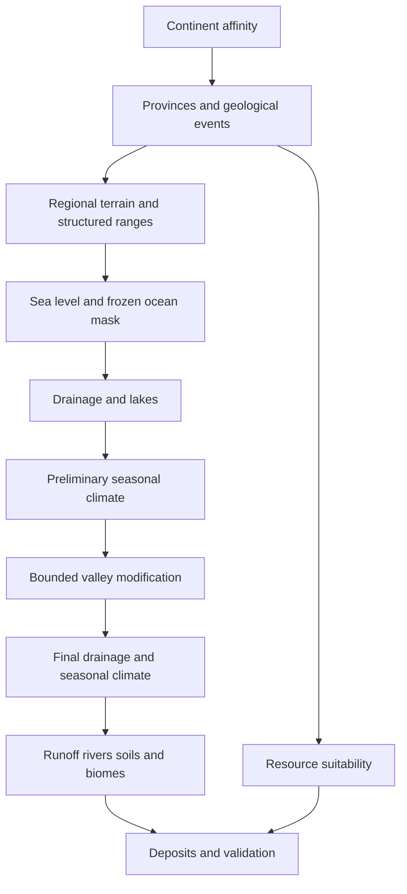

# Abstract

This specification defines a deterministic generator for Earth like game worlds on a rectangular grid that wraps east to west and has closed northern and southern boundaries. Internal generation uses 6 km cells; player-facing output uses 10 to 25 km cells derived later. The target ocean complement is 30 to 35 percent non ocean area. The implementation language is Go.

The generator preserves a supplied fracture based continental layout, constructs geological provinces and explicit mountain belts, establishes coherent drainage, computes seasonal climate and runoff, and assigns biomes and mineral deposits. Regional landforms are synthesized directly rather than produced by a long tectonic simulation. Mountain shape is controlled through related ridges, plateaus, structural basins, and drainage corridors.

This is a proposed engineering method, not a validated scientific model. Numerical defaults are initial calibration values. Coding agents must preserve the contracts and invariants below; changing artistic defaults is allowed through versioned configuration. Runtime and visual quality must be established through the prescribed benchmarks and comparisons.

# 1 Scope and normative requirements

MUST denotes a correctness requirement. SHOULD denotes a preferred implementation with a documented exception. MAY denotes an extension.

The reference implementation MUST:

1. Generate a final world that is a cylinder with east west continuity and no north south adjacency. Stages before climate are periodic in both axes; see section 2.

2. Generate internally at 6 km physical cell spacing and support later output conversion to 10 through 25 km per cell.

3. Produce a configured non ocean fraction from 0.30 through 0.35, within one cell of the requested rounded count.

4. Produce reproducible results for a fixed generator version, configuration, input mask, and seed.

5. Represent mean elevation separately from regional relief and representative high elevation.

6. Generate recognizable young collision belts, active margins, and old eroded belts.

7. Provide a drainage graph, seasonal temperature and precipitation, runoff, biomes, geological provinces, and discrete mineral deposits.

8. Emit diagnostics that expose intermediate stages and failed invariants.

Version one excludes dynamic plate motion, spherical geometry, fluid atmosphere simulation, physical sediment transport, explicit glaciers, groundwater simulation, and geological predictions of real deposit abundance. Every surface river drains to an ocean or an overflowing lake. Endorheic basins are an optional later extension and MUST NOT appear accidentally as broken drainage.

The continent source is defined in the [Fracture Continent Generator Implementation Specification](https://chatgpt.com/space/page_75336a45b3948191919fb8b2977fd117), based on the pinned mdhender/hamwold implementation. Implement its rectangular adaptation through the ContinentSource adapter, retaining upstream compatibility as a separate fixture. A substitute continent algorithm MUST be named as a substitute.

# 2 Coordinates units and resolution

Let W and H be raster dimensions and d be cell spacing in km. Physical dimensions are Lx = W d and Ly = H d. Raster index is i = y W + x. Cell centers are at ((x + 0.5)d, (y + 0.5)d). North is decreasing y. Elevations and relief use meters; distances use km unless explicitly converted; water depths use mm per seasonal interval; discharge uses cubic meters per second.

Use cardinal neighbors for conservative transport and eight neighbors for terrain routing. Diagonal edge length is sqrt(2)d. Horizontal indices wrap with a positive modulo.

The map can be recentered at any stage before climate, so every stage before climate (continents, structure, terrain, landmask, and drainage) is toroidal: vertical indices also wrap with a positive modulo, and the vertical displacement uses the same formula as dx with Ly in place of Lx. From climate onward the domain is a cylinder: a neighbor outside y in [0,H) does not exist, and no recentering is available. Where a section for a stage before climate says periodic x, x wraps, or y clamps, read it as periodic in both axes. The climate stage is responsible for whatever lies across the northern and southern edges when it fixes them.

The signed horizontal displacement from a to b is:

```text
dx = (b.x - a.x) - Lx * floor((b.x - a.x)/Lx + 0.5)
```

The exact half circumference tie resolves toward negative dx. All feature distance queries, spatial indexing, interpolation, derivatives, and raster filters MUST follow the same convention. Ridge and coast polylines MUST be stored in locally unwrapped coordinates, on both axes while the domain is toroidal, or explicitly split at the seam. Ordinary Euclidean distance across the rectangle is incorrect.

Assigned latitude is phi(y) = 90 degrees - 180 degrees \* (y + 0.5)/H. It controls climate only; cell area remains d squared. This is a cylindrical game domain, not an equal angle spherical raster.

A resolution comparison MUST hold physical extent and feature geometry fixed while changing d. Features narrower than approximately two cells are represented through relief, representative high elevation, and edge features rather than exaggerated mean elevation.

# 3 State model and determinism

Use separate flat slices for dense fields. Persistent output fields are:

| Field | Storage | Meaning |
| - | - | - |
| ElevationM | float32 | Mean solid surface elevation relative to fixed sea level |
| ReliefM | float32 | Representative high minus valley elevation within the cell |
| HighM | float32 | Representative high elevation, at least mean elevation |
| WaterSurfaceM | float32 | Ocean or lake surface where applicable |
| SurfaceKind | uint8 | Ocean, land, lake |
| ProvinceID | uint32 | Geological province, zero means none |
| Landform | uint8 | Plain, hills, mountain, plateau, basin, wetland and related classes |
| Receiver | int32 | Downstream cell; minus one for ocean |
| LakeID | uint32 | Zero means no lake |
| Biome | uint8 | Vegetation or climatic surface class |
| TemperatureC | four float32 bands | Seasonal mean temperature |
| PrecipMM | four float32 bands | Seasonal precipitation depth |
| RunoffMM | four float32 bands | Seasonal runoff generated locally |

Store ridge segments, provinces, events, river reaches, deposits, and pass edges as sparse records. Dense monthly bands are outside the initial memory budget. Scratch arrays MUST have documented lifetimes and be reused when safe.

Use float64 for feature geometry, accumulation totals, and climate water budgets. float32 is sufficient for persistent raster fields. Reject NaN and infinity at every stage boundary.

Derive random streams from seed, stable stage ID, stable feature ID, and sample ID using a documented integer hash or PRNG. Do not use Go map iteration order, worker number, or execution timing as random input. Sort feature records by stable ID before raster accumulation. Reductions MUST use a fixed order.

Reference reproducibility means identical persistent output on the supported Go toolchain and architecture for different worker counts. Cross architecture bit identity requires an additional quantization contract and is not promised by version one.

```go
type Config struct {
    Seed uint64
    GeneratorVersion string
    Width, Height int
    CellSizeKM float64
    NonOceanFraction float64
    Workers int
}
type ContinentSource interface {
    Sample(xKM, yKM float64) float64
}
type Stage interface {
    Name() string
    Run(ctx context.Context, state *State) error
}
```

Higher continent source values mean greater continental affinity. The source MUST be periodic in both axes, so that it can be recentered with the stages that follow.

# 4 Pipeline and stage contracts

The command and checkpoint boundaries for provinces and geological events are refined in [Structure Generation Design](<Structure Generation Design.md>). The planned command order is `continents → structure → terrain → landmask`; geological structure uses a provisional coast, while final ocean membership is accepted only after terrain generation. The current affinity-based landmask command requires a terrain-input mode to implement that final selection.



Before sea level selection, terrain stages may change continental extent. After selection, the ocean mask is immutable. Valley modification MUST leave non ocean solid surfaces at least 1 m above sea level except lake beds; ocean cells remain below sea level. There is no late global sea level adjustment.

Each stage MUST declare required fields, produced fields, scratch allocations, random stage ID, and validation checks. Cancellation MUST be checked between tiles or bounded work units. Failed generation returns a stage qualified error and diagnostic metadata, not a superficially complete map.

Climate is evaluated twice with a fixed terrain dependency order. The final climate does not trigger another erosion pass. This bounds the coupled computation and avoids an implicit equilibrium solver.

# 5 Continental foundation and geological provinces

Sample continental affinity on a coarse raster with spacing near 50 km. Choose dimensions that tile the physical domain exactly; retain actual coarse spacings. Coarse x interpolation wraps; y interpolation clamps. Preserve the original affinity and a preliminary land threshold for diagnostics.

Construct a signed distance field to the preliminary coast. Distance is positive inland and negative offshore. Use a periodic distance transform or graph distance with eight neighbor edge costs. Approximate graph distance is acceptable if documented.

Build the foundation from smooth physical profiles: an interior rising to approximately 200 to 600 m, shelves extending 50 to 200 km offshore near minus 50 to minus 200 m, continental slopes, and abyssal plains near minus 3500 to minus 5500 m. Blend profile transitions smoothly. These values initialize plausible regional relief; final sea level is selected later.

Partition continental areas into contiguous provinces by deterministic multi source region growth from spatially separated seeds. Seed count defaults to approximately one per 1.5 million square km of preliminary continental area, minimum one. Growth costs include distance and a low amplitude smooth field. Disconnected islands receive province ownership independently. Province types include shield, sedimentary basin, young collision, old orogen, active margin, rift, and volcanic province.

Province labels describe geological context, not an assumption that one province equals one plate. Keep an event graph connecting provinces to relevant belts, faults, intrusions, and basin records.

The default event recipe scales by continental area Ac in million square km:

```text
collision belts: max(1, round(Ac / 35))
active margins: max(1, round(Ac / 30))
old belts:      max(1, round(Ac / 20))
rifts:          round(Ac / 45)
island arcs:    round(Ac / 50)
```

These counts are artistic defaults. A candidate event MUST pass spatial eligibility: collisions lie mainly inland, active margins follow eligible coast segments with inland offset, and island arcs lie offshore with an appropriate adjacent ocean corridor. Try at most 32 candidates per requested event. If an optional event cannot be placed, record an omission. Required visual fixture events are supplied explicitly and cannot be silently omitted.

Select coastline chains by boundary tracing with periodic x adjacency. Smooth and resample chains in km. An active margin follows a chain offset roughly 50 to 200 km inland. An island arc follows a shorter offshore chain. Interior belts connect eligible inland anchors through a smoothly curved path biased toward province interfaces. Reject immediate self intersections and curvature radii below the belt width. Never uplift every province boundary automatically.

Generate event geometry once in physical coordinates. Raster resolution MUST NOT change the number or identity of events.

# 6 Mountain belt synthesis

A belt stores an unwrapped backbone, type, width, regional elevation amplitude, ridge amplitude, age parameter in [0,1], side orientation, along belt control samples, and stable seed. Age is a morphological control, not an asserted age in years.

For a cell near a backbone, compute closest segment, along distance s, signed cross distance r, and tangent. Blend frames near segment junctions to avoid visible seams. Width and amplitude vary smoothly along s, with control samples spaced approximately 150 to 400 km.

The regional envelope uses a compact smooth kernel:

```text
K(t) = (1 - t*t)^2 for abs(t) < 1; otherwise 0
regional uplift = A(s) * K(r / w(s))
```

K has zero first derivative at its support boundary. It defines regional support, not the final mountain shape.

Construct each belt from the following components:

1. Regional uplift or an elevated plateau.

2. Two to six related ridge chains with nonuniform lateral offsets.

3. Branches on selected ridge sections, with reduced amplitude.

4. Longitudinal basins between selected chains.

5. Explicit cross belt corridors and pass saddles.

6. Low amplitude residual variation aligned with the local structure.

Ridge chains are independent vector polylines derived from the backbone, with correlated but distinct perturbations. A ridge contributes amplitude times K(distance / halfwidth) times an along ridge envelope. Fade chain endpoints over 50 to 150 km. Break chains through gaps rather than merely modulating all ridges with the same noise. Do not sum enough overlapping kernels to create arbitrarily tall intersections: accumulate ridge contributions through maximum, then add the regional envelope. Blend separate event envelopes by maximum plus a configurable overlap contribution capped at 25 percent of the smaller envelope.

| Belt type | Full regional width | Initial regional character |
| - | - | - |
| Active margin | 100 to 400 km | Asymmetric ranges, inland basins, optional volcanic chain |
| Collision | 300 to 1200 km | Multiple ranges and an elevated plateau on one side |
| Old orogen | 100 to 600 km | Interrupted lower ridges and broad valleys |
| Rift | 50 to 300 km | Depressed axis with raised shoulders |
| Island arc | 30 to 150 km | Segmented volcanic highs crossing sea level |

For collision belts, plateau elevation defaults to 2500 to 4500 m and representative highs to 5000 to 8000 m. Active margin representative highs default to 3000 to 6500 m. Old belt highs default to 500 to 2500 m above local lowlands. These bounds are calibration inputs, not required distributions.

Use a smooth plateau mask that rises on one flank and remains broad inland; do not represent a plateau as a wider ridge. Margin asymmetry changes flank widths and the relative location of ridge, basin, and coast. Rift axes subtract elevation while shoulders add it.

An old belt uses lower ridge amplitudes, broader valleys, more chain gaps, and more subdued residual variation. Age does not merely multiply every height by one number.

Create one cross belt corridor per approximately 300 to 700 km of backbone, subject to a minimum separation of 150 km. Corridors can be dry saddles before drainage. They provide eligible routes, not mandatory rivers. Their floors must remain above local base level until drainage is established.

Rasterize each cell with fixed 4 by 4 subcell samples for intersecting terrain features. Average samples for mean elevation; use sampled maximum and minimum as initial high and valley estimates. Add an explicitly bounded subcell relief model for features too narrow to sample reliably. Record representative high, not a statistical maximum guaranteed over the whole cell.

Residual noise wavelengths MUST be at least 4d for modifications to cell mean elevation. Smaller structure affects relief or rendering only. Mean perturbation amplitude is capped at 10 percent of local structured relief. The generator MUST remain recognizable with residual noise disabled.

After river processing, recompute relief as the larger of the structured subcell estimate and high minus final valley floor, with HighM at least ElevationM. This is a game terrain descriptor, not a measured geomorphometric statistic.

# 7 Sea level and ocean identity

Let k = round(W H times NonOceanFraction), and let nOcean = W H - k. Select an initial sea datum using the elevation quantile that would leave k cells above water. Break elevation ties by cell index. Shift the datum to zero.

Find the largest connected component of the nOcean lowest cells using eight neighbor periodic x adjacency. Grow this component to exactly nOcean cells through a frontier priority queue keyed by original elevation followed by index. Each added cell MUST touch the existing component. This produces one connected ocean of exact area, while excluding isolated low inland depressions from ocean membership.

The ocean connectivity repair fraction is the symmetric difference between this mask and the original quantile mask divided by total cell count. Require it to be at most 0.01. If exceeded, regenerate continental parameters using the next deterministic attempt ID, up to four attempts, then return a layout failure. Store the repair fraction.

Clamp selected ocean bed elevations to at most minus 1 m and all non ocean elevations to at least plus 1 m. Reject the layout if this requires changing any cell by more than 500 m. These repairs are constrained geography corrections, not erosion. Their changed cells and elevation deltas MUST appear in diagnostics.

The frozen OceanMask, rather than a later elevation threshold, defines ocean membership. Non ocean includes inland lakes. Report ocean fraction, dry land fraction, and lake fraction separately. Version one guarantees 30 to 35 percent non ocean; projects requiring that fraction as dry land must expose a separate target and cannot conflate the two.

All later incision is clipped to at least 1 m on non ocean cells. Ocean cells are not erosion outlets through the north or south boundary; they are outlets because of OceanMask membership. Inland lakes may cover non ocean terrain above sea level. There is no global sea level adjustment after mask freezing.

# 8 Drainage lakes and valley modification

Use a multi source priority flood seeded with every ocean cell at hydraulic level zero. Queue key is hydraulic level followed by cell index. Mark cells when enqueued; when expanding cell p to unvisited neighbor c, assign filled level F[c] = max(Elevation[c], F[p]), flood parent p, and increasing discovery rank. Store the parent. Every non ocean cell is reachable because the raster graph is connected.

After flooding, choose the steepest descending neighbor on F where one exists. On equal level flats use the flood parent, whose rank is lower. This yields a strictly decreasing lexicographic potential (F, rank) along equal level edges and prevents cycles. Use actual edge lengths for gradients. For correctness on flats, do not replace the parent with an arbitrary equal height neighbor.

Cells with F greater than solid elevation by more than 0.5 m are potential lake cells. Group connected flooded cells at the same spill level within a 0.5 m tolerance and retain the shared spill outlet. Default retained lakes have at least 100 square km of water area and maximum depth at least 5 m. Fill smaller incidental depressions in the solid terrain to F, retain larger depressions as lake beds, and publish WaterSurfaceM = F for lake cells. Merge groups sharing a water surface and outlet. Grouping MUST be checked against the routing tree; proximity alone cannot merge hydraulically separate lakes.

In version one, retained lakes overflow. Route runoff through the lake to its outlet. Lake bed receivers are routing machinery and MUST NOT be rendered as exposed river reaches. Large open water evaporation is included in the climate moisture source; the initial runoff model does not calculate lake storage dynamics.

Accumulate contributing area by counting incoming receiver edges, processing zero donor cells in index ordered queues, and adding d squared to each land cell. Ocean cells terminate accumulation. All non ocean cells MUST be processed exactly once; a short count is a routing error.

For bounded valley modification, calculate provisional annual runoff volume Qproxy from preliminary climate. Process the established graph downstream first, using reverse accumulation order. Define:

```text
incision depth = min(local cap,
                    C * log1p(Qproxy / Qref))
new bed = max(1 m, old bed - incision depth,
              downstream bed + minimum gradient * edge length)
```

Use a minimum gradient of 0.01 m per km for non lake valley beds. If the downstream constraint exceeds old bed, skip incision rather than raising terrain. Initial C = 50 m, Qref = 1 cubic meter per second, and local cap = min(500 m, 0.3 times local relief). The downstream constraint applies only where receiver and source are solid river terrain; lakes use their spill surface.

Widen selected large valleys with a compact distance kernel, initially radius 10 to 40 km, bounded by the same local cap. Widening occurs in a separate destination buffer so traversal order does not change the result. Preserve ridge chain IDs and freeze the ocean mask. Rebuild flooding, lake grouping, and receivers once after all valley changes.

This procedure creates hydrological organization while preserving authored regional shape. It is not a stream power solver and its constants must not be described as physical erosion coefficients.

# 9 Seasonal temperature and winds

Use four equal seasons of 365.2425/4 days. The northern midsummer season has solar declination plus 23.44 degrees; successive declinations are 0, minus 23.44, and 0 degrees. Label seasons by index rather than assuming the same local calendar season in both hemispheres.

Compute daily mean top of atmosphere insolation using solar latitude geometry, including polar day and night. Normalize by its global annual mean to form I. The initial sea level equilibrium temperature is clamp(15 + 35 times (I - 1), minus 45, 40) degrees C. This empirical mapping is a calibration default.

Coastal moderation weight is exp(minus inland distance / 500 km). Land seasonal temperature blends local seasonal equilibrium with a damped ocean seasonal cycle at the same latitude; the ocean cycle amplitude is 35 percent of the local equilibrium cycle. Apply land thermal lag of one quarter season through a fixed interpolation of current and previous equilibrium values. Subtract 6 degrees C per km of positive mean elevation. Inland moderation weight tends to zero.

Create cardinal face winds from broad zonal circulation: westward tropical winds below approximately 30 degrees absolute latitude, eastward midlatitude winds from 30 to 60 degrees, and westward polar winds. Smooth transitions over 5 degrees and shift belts by up to 5 degrees toward the summer hemisphere. Use a nominal speed of 5 m/s.

Add a low amplitude monsoon tendency directed along the horizontal gradient of smoothed seasonal surface temperature, toward warmer land, capped at 2 m/s. This is a prescribed wind approximation. Set normal velocity to zero at northern and southern faces; x faces wrap. Wind is computed on the coarse climate grid, initially approximately 50 to 100 km spacing. Interpolate conserved precipitation depths and temperature to the final raster with periodic x handling.

Because mountain ranges narrower than the climate grid still affect rainfall, provide each coarse face with an effective intervening barrier height obtained from intersecting terrain highs. Do not infer every barrier solely from coarse mean elevation.

# 10 Conservative moisture transport and precipitation

For each season solve a bounded steady transport approximation on the coarse grid. Atmospheric state q is precipitable water in mm. Initialize q to a latitude dependent ocean equilibrium qsat(T) = clamp(20 exp(0.06 T), 0.5, 70) mm and zero over land.

Use first order conservative upwind finite volume transport on cardinal faces. Choose dt so the largest cell sum of outgoing face Courant numbers is at most 0.5; convert km to meters and m/s consistently. The same face flux is subtracted from its donor and added to its recipient. Closed y faces have zero flux.

After transport, add evaporation at rate E = Emax times max(0, 1 - q/qsat), with Emax = 4 mm/day over open water and 0.5 mm/day over land. In the atmospheric model land evaporation is prescribed and is not deducted from the later soil bucket; record this approximation. Winter land evaporation is multiplied by clamp((T + 5)/20, 0, 1).

Remove precipitation through an exact exponential sink. Background removal rate is 1/10 per day. Add an orographic rate of 1/2 per day times clamp(upwind barrier ascent / 1000 m, 0, 2). Also remove any water above qsat during the step. Record sink depth divided by dt as precipitation rate. Clamp numerical negative q only within roundoff tolerance; otherwise fail.

Iterate at most 4096 steps per season. Require at least five nominal zonal transit times Lx / 5 m/s before declaring convergence. Over a one transit time rolling window, require relative storage change and precipitation mean change below 0.001, with denominators bounded away from zero. If the iteration cap cannot meet the minimum transit requirement or convergence fails, return a climate convergence diagnostic; do not silently normalize rainfall.

After convergence, average precipitation rates over the final transit window and multiply by seasonal length. Check the water budget: storage change equals evaporation minus precipitation minus boundary export; boundary export is zero for this domain. Relative budget residual MUST be below 0.0001 using float64 accounting.

Rain shadows emerge from moisture loss across barriers and slow replenishment over land. Descending winds do not receive an extra precipitation bonus. Avoid per latitude row rainfall normalization because it destroys continental moisture transport. This climate model is intended to generate plausible game patterns, not forecast Earth climate.

# 11 Runoff soil water and biomes

For each cell calculate potential evapotranspiration PET = max(0, 0.6 T + 5) mm/day times season length, where T is seasonal mean temperature in degrees C. This empirical function is intentionally simple and configurable. Use initial soil capacity 150 mm on ordinary terrain, 75 mm on rugged terrain, and 250 mm on floodplains.

Partition precipitation into snow at T below minus 1 degree C, rain above plus 1, and a linear blend between. Snow melts at up to 3 mm per positive degree C per day, limited by stored snow. Add rain plus melt to the soil bucket. Actual evapotranspiration is the smaller of PET and available liquid water; runoff is excess above capacity after evapotranspiration. All terms MUST conserve water within numerical tolerance.

Run the four season bucket cycle repeatedly, at most 40 years, until soil and snow start of year state changes are below 1 mm. If snow increases without bound, classify persistent ice, store annual net snow accumulation, and stop representing all accumulation as a finite equilibrium snowpack. Emit an ice flag and exclude the persistent snow surplus from liquid runoff. A finite, nonconvergent non ice bucket is an error.

Accumulate seasonal runoff on the final drainage graph:

```text
local volume m3 = runoff mm * cell area km2 * 1000
mean seasonal discharge m3/s = accumulated volume / season seconds
```

Wetlands require low relief, shallow topographic drainage potential, and a water surplus; high rainfall alone is insufficient. Floodplain candidates are low gradient cells near high discharge reaches. Their soil adjustment is a single classification pass; it does not trigger another terrain or atmosphere solve.

Assign biomes with ordered rules so every non ocean cell receives exactly one primary class:

1. Lake and persistent ice override vegetation classes.

2. Warmest seasonal mean below 10 degrees C produces tundra; persistent ice was already separated.

3. Annual precipitation/PET below 0.2 produces desert; below 0.5 produces steppe or dry shrubland.

4. Wetland eligible cells receive wetland.

5. Coldest season below minus 3 and warmest below 20 produces boreal forest where moisture permits.

6. Coldest above 18 produces tropical forest if driest season precipitation exceeds 100 mm; otherwise tropical seasonal forest or savanna according to moisture ratio above or below 0.8.

7. Remaining moist climates produce temperate forest; intermediate moisture produces grassland or woodland.

A separate seasonal dryness flag identifies Mediterranean like conditions when summer precipitation is less than one third of winter precipitation and annual moisture ratio exceeds 0.5. Alpine cover uses HighM temperature in addition to mean temperature. Rock exposure uses relief and snow cover. These are overlays rather than replacements for all cell vegetation.

The thresholds are game classification defaults. They are not a claimed implementation of the complete Köppen system. Geological substrate, biome, landform, and vegetation cover MUST remain separate fields.

# 12 Geological resources and gameplay adjustments

Represent mineral deposits as sparse records with commodity, host province, deposit style, cell, footprint radius, size class, depth class, grade class, and discovery difficulty. Deposit sizes are game units unless an explicit calibrated unit model is supplied.

Build commodity suitability from geological events and host rock classes. Initial associations are arc related copper gold and molybdenum; mafic provinces with nickel chromium and platinum group metals; selected ancient shield formations with iron and gold; granite related tin and tungsten; sedimentary basins with coal salt and phosphates; suitable strongly weathered host rock with bauxite or lateritic nickel; and downstream alluvium with placer minerals. A shield label alone does not imply every shield commodity.

Each commodity has a configuration record containing eligible hosts, base intensity per million square km, clustering radius, minimum separation, deposit size weights, and depth weights. There is no universal built in economically accurate abundance. Supply a named gameplay abundance profile; absent commodity configuration means zero deposits of that commodity.

For each eligible province draw deposit count from a seeded Poisson distribution with mean equal to eligible area times configured intensity. Select positions from a suitability weighted cumulative distribution in stable cell order. Apply clustered placement around a small number of parent centers where configured. Bound rejection sampling to 64 attempts per deposit and report unplaced records.

For placer resources, trace eligible source deposits along downstream receivers, choose downstream alluvial cells, and limit transport distance through configuration. Avoid adding placers in arbitrary rivers without a source province or deposit.

Gameplay balancing runs after geological placement. It MAY add deposits only in eligible locations and MUST mark origin as gameplay_adjustment with the violated balance rule. If no eligible location exists, report an unsatisfied constraint instead of inventing an unrelated geological setting. Never move mountains solely to hide a resource placement failure.

# 13 Performance memory and output

The reference target is a 40,000 by 20,000 km map: 1600 by 800 cells at 25 km and 4000 by 2000 at 10 km. These are benchmark cases, not mandatory world dimensions.

Expected stage costs are near linear raster processing, feature rasterization proportional to intersecting feature footprints, priority flood O(N log N) with a binary heap, drainage accumulation O(N), and climate O(C I) for C coarse climate cells and I bounded transport iterations. Do not claim the complete generator is O(N) while using a binary heap.

One float32 field occupies approximately 32 MB at eight million cells. Persistent seasonal temperature, precipitation, and runoff alone occupy approximately 384 MB in decimal units. Persistent terrain, IDs, routing, queue storage, and scratch require additional memory. Set an initial peak memory engineering target of 2 GB for the eight million cell case and measure it; it is not an established result.

Parallelize independent raster tiles and read only feature queries. Use fixed destination ownership. Priority queues and topological accumulation SHOULD begin as sequential implementations; optimize only after profiling. Never use concurrent floating point atomic accumulation if worker independent reproducibility is required.

Emit a versioned manifest containing full configuration, seed, input source checksum, generator version, PRNG version, physical units, field schema, hashes, stage durations, peak memory, convergence counts, repair counts, omitted events, and balance adjustments. Store raster arrays in an explicitly endian binary format with dimensions and field descriptors. Use JSON for metadata and sparse features. Debug PNGs are inspection artifacts, not authoritative elevation storage.

Support checkpoints after regional terrain, ocean selection, final drainage, and final climate. A checkpoint includes dependency hashes so stale downstream stages are rejected. All output files MUST be written atomically through temporary files and rename.

# 14 Validation and implementation acceptance

Every build MUST pass topology, accounting, and routing checks before visual evaluation.

| Check | Required result |
| - | - |
| East west neighbors | Opposite edge cells are adjacent with physical distance d |
| North south neighbors | Before climate: opposite edge cells are adjacent with physical distance d. From climate onward: no edge leaves the domain |
| Recentering | Before climate: a whole cell translation on either axis changes no adjacency, distance, or feature relationship |
| Land accounting | Non ocean count equals requested rounded count |
| Ocean identity | Ocean mask satisfies its connectivity contract |
| Drainage | Every non ocean cell reaches an ocean through receivers |
| Routing order | Every non ocean cell processed exactly once |
| Lake routing | Retained lakes have valid spill outlets |
| Flow conservation | Outlet volume equals generated runoff within numerical tolerance |
| Climate budget | Relative finite volume budget residual below 0.0001 |
| Field validity | No NaN, infinity, negative precipitation or negative runoff |
| Relief consistency | HighM at least ElevationM and ReliefM nonnegative |
| Resource eligibility | Every deposit satisfies host and origin rules |
| Determinism | Canonical output hashes match for 1 and multiple workers |

A seam test MUST evaluate analytic feature queries at x, x plus Lx, and x minus Lx. Do not assert that the first and last raster columns are equal: they are neighboring sample centers, not duplicate samples. Compare edge differences against nearby gradients and inspect terrain, wind, precipitation, and rivers across the seam.

Required visual fixtures supply explicit geological features on fixed physical domains: an active margin with inland basins, a collision belt with a plateau, an old interrupted orogen, a rift with raised shoulders, and an offshore arc. Render each at both 10 and 25 km spacing with residual noise on and off. Inspect mean elevation, high elevation, relief, rivers, lake levels, cross sections, and movement passes.

Aggregate real elevation references to comparable physical cell sizes before judging shape. Compare belt width, along belt continuity, plateau area, cross belt asymmetry, basin placement, and major drainage organization. Visual acceptance is a reviewer decision recorded beside these diagnostics, not a unit test asserting realism.

Run a seed suite of at least 32 worlds for release qualification. Report failures by category and stage. Do not discard failed seeds from performance statistics. Benchmark the two reference resolutions on named hardware, reporting wall time, peak resident memory, per stage cost, and climate iterations. No runtime threshold is normative until the project sets a measured budget.

Movement passes are sparse adjacency records produced where saddle analysis finds a lower crossing through mountain terrain. A pass stores cells or edges, saddle altitude, effective grade, and seasonal snow status. It MUST NOT imply traversal across forbidden northern or southern boundaries.

# 15 Implementation sequence and extension policy

Implement in the following order, keeping each milestone executable:

1. Cylindrical grid utilities, deterministic random keys, continent adapter, unit conventions, and manifest.

2. Explicit geological fixture inputs and structured terrain rasterization.

3. Ocean selection, priority flood, lakes, drainage graph, and terrain diagnostics.

4. Mountain review at game resolution, including noise disabled comparisons.

5. Coarse seasonal temperature, winds, conservative moisture transport, and water budgets.

6. Preliminary runoff, bounded valley modification, final routing and climate.

7. Soil buckets, biomes, river reach extraction, pass edges, and resources.

8. Seed suite, performance profiling, checkpoint support, and output packaging.

Do not implement climate and resources to compensate for unaccepted mountain geometry. Do not add a full tectonic solver, droplet erosion, a neural terrain model, or a GPU dependency as an implicit prerequisite.

Potential later extensions are analytical erosion restricted to selected regional tiles, closed basin water budgets, lake storage, glacier shaping, calibrated ocean currents, monthly climate, sedimentary history, and terrain exemplars. Each extension must state which stage contracts it changes and which additional tests establish correctness.

Scientific parameters and artistic parameters MUST be named separately. The implementation must not label a morphological age, an incision strength, a resource intensity, or a precipitation tuning factor as a measured physical quantity without calibration.

# 16 Relationship to prior work

Cordonnier and colleagues demonstrate that tectonic uplift coupled with fluvial erosion can produce coherent dendritic mountain terrain. Their 2016 method motivates drainage aware terrain organization here. This generator replaces iterative uplift evolution with explicit regional feature construction and bounded valley modification. It does not implement their solver.

Cortial and colleagues demonstrate procedural geological processes for planetary landforms, including continental collision, subduction, and island arcs. Their 2019 method motivates event specific landform families. This generator uses static geological records fitted to a continent layout and does not evolve spherical plates.

Tzathas and colleagues develop analytical stream power erosion with drainage consistency and multigrid acceleration. Their 2024 method is a candidate regional refinement extension. The reference pipeline does not require an analytical erosion solve.

None of these papers validates the proposed climate approximation, resource model, artistic parameter defaults, or complete pipeline. Those components are defined as engineering choices and evaluated through the acceptance procedure.

References:

1. Guillaume Cordonnier, Jean Braun, Marie Paule Cani, Bedrich Benes, Eric Galin, Adrien Peytavie, and Eric Guérin. Large Scale Terrain Generation from Tectonic Uplift and Fluvial Erosion. Computer Graphics Forum 35(2), 2016, pages 165–175. DOI: [10.1111/cgf.12820](https://doi.org/10.1111/cgf.12820).

2. Yann Cortial, Adrien Peytavie, Eric Galin, and Eric Guérin. Procedural Tectonic Planets. Computer Graphics Forum 38(2), 2019. DOI: [10.1111/cgf.13614](https://doi.org/10.1111/cgf.13614).

3. Petros Tzathas, Boris Gailleton, Philippe Steer, and Guillaume Cordonnier. Physically based analytical erosion for fast terrain generation. Computer Graphics Forum 43(2), 2024. DOI: [10.1111/cgf.15033](https://doi.org/10.1111/cgf.15033).
