# Large Scale Terrain Generation from Tectonic Uplift and Fluvial Erosion

Guillaume Cordonnier1, Jean Braun2, Marie-Paule Cani1, Bedrich Benes3, Éric Galin4, Adrien Peytavie4 and Éric Guérin4

- 1 Université Grenoble-Alpes and INRIA, France
- 2 ISTerre, Université Grenoble Alpes and CNRS, BP 53, 38041 Grenoble Cedex 9, France
- 3 Purdue University, West Lafayette, IN, USA
- 4 Université de Lyon, LIRIS, CNRS, UMR5205, Lyon, France

Computer Graphics Forum, Volume 35 (2016), Number 2 (EUROGRAPHICS 2016), pp. 165–175. DOI: [10.1111/cgf.12820](https://doi.org/10.1111/cgf.12820). Author version, HAL: [hal-01262376](https://inria.hal.science/hal-01262376v1).

This transcription corrects typographical errors and notation inconsistencies in the author version.

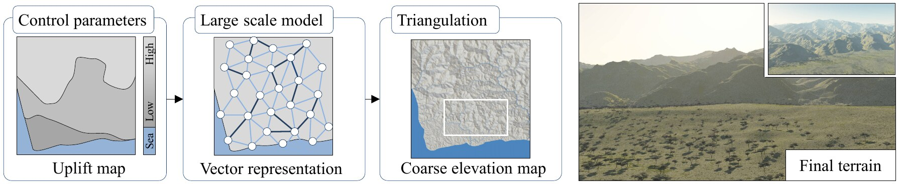

**Figure 1:** The user defines an uplift map specifying a simulation domain and the speed at which mountains grow.
The combined effect of uplift and hydraulic erosion is simulated on a vector representation of this map.
The latter is finally converted into a digital terrain model that conforms to global geomorphologic processes.

## Abstract

At large scale, landscapes result from the combination of two major processes: tectonics which generate the main relief through crust uplift, and weather which accounts for erosion.
This paper presents the first method in computer graphics that combines uplift and hydraulic erosion to generate visually plausible terrains.
Given a user-painted uplift map, we generate a stream graph over the entire domain embedding elevation information and stream flow.
Our approach relies on the stream power equation introduced in geology for hydraulic erosion.
By combining crust uplift and stream power erosion we generate large realistic terrains at a low computational cost.
Finally, we convert this graph into a digital elevation model by blending landform feature kernels whose parameters are derived from the information in the graph.
Our method gives high-level control over the large scale dendritic structures of the resulting river networks, watersheds, and mountain ridges.

## 1. Introduction

Virtual terrains, although they usually serve as background elements, are important in a wide range of applications such as simulations, architectural designs, games, and movies.
Designing controllable and efficient algorithms for generating terrains remains an important and open problem in computer graphics.

There is a large body of previous work on terrain modeling going back nearly 35 years.
The first algorithms were inspired by fractals and noise generators [FFC82, EMP\*02].
More realism was later achieved by using physical and geological considerations, such as simulating hydraulic erosion [MKM89, BF02] to improve existing terrains.
Example-based algorithms [ZSTR07, GMM15] provide a high level of control but are limited to the landform features provided by exemplars and usually cannot generate new geological structures.
In contrast, erosion simulations [BF02, BTHB06] directly generate realistic dendritic ridges and drainage structures, but these approaches are computationally demanding and therefore ill suited for generating large terrains with a high level of detail.
Using interactive modeling systems such as [GMS09, TEC\*14] to create terrain models can be tedious and may not match geological constraints.

The key observation of our work is that terrains and mountains are formed by various mutually interacting physical processes acting at geological time and spatial scales [BFH92].
In order to capture its action at large spatial and temporal scales, mountain development should be taken into account.
The terrains we observe in nature are emergent phenomena resulting from the erosional response to tectonically-driven uplift, potentially leading to a steady-state or equilibrium situation [How82].
The role of the interaction between the uplift and the erosion has been extensively studied in geomorphology and expressed through different models, such as the stream power equation [WT99].
By bringing this theory to computer graphics we can provide an easily controllable mechanism that generates large scale realistic terrains conforming to a global geomorphological process.

We present a novel method that generates large mountainous terrains with plausible large scale landform features and patterns.
The input to our algorithm is an uplift map painted by the user that defines the speed at which mountains are lifted.
From this input, and a random planar graph covering the region on the map, we iterate through elevation updates for graph nodes, using the stream power equation to simulate the interaction between tectonic uplift and fluvial erosion processes.
The original method from [BW13] is extended to efficiently model water flowing from lakes.
This simulation process produces a stream graph derived from the initial graph.
The graph is augmented with stream directions along edges and elevation information at the nodes.
The graph can either be converted into an elevation map by interpolating the elevation information between streams for real-time visualization, or converted into a primitive-based terrain model with a high level of detail embedding riverbeds, ridges and valleys, using a combination of parameterized terrain primitives introduced in [GGP\*15] and automatic terrain amplification [GDPG16].

The terrain at the right of Figure 1 was generated using our method from the simple uplift map depicted on the left.
The simulation process runs at interactive rates.
While individual iterations provide a real-time preview enabling user interaction, the method converges to a final solution in less than two minutes.
The interactive visual feedback enables users to interrupt the process before convergence if they need to change control parameters.

## 2. Related Work

In this section, we review the existing approaches for terrain generation and focus on the level of user control, efficiency, and realism.
For recent surveys on procedural terrain synthesis methods we refer the reader to [NLP\*13, STBB14].

**Procedural terrain generation** is usually based on fractals and these approaches are among the most commonly used in computer graphics.
Fractal-based methods exploit the observation that primary terrain features repeat at different scales.
Ebert *et al.* [EMP\*02] provide an overview of these methods, including various noises, such as the fractional Brownian motion [MVN68] and the adaptive subdivision method [FFC82].
These algorithms only provide indirect control over the resulting terrain by modifying the input parameters of the algorithm [SBW06].
Moreover, they lack geological realism because the distribution of generated structures follows stochastic patterns observed only on relatively new mountain ranges.
The geological structures formed by fluvial erosion, such as networks of parallel valleys, are not captured by these methods.

To improve the user control of fractal-based methods, several algorithms were used that attempted to model terrain generation from a set of 3D feature curves used to specify ridges and river networks [KMN88, HGA\*10] or from a user-defined hydrology map [GGG\*13].
Although these methods generate plausible river networks, they generally do not capture large scale landform features and patterns where the elevation is not exclusively explained by the presence of rivers and streams.

**Terrain editing and synthesis by example** combine high-level user control by re-using (parts of) existing terrain models to generate new ones.
Many example-based methods are inspired from texture synthesis; for example they exploit a user-painted coarse map to control the combination of patches extracted from real terrain data [ZSTR07].
Real terrains were also used to add details to an existing terrain model [BSS07].
These approaches were later improved to enable the combination of user-defined maps with silhouette strokes defining roughness [GMS09, PGGM09, GMM15].
Sketched terrain silhouettes were used to deform an existing terrain to conform to a view from a certain viewpoint [TEC\*14].
Another approach uses examples of primitives that are combined into mathematical trees to define terrains [GGP\*15].
The difficulty of these approaches is to fine tune plausible results in detailed regions where the input terrains are combined or deformed.
Moreover, these methods fail to generate large scale realism, because the land forming physical processes are not taken into account.

**Erosion** is the most important geomorphological agent forming terrains and methods simulating erosion have been developed for many years in computer graphics.
The seminal paper by Musgrave *et al.* [MKM89] introduced hydraulic and thermal erosion.
Both approaches were coupled with fractal terrain generations.
Chiba *et al.* [CMF98] and Benes and Forsbach [BF02] detailed the hydraulic erosion by using the simulation of water flow, followed by dissolution of soil, transportation and deposition.
These methods were later improved by adopting the Navier-Stokes equations on a 3D voxel grid in [BTHB06] and by enabling the interactive sculpting of the input terrain through erosion strokes in [VBHS11].
Landslides (mass erosion) were modeled by combining discrete element methods and particle hydrodynamics [Hv11].
Various approaches apply small-scale erosion models such as weathering of statues [DEJP99], Voronoi-based block erosion for modeling cliffs [PGGM09], spheroidal erosion for modeling of goblins [BFO\*07], corrosion simulation [WCMT07], and small-scale volumetric mountains and rocks [TJ10].

Erosion models add high quality realistic details to existing terrains but, despite several attempts to provide interactive and GPU implementations [NWD05, MDH07, VBHS11], they suffer from long computational times and low controllability.
In contrast, our approach couples the simulation of tectonic uplift and hydraulic erosion to generate mountain ranges that are consistent at a large scale with simple and efficient user-control.

## 3. Background and Overview

We extend the way hydraulic erosion is modeled in computer graphics to capture its action at large spatial and temporal scales by including *fluvial erosion*.
At such scales, erosion due to streams cannot be considered without also taking into account mountain development.
This section recalls geological background that provides a basis for the following overview of our method.

### 3.1. Geological Background

**Uplift and faults.** Terrains result from the combined action of tectonic uplift of the Earth’s surface and erosion.
Collisions between continental plates, as well as subduction of ocean plates under continental ones, cause the continental crust to shorten and thicken.
This results in the growth of mountains along the main boundaries between plates.
Faults and folds appear in regions where the crust undergoes the highest stress [WBF93].

In geology, the term *uplift* is used to denote the local speed at which a mountain grows.
Because the growth occurs between the series of parallel folds (and faults), considering the uplift as locally uniform between these folds is a valid approximation.
The complex landform features found in nature are mainly the result of the interaction between the uplift factor and fluvial erosion, *i.e.,* the action of water forming streams that carve the terrain while it grows.

**Fluvial erosion** is the erosion of the bedrock material and its transportation downhill by streams.
It is caused by the shear stress exerted by running water and the sediment it contains onto the bed of a stream.
The interaction between the fluvial erosion and the tectonic uplift has been studied for many years in geology and is usually modeled by *the stream power equation* [WT99]:

$$
\frac{dh(\mathbf{p})}{dt} = u(\mathbf{p}) - k A(\mathbf{p})^m s(\mathbf{p})^n
\tag{1}
$$

The stream power equation states that the rate of change of surface topography $h(\mathbf{p})$ at a position $\mathbf{p}$ is controlled by the balance between the surface uplift $u(\mathbf{p})$ and the fluvial erosion, which is a function of the local slope $s(\mathbf{p})$ and the drainage area $A(\mathbf{p})$.
The local slope $s(\mathbf{p})$ is defined as the surface topographic gradient:

$$
s(\mathbf{p}) = \nabla h(\mathbf{p}).
$$

The constants $m$ and $n$ depend on rock strength, climate, and the topology of river networks.
While the values of those parameters are poorly understood, the ratio $m/n$ is constrained by the shape of the stream profiles and is thought of being $m/n \approx 0.5$ [WT99].
As in most geomorphological studies, we use $n = 1$ and $m = 0.5$.
Moreover, some geological studies attempt to tune these parameters by example [CB14] and a recent survey [Lag14] studies the limit of geological knowledge regarding the parameters of the stream power equation.

The drainage area $A(\mathbf{p})$ is the upstream area draining through point $\mathbf{p}$, assuming that water flows along the topographic gradient (Figure 3).
In our implementation, the terrain is represented by a geometric graph $\mathcal{G}$ connecting points sampled over the terrain domain.
The drainage area $A(\mathbf{p})$ is the area associated to the set of points $\{\mathbf{q} \in \mathcal{G}\}$ strictly above $\mathbf{p}$ such that there exists one path of strictly increasing height starting from $\mathbf{p}$ and ending at $\mathbf{q}$.
The factor $k$ is an erosion constant that depends on many factors, such as lithology (the composition of the soil/bedrock), vegetation, climate, and climate variability.

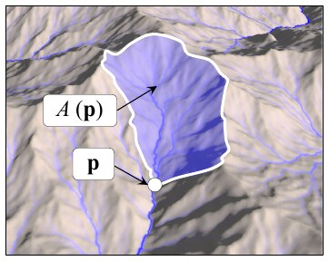

**Figure 3:** The drainage area $A(\mathbf{p})$ is defined as the planar region where streams flow to point $\mathbf{p}$.

Note that, when applied at the right temporal and spatial scales (typically between $10^5$ and $10^7$ years and a few tens to hundreds of kilometers), the stream power equation does not only model erosion, but also captures the way a complex relief emerges from a supposedly flat part of the continental crust [How94].

### 3.2. Algorithm Overview

The input to our algorithm (Figure 2) is the uplift map $\mathcal{U}$ defining the speed at which the terrain is elevated by tectonics.
We define it as a piece-wise uniform distribution of values over the domain $\Omega$.
It is given by the user as gray-scale images.
The output is a vector-based representation of the terrain resulting from the interaction between the uplift and the fluvial erosion, and in the case of the final high quality rendering, a set of procedural feature elements.

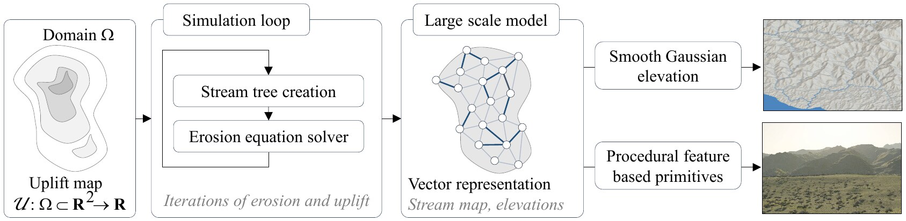

**Figure 2:** Our algorithm takes the uplift map as input and repeatedly applies stream tree creation and erosion.
The output is encoded in a vector-based representation which is then converted into a procedural terrain construction tree.

Our algorithm proceeds in two main steps: erosion simulation computed on planar graph $\mathcal{G}$ embedding elevation and flow information, called the *stream graph*, and conversion of this graph into an elevation model $\mathcal{M}$ representing the terrain.

**Erosion simulation.** Starting from the input domain $\Omega$ where the uplift $\mathcal{U} \neq 0$, we initialize the stream graph $\mathcal{G}$ as a random planar graph defined by triangulating uniformly distributed terrain sample points $\mathbf{p}_k$ in $\Omega$.
We set the initial elevation of the nodes $h_k$ of $\mathcal{G}$ to zero.
We then iterate the stream power equation until we get plausible elevation information (or water flow directions) associated to each node (or arc) of $\mathcal{G}$.
This is done by iterating the following steps until convergence (Figure 4):

1. A set of oriented stream trees $\mathcal{T}$ covering the graph $\mathcal{G}$ is extracted according to the current elevations $h_k(t)$ of the nodes to model the direction of running water.
2. The set of stream trees $\mathcal{T}$ is augmented by adding new arcs modeling water from lakes overflowing into streams, yielding a modified stream tree $\widetilde{\mathcal{T}}$.
3. The drainage area $A_k(t)$ is computed for every node in the trees $\widetilde{\mathcal{T}}$, and the local slope $s_k(t)$ is evaluated from the current elevations $h_k(t)$.
4. The stream power equation (1) is solved to compute the new elevation values $h_k(t + \delta t)$ from the uplift map $\mathcal{U}$ and the new values of $A_k(t)$ and $s_k(t)$.

This iterative process stops when a stabilization criterion is met, *i.e.,* when the changes in elevation $|h_k(t + \delta t) - h_k(t)|$ are below a given threshold.
The resulting stream graph $\mathcal{G}$ has the same topology as the initial graph, but embeds a map of streams and elevation information for all nodes.

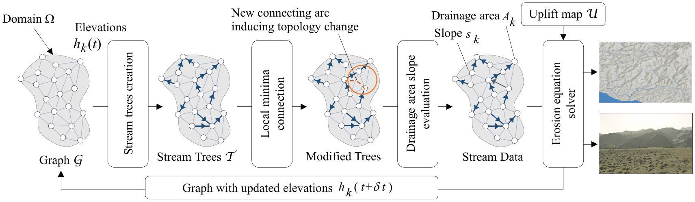

**Figure 4:** Overview of the stream power resolution algorithm: given an initial domain $\Omega$ and a random planar graph $\mathcal{G}$ over $\Omega$, we build the set of stream trees representing the drainage structure of $\Omega$ and solve the stream power equation to update the elevation $h_k(t)$ from the drainage and the uplift map $\mathcal{U}$.

**Conversion of the stream graph into a terrain model.** We propose two methods for generating the terrain model as a global elevation function $h : \Omega \subset \mathbb{R}^2 \to \mathbb{R}$ from the stream graph $\mathcal{G}$.
The first, which can be used to visualize the simulation at interactive rates, uses a simple interpolation scheme to define $h$ from the elevations $h_k$.

The second method targets off-line high-quality rendering and generates a detailed terrain from the data embedded in the stream graph.
This is achieved by combining procedural function-based primitives representing landform features as described in [GGP\*15], which enables us to add visual details such as ridges, valleys, and river beds.

## 4. Stream Generation

In this section, we describe how the stream graph is generated and how stream trees are extracted from it (Figure 4).

### 4.1. Stream Graph Initialization

We use a coarse triangulation of the domain $\Omega$ to initialize the (undirected) stream graph $\mathcal{G}$.
More precisely, points $\mathbf{p}_k$ are generated by using Poisson distribution over $\Omega$ and the edges of the graph are created by computing a constrained Delaunay triangulation of $\mathbf{p}_k$, where constraints are used to fit the borders of the domain.
Although our algorithm could also be applied to a regular grid, the randomized triangular graph generates more plausible results because the edges of the graph better represent possible directions for local streams.
Moreover, Poisson sampling ensures the coverage of the domain and guarantees a minimum distance between points.
Its association with a Delaunay triangulation provides edges of quasi-uniform length, enabling us to set the level of detail at which terrain features will be generated.

In addition to its position $\mathbf{p}_k$, each graph node holds an initial height $h_k = 0$, an uplift value $u_k = \mathcal{U}(\mathbf{p}_k)$, and local values derived from the erosion parameters $k$, $m$ and $n$.
Note that $h_k$ is set constant for nodes lying on the border of the domain $\Omega$.
These nodes are tagged as external nodes and serve as river mouths, *i.e.,* points at the sea level, and are the outflows of $\Omega$.

Finally, we compute a Voronoï tessellation of $\Omega$ and assign an area value $a_k$ to the nodes $\mathcal{N}_k$, defined as the area of the Voronoï cell surrounding $\mathcal{N}_k$.
The area $a_k$ is used to evaluate the amount of rain directly received by the node $\mathcal{N}_k$ in the computation of the drainage area (Figure 3).

### 4.2. Stream Tree Computation

Computing a set of (directed) stream trees that cover the graph (the first step of the simulation loop in Figure 4) and updating them at each iteration is the key for efficiently computing the drainage areas needed for solving the stream power Equation (1).

We define the set of directed stream trees $\mathcal{T}$ as follows.
For each node $\mathcal{N}_k$, considering that water only flows from $\mathcal{N}_k$ to its neighbor of the lowest elevation $\mathcal{N}_l$, which we call the *receiver* of $\mathcal{N}_k$, we connect $\mathcal{N}_k$ to $\mathcal{N}_l$ by an arc (a directed edge).
Since these connections cannot create loops, they result in a set of trees that are oriented from leaves (*i.e.,* the nodes that are not receivers for any other node) to the root nodes (*i.e.,* lakes or outflows from $\Omega$).
By construction, the set $\mathcal{T}$ covers $\mathcal{G}$, in the sense that all the nodes of $\mathcal{G}$ are included, although only a subset of the edges from $\mathcal{G}$ is represented by arcs in $\mathcal{T}$.
Note that during the first iteration, when all nodes are of height zero, no arc is created and each node is initialized by a tree with only a root node.

### 4.3. Lake Overflow

The stream trees $\mathcal{T}$ cannot be used directly to simulate water flow over $\Omega$ because these trees are not connected, and the water would stop at internal root nodes that represent lakes.
While a solution for connecting lakes to other nodes was proposed as an optional step of the main $O(N)$ algorithm in [BW13], adding this step leads to a complexity of $O(N\sqrt{N})$, where $N$ denotes the number of nodes.
We describe below a more efficient solution that performs lakes connection in $O(N + M\log(M))$ where $M \ll N$ is the number of lakes.

**Abstraction of the lake flows.** Lakes are located at the root nodes $\mathcal{N}_l \in \mathcal{T}$ that are not on the boundary of $\Omega$.
We assign the unique identifier $L(\mathcal{N}_k) = l$ to $\mathcal{N}_l$ and to all the nodes $\mathcal{N}_k$ belonging to the same tree (*i.e.,* in the drainage area of $\mathcal{N}_l$), to represent water passing through these nodes and flowing to the lake $\mathcal{N}_l$.
As the water level rises, some of these upper nodes will be absorbed by the lake before water overflows.

Our goal is to model overflow between these different lakes down to the river mouths that connect the graph to the outside.
We create a directed super graph of lakes $G_L$, where each group of nodes in $\mathcal{G}$ with the same identifier $L(\mathcal{N}) = l$ is represented by a single node $\mathcal{N}_l$.
Extra nodes are created to represent river mouths (root nodes at the border of $\Omega$) and their stream tree.

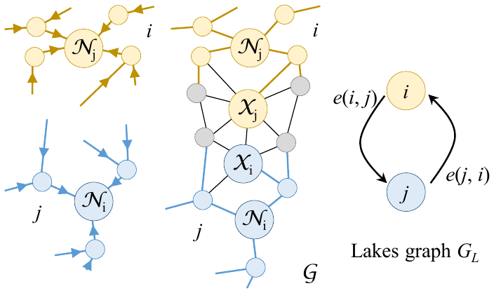

**Figure 5:** Left: nodes $\mathcal{N}_k$ belonging to the stream tree of root $\mathcal{N}_i$ (yellow) share the lake identifier $L(\mathcal{N}_k) = i$.
Middle: a pass, defined as the lowest pair $(\mathcal{X}_i, \mathcal{X}_j)$ connecting two lakes in $\mathcal{G}$.
Right: Lakes are abstracted as nodes of $G_L$, connected by an arc in each direction if there exists a pass between them.

We call a *pass* the lowest pair $(\mathcal{X}, \mathcal{Y}) \in \mathcal{G}$ of two neighboring nodes $\mathcal{X}$ and $\mathcal{Y}$ belonging to different lakes $L(\mathcal{X}) \neq L(\mathcal{Y})$.
Formally, a pass $(\mathcal{X}_i, \mathcal{X}_j)$ between two lakes identified by $l_0$ and $l_1$ needs the height of its nodes to satisfy: $\forall k, l$ such that $L(\mathcal{X}_k) = l_0$ and $L(\mathcal{X}_l) = l_1$, $\max(h_i, h_j) \leq \max(h_k, h_l)$.
This $\max(h_i, h_j)$ is called the pass height.
The pass is a connection between both lakes; it corresponds to a saddle point in terms of elevation in the stream graph $\mathcal{G}$.
Lakes are connected by adding an arc $(L(\mathcal{X}), L(\mathcal{Y}))$ for each pass $(\mathcal{X}, \mathcal{Y})$ as shown in Figure 5.
Because it is not yet clear in which direction the water will flow, we add two arcs in opposite directions.
The opposite arc $e(j, i)$ between the two lakes $i$ and $j$ has the same pass tuple $(\mathcal{X}, \mathcal{Y})$.
These arcs represent the two possible flow directions.

**Extraction of the lake connections.** In the next step we compute a set of trees $T_L$ covering $G_L$.
This step is analogous to the stream tree calculation from Section 4.2, but this time we model the flow between lakes.
Unfortunately, this cannot be done in the same way as for $\mathcal{G}$, because there is no height ordering in the lake graph $G_L$.

In the first step (Figure 6) we initialize $T_L$ with nodes $l \in G_L$ such that $\mathcal{N}_l$ belongs to the border of $\Omega$ and we remove all arcs leaving them.
These nodes correspond to river mouths where water flows out of the region of interest.
Then, we progressively extend the trees $T_L$ towards the interior of $\Omega$.
We say that an arc $e(i, j) \notin T_L$ is *a candidate* if it captures the flow from a node $i \notin T_L$ towards a node $j \in T_L$.
We parse the set of candidate arcs $\{e(i, j)\}$ in increasing pass height order; adding $e$ and the flowing lake $i$ to $T_L$.
The set of candidate arcs is updated after each step of the parsing.

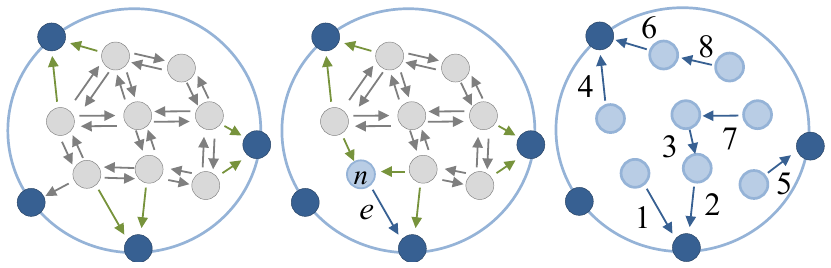

**Figure 6:** Lake connections $G_L$.
Left: arcs leaving external nodes (dark blue) are removed.
Incoming arcs are candidates to $T_L$ (green).
Middle: We add the candidate arc $e$ that has the lowest pass height and its flowing lake $\mathcal{N}$ to the tree $T_L$.
The unused candidate arcs are removed from $G_L$.
Right: Trees of lakes after convergence with all arcs numbered in the parsing order.

The tree structure is guaranteed to be consistent and coherent under the condition that we cannot add an arc flowing from a previously added node.
We remove the unused candidate arcs from $G_L$ and we use a red-black tree for labeling and sorting the set of candidate arcs.
Let $M$ denote the number of lakes.
A first $O(N)$ pass on the graph is performed.
Then our algorithm needs at most $M$ evaluations in a red-black tree of size $M$, which guarantees a complexity of $O(N + M\log(M))$.
The number of lakes $M$ is usually much lower than the number of nodes $N$.
The experimental speedup compared to the $O(N\sqrt{N})$ version is noticeable in the first iterations where the local minima are numerous.

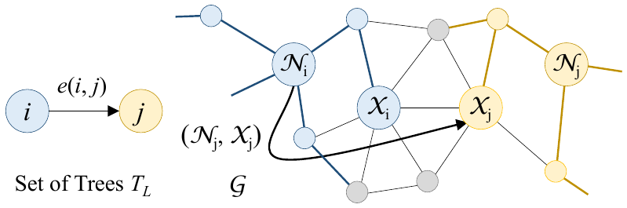

**Figure 7:** An arc $e(i, j)$ in $T_L$ (left) is converted into an arc in $\widetilde{\mathcal{T}}$ by connecting the bottom of the lake $i$ ($\mathcal{N}_i$ in $\mathcal{G}$) to the pass belonging to lake $j$ ($\mathcal{X}_j$ in $\mathcal{G}$).

**Stream tree update** generates a new version of $\mathcal{T}$, denoted as $\widetilde{\mathcal{T}}$, which includes the pass information from the previous step.
Recall that a node of $T_L$ is identified by the index $i$ of the root of a stream tree $\mathcal{N}_i$ in $\mathcal{G}$.
Moreover, an arc $e(i, j)$ of $G_L$ is associated to a pass $(\mathcal{X}_i, \mathcal{X}_j)$, where $\mathcal{X}_j$ is a node of $\mathcal{G}$ at the side of the pass belonging to lake $j$.

During this merging step, we add an arc $e(\mathcal{X}_i, \mathcal{X}_j) \in \mathcal{G}$ for each arc $e(i, j) \in G_L$ (Figure 7).
After this step all water flowing into $i$ will flow toward $j$ through the node $\mathcal{X}_j$ of the pass.

## 5. Erosion

This section describes the last two steps of our iterative algorithm: drainage and slope computation, and solving the stream power Equation (1).

**Drainage and slope.** Let $\mathcal{N}_k$ denote a node of the graph-covering stream trees $\widetilde{\mathcal{T}}$ and $C(\mathcal{N}_k)$ the set of its children nodes.
The drainage area $A_k$ can be computed using the recursive formula:

$$
A_k = a_k + \sum_{\mathcal{N}_l \in C(\mathcal{N}_k)} A_l.
$$

To compute $A_k$ efficiently, we perform a breadth first traversal of the tree, storing each node in parsing order in a set $P$.
Then we compute the drainage area for each node of $P$, parsed in the reverse order, *i.e.,* from leaves to the root (Figure 8).
This enables us to compute $A$ in linear time.

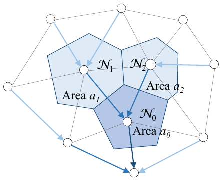

**Figure 8:** Drainage area of the leaf node $\mathcal{N}_1$ is $A_1 = a_1$, where $a_1$ is the area of the cell surrounding the vertex.
For the node $\mathcal{N}_0$ of lower elevation, $A_0 = a_0 + A_1 + A_2$.

Given a node $\mathcal{X}_k$, we use its receiver $\mathcal{X}_l$ stored in $\widetilde{\mathcal{T}}$ to compute the slope.
Let $\|\mathbf{p}_k - \mathbf{p}_l\|$ denote the distance between nodes $\mathcal{X}_k$ and $\mathcal{X}_l$ located at points $\mathbf{p}_k$ and $\mathbf{p}_l$ in the horizontal plane, we have:

$$
s(\mathbf{p}_k) = \frac{h_k - h_l}{\|\mathbf{p}_k - \mathbf{p}_l\|}
$$

**Solving the stream power equation.** The stream power Equation (1) can be solved efficiently by using an implicit scheme.
For a node $\mathcal{X}_i$ of receiver $\mathcal{X}_j$, it can be rewritten as:

$$
\frac{h_i(t + \delta t) - h_i(t)}{\delta t} = u_i - k A_i^m \left( \frac{h_i(t + \delta t) - h_j(t + \delta t)}{\|\mathbf{p}_i - \mathbf{p}_j\|} \right)^n
$$

Assuming $n = 1$ (Section 3.1), this equation can be solved as follows:

$$
h_i(t + \delta t) = \frac{h_i(t) + \delta t \left( u_i + \frac{k A_i^m}{\|\mathbf{p}_i - \mathbf{p}_j\|} h_j(t + \delta t) \right)}{1 + \frac{k A_i^m}{\|\mathbf{p}_i - \mathbf{p}_j\|} \delta t}
\tag{2}
$$

This scheme requires that $h_j(t + \delta t)$ should be computed before $h_i(t + \delta t)$, which is made possible by parsing the previously computed trees from root to leaves.
Thus, the implicit solver has an $O(N)$ complexity.

**Correction based on thermal erosion.** While the simulation of the stream power equation works efficiently for carving the bottom of the rivers, other phenomena may be predominant in some cases, in particular for low drainage areas.
In such cases, the stream erosion equation produces unrealistic sharp and high peaks.

We correct this effect by using a thermal erosion mechanism [MKM89].
Thermal erosion embeds the set of processes that cause rocks to break because of the thermal shocks caused by the infiltrated water and changes in temperature.
The eroded material is transported down-slope.
We modify our algorithms as follows: if the result of the stream power equation leads to slopes higher than $30^\circ$, we reduce the change of elevation so as to keep slopes in the prescribed range.

**Convergence.** The implicit solver needs to iterate several times, because of the change of connectivity of the stream trees (see also the accompanying video).
Although the convergence is difficult to quantify, we found that tracking changes in the topology of the stream graph is an accurate predictor.
The use of an implicit solver enables us to use large time-steps which provides fast convergence, typically between 100–300 steps for all the examples shown in this paper.

## 6. Results

Our system is developed in C++ and uses OpenGL and GLSL for rendering.
High quality image output was directly streamed to Vue 2015® (http://www.e-onsoftware.com).
All examples in this paper were created on a desktop computer equipped with an Intel Core i7 CPU, clocked at 3GHz with 16GB of RAM.

In all experiments, unless stated differently, we use a terrain size of $50 \times 50\,km^2$.
We set the maximum tectonic uplift to $\mathcal{U} = 5.0 \times 10^{-4}\,m\,y^{-1}$ (meters per year), which is the average uplift among Earth mountains.
The erosion rate depends on many factors, such as precipitation and rock strength.
In order to get a more intuitive setting, we follow the relationship between height, uplift, and erosion detailed in Section 6.4.
We set the erosion rate to $k = 5.61 \times 10^{-7}\,y^{-1}$ for mountains to culminate at about $2\,000\,m$.
We set the time step at the geological scale $\delta t = 2.5 \times 10^5\,y$ to ensure a fast convergence while avoiding the appearance of high unnatural cliffs.

### 6.1. Visual realism

We compared our stream-erosion simulation to real mountain data sets where fluvial erosion is the dominant factor: the San Gabriel mountains in California (data from http://www.usgs.gov/).
Figure 10 shows a side by side comparison of real terrain and a result produced by our method.
This confirms that our method can successfully generate coherent and plausible large scale dendritic patterns.

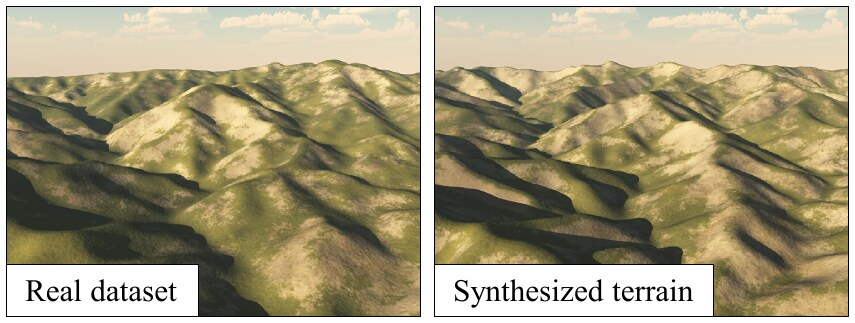

**Figure 10:** Comparison of a real terrain and a digital model produced by our fluvial erosion simulation.

### 6.2. Rendering

We implemented three methods for rendering of our terrains.
The first two approaches lend themselves for interactive modeling and provide a fast visual feedback, whereas the third method relies on a more computationally demanding conversion of the stream graph data-structure into a set of procedural primitives and targets visualization at a high level of detail.

The first interactive rendering method is achieved by generating a mesh from the stream graph by using Phong tessellation [BA08].
We flatten the shading of the edges traversed by a stream to emphasize the path of water, and we color the nodes depending on the drainage area to show the river network.
We also visualize lakes by comparing the pass height with the height of all the points flowing into the bottom of the lake.
An example is shown in Figure 11.

The second interactive rendering method consists of defining the surface of the terrain as an elevation function defined as the sum of Gaussian kernels centered at each node multiplied by the node height.
The height is then normalized by the sum of the kernels at that point.
This results in a smoother geometry than the Phong tessellation, but it is harder to emphasize the water network.

The third method is not interactive because it is based on a high level of detail terrain representation.
This representation is obtained by converting the stream graph model into a hierarchical primitive-based model, as described in [GGG\*13, GGP\*15].
This model combines parameterized terrain primitives representing the different landform features (ridges, valleys, and rivers) into a hierarchical construction tree.
This identification of landform features and the selection of the corresponding primitives is performed automatically by analyzing the coarse terrain elevation map produced by the stream power erosion process as described in [GDPG16].
Rivers are carved by using the elevation and drainage information embedded in the graph (Figure 11).

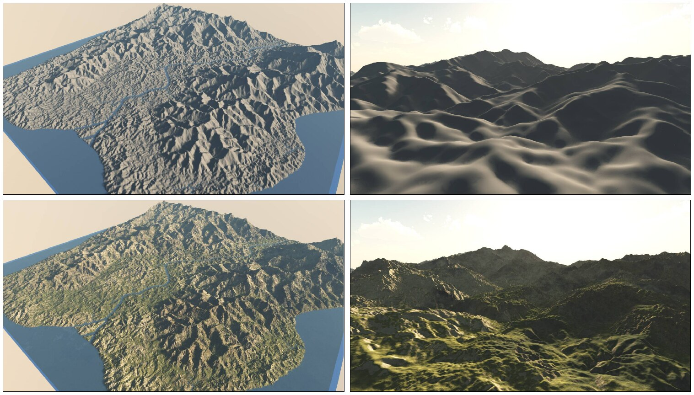

**Figure 11:** Comparison of two of the rendering methods used in our approach.
The images show a far view (left) and a close-up of real time tessellation (top) and procedural primitives (bottom).

### 6.3. Performance

Table 1 reports the performance of our method as a function of the number of sampling points.
Although we did not fully optimize the implementation, our method provides interactive feedback at every time step which enables us to visualize a simulation at interactive rates and to tune parameters.

| # samples | One time step (s) | Convergence time (s) |
|---:|---:|---:|
| 10 000 | 0.031 | 6.4 |
| 40 000 | 0.177 | 35.4 |
| 90 000 | 0.401 | 78.0 |
| 160 000 | 1.273 | 252.0 |

**Table 1:** Simulation time as a function of the number of samples.
Convergence is obtained after around 200 time steps.

The number of iterations needed to obtain a fully-formed mountain chain is difficult to estimate because it depends on a number of input parameters (see the discussion below).
Yet, thanks to the implicit resolution, it does not depend on the resolution of the terrain.
In our experiments, the mountains were fully shaped after 50 iterations and the geometry stops evolving after 100–300 iterations, as shown in Figure 12.
A solution to accelerate convergence could be to progressively refine the sampling grid.
Note that this refinement needs to be uniform, in order to preserve the possible emergence of local streams and the details in the shape of rivers.

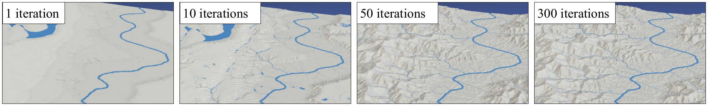

**Figure 12:** Different steps of our fluvial erosion algorithm.
The mountains are formed at $\sim 50$ iterations, and the algorithm converges after 100 to 300 steps.

### 6.4. Stream power erosion

Figure 9 shows the result of the stream power equation erosion, combined with small scale details.
Because our method generates the coverage of the terrain by the river and lake network, it also provides a hydrology network for any possible uplift input.

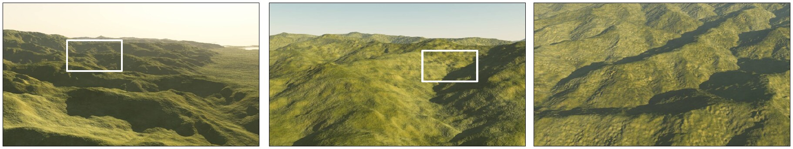

**Figure 9:** The graph representing the terrain was rendered by using a set of function-based primitives corresponding to different landform features which are parameterized by the data embedded in the stream graph [GGP\*15].
This method provides varying level of detail as can be seen in this successive zoom (from left to right).

The **erosion parameters** in the stream power erosion are not intuitive to set.
Even in geology, the impact of these coefficients is not well-understood.
The erosion coefficient $k$ and the uplift $u$ are both subject to a multiplication by $\delta t$, so only their ratio is relevant.
However, its value has a strong influence on the mountain height.
We made a series of experiments in order to find a relationship between this ratio and the maximum mountain height.
It turned out this relation is linear and the height in kilometers follows the rule $h_{\max} = 2.244\,u/k$.

In our approach, we allow only the changes to the drainage area exponent $m$.
Indeed, only the ratio between $m$ and $n$ has a meaning that we can deduce from the equations.
Let us suppose we have reached an equilibrium state in a region where $u$ and $k$ are constant over the space.
The stream power Equation (1) becomes:

$$
\frac{dh(\mathbf{p})}{dt} = 0 = u(\mathbf{p}) - k A(\mathbf{p})^m s(\mathbf{p})^n
$$

From that, we have $s$ and $A$ proportional:

$$
s \sim A^{-m/n}.
$$

We note $x$ the distance between $\mathbf{p}$ and the corresponding outflow, and $d$ the distance between the outflow and a ridge.
Then we assume that $A$ is proportional to $(d - x)^2$.
Recall that $s = dh/dx$, so we obtain:

$$
\frac{dh}{dx} \sim (d - x)^{-2m/n}.
$$

After integration, and imposing $h(0) = 0$, we have:

$$
h \sim
\begin{cases}
d^{1-2m/n} - (d - x)^{1-2m/n} & \text{if } m/n < 1/2 \\
\log(d) - \log(d - x) & \text{if } m/n = 1/2 \\
\dfrac{1}{(d - x)^{2m/n-1}} - \dfrac{1}{d^{2m/n-1}} & \text{otherwise}
\end{cases}
$$

We use the result of these equations to choose the proper ratio $m/n$ to shape the desired river profile.

**The uplift** has a strong influence on the resulting terrain and it is the main way the user affects the final shape.
As shown in Figure 13, the main impact is in the gradient of the uplift values.
The actual shape of the uplift does not have a strong influence, except on the boundaries.
Having the same uplift shape, a slowly decreasing gradient leads to a very straight erosion in the gradient direction, whereas a set of steps of constant values gives more random valleys with sudden jumps on the gradient in the mountain heights.
We can also observe that lower values of uplift lead to smaller valleys, and that the thermal erosion is important with regular slopes for high uplift values.

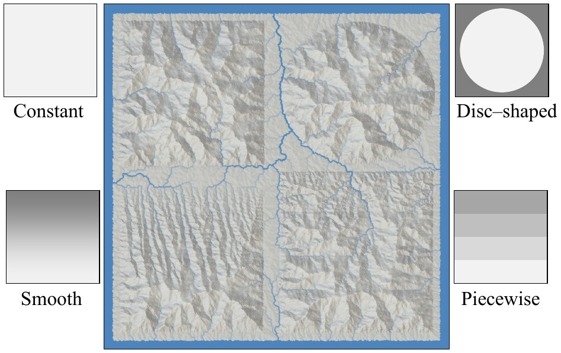

**Figure 13:** The uplift gradient has a strong influence on the resulting terrain.

**Stream power erosion without the uplift.** The stream power erosion can be used without the uplift and it adds a global hydrological realism to an existing scene as shown on an example of a fractal terrain enhanced with erosion in Figure 14.
As the erosion converges toward a flat terrain, it is necessary to use small time steps and to stop the simulation after only a few iterations.

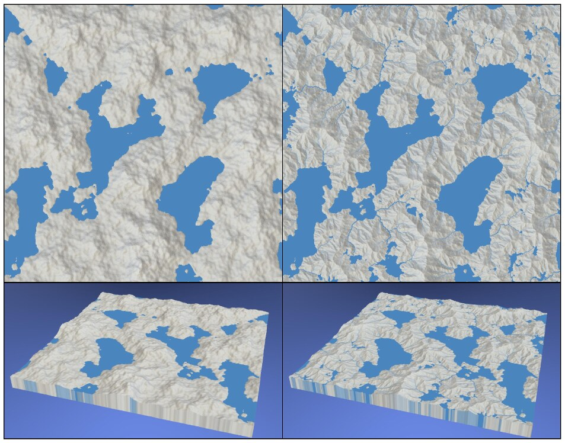

**Figure 14:** A fractal terrain (left) after the application of the stream power erosion (right).
Note the creation of new rivers and lakes.

Figure 15 shows that this method can model a large variety of landscapes: starting from a simple height map formed with two strokes and a gradient, we obtain a plausible canyon.
We chose a height dependent maximal slope for thermal erosion to obtain the succession of cliffs and slopes in the result.

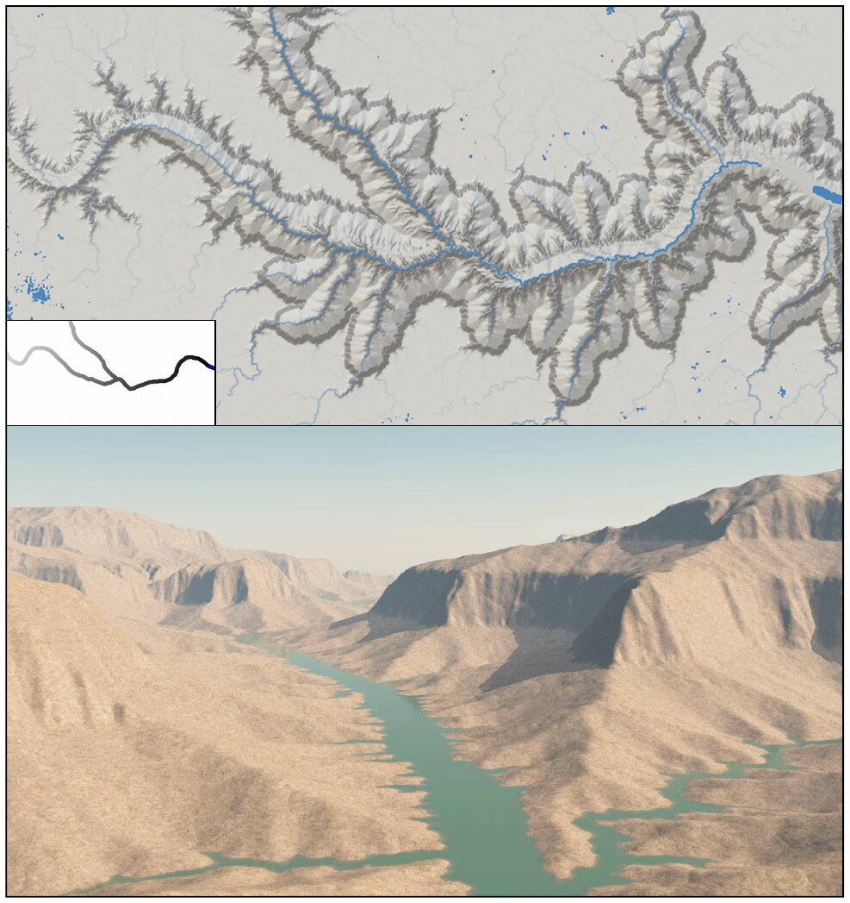

**Figure 15:** A flat terrain initialized with a carving river (top left) has been eroded with height dependent slopes (close-up at bottom).

The algorithm for **lakes flow connection** decreases greatly the number of iterations needed to obtain a plausible terrain in terms of hydrology.
Without the lake connections, the water eventually finds a flow out of the main local minima, but after 4–5 more iterations than the total convergence of the erosion with lake connection (Figure 16).
Even after many iterations, a large number of local minima are still adding some discontinuities in the hydrology network.

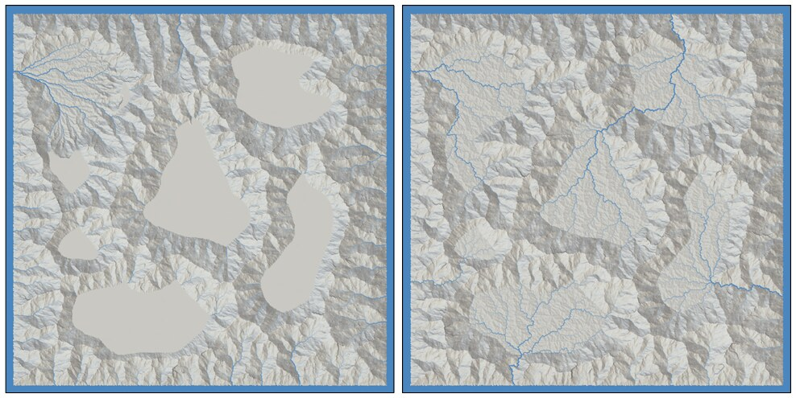

**Figure 16:** Comparison without (left) and with (right) lake flow computation, after 175 iterations.

The **thermal erosion** has an important influence on the shape of the valleys.
It affects their regularity as shown by Figure 17.
If the maximum slope given for the mountain is $30^\circ$, which is the usual talus angle for thermal erosion [MKM89], our erosion model results in a layout of very regular geometric valleys.

We experimented by forcing the maximum slope to follow a 3D Perlin noise with a high persistence, to account for locally different rock strength.
We choose the minimal and maximal slope angles to be $6^\circ$ and $54^\circ$ respectively.
This results in a more random distribution of the erosion patterns in valleys as shown in Figure 17.

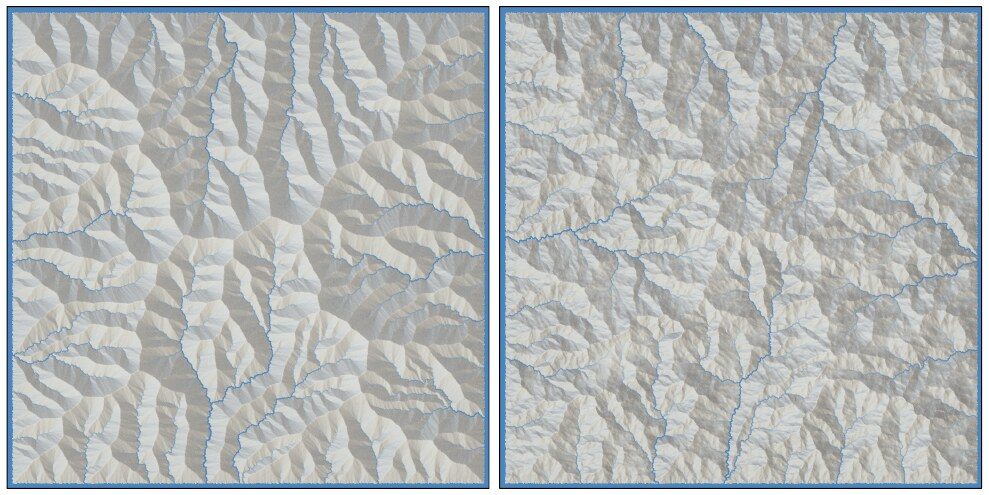

**Figure 17:** Uniform maximum talus angle gives a regular pattern (left), whereas modulating the value by 3D Perlin noise gives more randomized results (right).

Furthermore, we can obtain interesting features by procedurally adjusting the thermal slope.
Figure 18 shows a landscape with small thermal slopes below a given height, but higher slopes above it.
This adds cliffs to the crests, which is typical for many mountains.

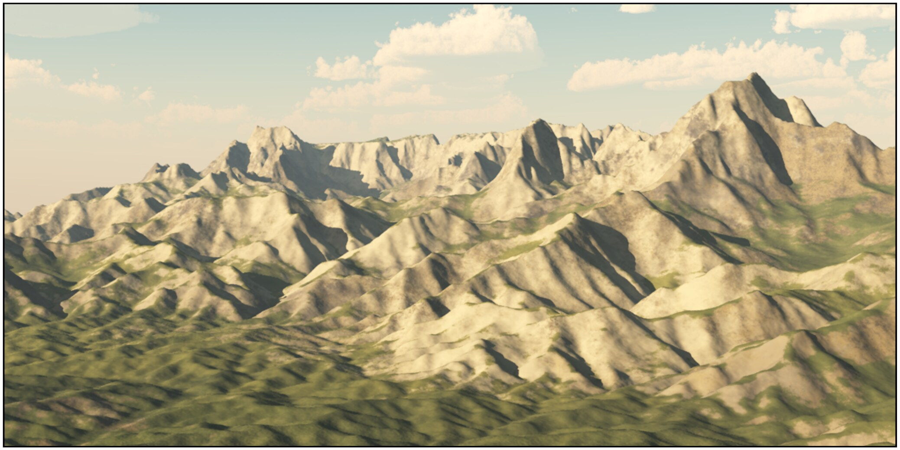

**Figure 18:** Choosing different maximum slopes depending on the mountain height gives a plausible cliff effect.

## 7. Conclusion

We presented a method for terrain generation that takes into account large scale fluvial erosion.
This is achieved by simultaneously considering uplift and erosion, a commonly observed behavior of mountains in nature.

Contrary to previous erosion simulation methods, the user does not need to predefine an initial mountain on which erosion is applied, and which may affect the visual realism.
In our approach the user paints a simple uplift map on a flat ground, enabling control of the shape of the main mountain ranges after a few iterations.
Our simulation algorithm runs at interactive rates, and allows monitoring the results by tuning a single erosion parameter.
Moreover, the erosion itself can be used without the tectonic uplift and it improves realism of existing terrain models.
In addition to real-time visualization methods used during simulation, we can convert the vector data we compute to high-quality procedural terrain elements with detailed ridges and riverbeds.

Our algorithm has various limitations.
Our validations are based only on our observations and statements about the visual plausibility should be supported by some evaluation, for example by testing with human subjects.
However, a difficulty of a fair comparison with real-world structures is that only main terrain structures should be compared, while users may base their visual comparison on details.
This lack of evaluation was partially alleviated by the fact that one of the co-authors of the paper is an expert in geology and provided at least a partial visual evaluation of the method.
Another limitation is that the system behavior depends on the parameters that are not well-understood even in geology.
While we attempted to provide meaning to those parameters and we document them meticulously in Section 6, a further insight into their values, dependencies, and effects could bring additional value to our approach.
Some of those values could be, for example, measured in real terrains.

In the future, we would like to model sediment deposition processes, which are currently neglected, in areas with low slope.
Moreover, our method focuses on a single erosion process.
A more complete framework integrating different causes of erosion, modeled at different scales, such as glacier erosion, hillslope processes, or alluvial erosion, would allow for more variability of the results.
We could also use plate-tectonics simulation to automatically compute uplift maps.
Lastly, our implementation is not optimized.
It would be interesting to exploit parallel implementation and one option would be to use adaptive tiling such as [VBHS11].

## References

- **[BA08]** Boubekeur T., Alexa M.: Phong tessellation. *ACM Trans. Graph. 27*, 5 (Dec. 2008), 141:1–141:5.
- **[BF02]** Benes B., Forsbach R.: Visual simulation of hydraulic erosion. In *Proceedings of the WSCG* (2002), pp. 120–132.
- **[BFH92]** Beaumont C., Fullsack P., Hamilton J.: Erosional control of active compressional orogens. In *Thrust Tectonics* (New York, 1992), Chapman and Hall, pp. 1–18.
- **[BFO\*07]** Beardall M., Farley M., Ouderkirk D., Reimschussel C., Smith J., Jones M., Egbert P.: Goblins by spheroidal weathering. In *Proceedings of the 3rd Eurogr. Conf. on Natural Phenomena* (2007), pp. 7–14.
- **[BSS07]** Brosz J., Samavati F. F., Sousa M. C.: Terrain synthesis by-example. In *Advances in Computer Graphics and Computer Vision*. Springer, 2007, pp. 58–77.
- **[BTHB06]** Benes B., Těšínský V., Hornyš J., Bhatia S. K.: Hydraulic erosion. *Comp. Anim. and Virt. Worlds 17*, 2 (2006), 99–108.
- **[BW13]** Braun J., Willett S. D.: A very efficient O(n), implicit and parallel method to solve the stream power equation governing fluvial incision and landscape evolution. *Geomorphology 180* (2013), 170–179.
- **[CB14]** Croissant T., Braun J.: Constraining the stream power law: a novel approach combining a landscape evolution model and an inversion method. In *EGU General Assembly Conference Abstracts* (2014), vol. 16, p. 10657.
- **[CMF98]** Chiba N., Muraoka K., Fujita K.: An erosion model based on velocity fields for the visual simulation of mountain scenery. *The Journal of Visualization and Computer Animation 9* (1998), 185–194.
- **[DEJP99]** Dorsey J., Edelman A., Jensen H. W., Pedersen H. K.: Modeling and rendering of weathered stone. In *Proceedings of SIGGRAPH ’99* (1999), vol. 25(4), ACM, pp. 225–234.
- **[EMP\*02]** Ebert D. S., Musgrave F. K., Peachey D., Perlin K., Worley S.: *Texturing and Modeling: A Procedural Approach*. Morgan Kaufmann Publishers Inc., 2002.
- **[FFC82]** Fournier A., Fussell D., Carpenter L.: Computer rendering of stochastic models. *Communications of the ACM 25*, 6 (1982), 371–384.
- **[GDPG16]** Guérin E., Digne J., Peytavie A., Galin E.: Sparse representation of terrains for procedural modeling. *Computer Graphics Forum* (2016).
- **[GGG\*13]** Génevaux J.-D., Galin E., Guérin E., Peytavie A., Benes B.: Terrain generation using procedural models based on hydrology. *ACM Trans. Graph. 32*, 4 (2013), 143:1–143:13.
- **[GGP\*15]** Génevaux J.-D., Galin E., Peytavie A., Guérin E., Briquet C., Grosbellet F., Benes B.: Terrain modelling from feature primitives. *Computer Graphics Forum 34*, 6 (2015), 198–210.
- **[GMM15]** Gain J., Merry B., Marais P.: Parallel, realistic and controllable terrain synthesis. *Comp. Graph. Forum 34*, 2 (2015), 105–116.
- **[GMS09]** Gain J., Marais P., Strasser W.: Terrain sketching. In *Proceedings of the I3D* (2009), ACM, pp. 31–38.
- **[HGA\*10]** Hnaidi H., Guérin E., Akkouche S., Peytavie A., Galin E.: Feature based terrain generation using diffusion equation. *Comp. Graph. Forum 29*, 7 (2010), 2179–2186.
- **[How82]** Howard A. D.: Equilibrium and time scales in geomorphology: Application to sand-bed alluvial streams. *Earth Surface Processes and Landforms 7*, 4 (1982), 303–325.
- **[How94]** Howard A. D.: A detachment-limited model of drainage basin evolution. *Water Resources Research 30*, 7 (1994), 2261–2285.
- **[Hv11]** Hudák M., Ďurikovič R.: Terrain Models for Mass Movement Erosion. In *Theory and Practice of Computer Graphics* (2011).
- **[KMN88]** Kelley A. D., Malin M. C., Nielson G. M.: Terrain simulation using a model of stream erosion. *ACM Trans. on Graph.* (1988), 263–268.
- **[Lag14]** Lague D.: The stream power river incision model: evidence, theory and beyond. *Earth Surface Processes and Landforms 39*, 1 (2014), 38–61.
- **[MDH07]** Mei X., Decaudin P., Hu B.-G.: Fast hydraulic erosion simulation and visualization on GPU. In *Pacific Graphics* (2007), vol. 0, IEEE Computer Society, pp. 47–56.
- **[MKM89]** Musgrave F. K., Kolb C. E., Mace R. S.: The synthesis and rendering of eroded fractal terrains. *ACM SIGGRAPH Computer Graphics 23*, 3 (1989), 41–50.
- **[MVN68]** Mandelbrot B. B., Van Ness J. W.: Fractional Brownian motions, fractional noises and applications. *SIAM Review 10*, 4 (1968), 422–437.
- **[NLP\*13]** Natali M., Lidal E., Parulek J., Viola I., Patel D.: Modeling terrains and subsurface geology. *Proc. of Eurogr. State of the Art Reports* (2013), 155–173.
- **[NWD05]** Neidhold B., Wacker M., Deussen O.: Interactive Physically Based Fluid and Erosion Simulation. In *Eurographics Workshop on Natural Phenomena* (2005), Poulin P., Galin E., (Eds.), The Eurographics Association, pp. 25–33.
- **[PGGM09]** Peytavie A., Galin E., Grosjean J., Mérillou S.: Arches: a framework for modeling complex terrains. *Comp. Graph. Forum 28*, 2 (2009), 457–467.
- **[SBW06]** Schneider J., Boldte T., Westermann R.: Real-time editing, synthesis, and rendering of infinite landscapes on GPUs. In *Vision, modeling, and visualization 2006: proceedings* (Aachen, Germany, 2006), IOS Press, p. 145.
- **[STBB14]** Smelik R. M., Tutenel T., Bidarra R., Benes B.: A survey on procedural modelling for virtual worlds. *Comp. Graph. Forum 33*, 6 (2014), 31–50.
- **[TEC\*14]** Tasse F. P., Emilien A., Cani M.-P., Hahmann S., Bernhardt A.: First person sketch-based terrain editing. In *Proceedings of the Graphics Interface* (2014), Canadian Information Processing Society, pp. 217–224.
- **[TJ10]** Tychonievich L., Jones M.: Delaunay deformable mesh for the weathering and erosion of 3D terrain. *The Visual Computer 26*, 12 (2010), 1485–1495.
- **[VBHS11]** Vanek J., Benes B., Herout A., Stava O.: Large-scale physics-based terrain editing using adaptive tiles on the GPU. *Comp. Graph. and App., IEEE 31*, 6 (2011), 35–44.
- **[WBF93]** Willett S., Beaumont C., Fullsack P.: Mechanical model for the tectonics of doubly vergent compressional orogens. *Geology 21*, 4 (1993), 371–374.
- **[WCMT07]** Wojtan C., Carlson M., Mucha P. J., Turk G.: Animating corrosion and erosion. In *Proc. of the EG WS on Natural Phenomena* (2007), pp. 15–22.
- **[WT99]** Whipple K. X., Tucker G. E.: Dynamics of the stream-power river incision model: Implications for height limits of mountain ranges, landscape response timescales, and research needs. *Journal of Geophysical Research: Solid Earth (1978–2012) 104*, B8 (1999), 17661–17674.
- **[ZSTR07]** Zhou H., Sun J., Turk G., Rehg J. M.: Terrain synthesis from digital elevation models. *IEEE Trans. on Vis. and Comp. Graph. 13*, 4 (2007), 834–848.

