# Procedural Tectonic Planets

Y. Cortial1, A. Peytavie2, E. Galin2 and E. Guérin1

- 1LIRIS-CNRS INSA de Lyon
- 2LIRIS-CNRS Université de Lyon

Computer Graphics Forum, Volume 38 (2019), Number 2 (EUROGRAPHICS 2019). DOI: [10.1111/cgf.13614](https://doi.org/10.1111/cgf.13614). Author version, HAL: [hal-02136820](https://hal.science/hal-02136820v1).

This transcription corrects typographical errors and notation inconsistencies in the author version. The paper does not number its equations; the numbers here were added to track them.

## Abstract

We present a procedural method for authoring synthetic tectonic planets.
Instead of relying on computationally demanding physically-based simulations, we capture the fundamental phenomena into a procedural method that faithfully reproduces large-scale planetary features generated by the movement and collision of the tectonic plates.
We approximate complex phenomena such as plate subduction or collisions to deform the lithosphere, including the continental and oceanic crusts.
The user can control the movement of the plates, which dynamically evolve and generate a variety of landforms such as continents, oceanic ridges, large scale mountain ranges or island arcs.
Finally, we amplify the large-scale planet model with either procedurally-defined or real-world elevation data to synthesize coherent detailed reliefs.
Our method allows the user to control the evolution of an entire planet interactively, and to trigger specific events such as catastrophic plate rifting.

## CCS Concepts

- **Computing methodologies** → **Computer graphics**; Shape modeling;

## 1. Introduction

Modeling virtual landscapes has been one of the goals of computer graphics for several decades.
Although a vast variety of techniques have been proposed for generating virtual terrains, few attempts have been made to synthesize entire planets.
The challenge stems not only from the scale of the domain that needs to be generated (hundreds of millions of square kilometers, *i.e.* $\approx 10^8\,km^2$) but also from the diversity and consistency of landforms and oceanic features at different scales that need to be synthesized.

We address the challenging problem of allowing the user to interactively control the synthesis of virtual planets by shaping continents, oceanic ridges, island arcs, archipelagos, and large scale mountain ranges, plateaus, plains or seas.
Existing approaches mostly rely on fractal synthesis based on coherent noise functions or stochastic displacement and do not capture the complex shape of continents and large-scale characteristic landform features.
Our work comes from the observation that the shape of continents and islands is determined by several interdependent phenomena triggered by tectonic forces.

Plate tectonics is a crust kinematic theory fitting observed geophysical data [Mor68, LP68].
Recent research on mantle dynamics shows that the movement, the shape and the deformations of the plates result from the convection phenomena occurring in the mantle [BTR15].
Mantle dynamics simulations are the focus of active research by geophysicists, but major challenges still remain to be overcome.
Simulating mantle convection and plate tectonics as a self-organized system [CGU17] remains a challenging and computationally demanding problem in geophysics [CS17].

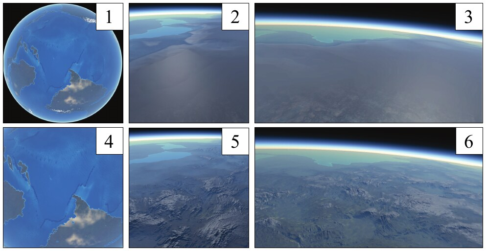

**Figure 1:** Our method creates planets (1) with continents, peninsulas, island arcs, oceanic ridges and trenches (4) by computing the plate tectonics.
The detailed relief (5, 6) of the planet is generated by amplifying the coarse crust model (2, 3) with landforms.

We propose instead a geologically-inspired procedural generation model that approximates the deformation of the crust under tectonic forces to obtain realistic continents and oceans (Figure 1).
The user can freely prescribe or change the movement of the plates at any time, or even cut plates into new fragments.
Converging and diverging plates result in different phenomena including collision, subduction, rifting and oceanic crust generation, which are computed at interactive rates, thus allowing authoring and designer-oriented control.

Our method meets the entertainment industries' need for automatic generation of planets, with a direct application for movies and emerging universe-exploration games.
We do not claim to reproduce the complexity of geological models or physically-based simulations [BY10], instead we provide an interactive framework for intuitively controlling the creation of realistic planets in computer graphics.

Tectonic plates drift, collide and deform, and we approximate tectonic effects in the lithosphere to compute the uplift and folding of the crust.
Simultaneously, we adjust elevations by approximating continental erosion and taking into account oceanic crust damping due to aging and increase of density.
This enables us to generate large scale mountain ranges or oceanic trenches at the boundaries of converging plates, and oceanic ridges between diverging plates.
The coarse crust model is finally amplified using either real-world elevation data or procedural landforms to generate a high resolution representation of the relief according to the characteristics of the plates.
The user may control the amplification process according to the characteristics of the crust; therefore our method allows for user authoring at both global and local scales.

Our main contribution is an efficient procedural model for synthesizing planets based on tectonics.
Moreover, our method provides the user with different means for controlling the evolution of the planet and prescribing the location of continents, mountain ranges or the generation of island arcs and seas.
We also demonstrate that our method lends itself for amplification, which enables us to generate detailed reliefs from the coarse scale crust parameters obtained from the simulation.
Our model can be seamlessly streamed with existing terrain amplification techniques including procedural generation [EMP\*98], sparse modeling [GDGP16], and erosion simulation [CGG\*17].

Our procedural model provides a consistent framework for authoring realistic tectonic planets with consistent continental and oceanic landforms.
The user may pause the simulation at any time, prescribe new continent directions or change the other parameters of the plates and resume the simulation.
Our experiments demonstrate that complex planets can be modeled in a few minutes.
The crust model has a resolution ranging from $50\,km$ to $500\,km$.
The amplification process taking into account the characteristics of the crust allows us to generate detailed reliefs with a $\approx 100\,m$ resolution.
The shape of the continents, oceanic trenches and ridges was validated by a geophysics expert and the realism confirmed by a user-study.

## 2. Related Work

A wide variety of methods for modeling terrains have been proposed, which can be organised into three categories: procedural generation, erosion simulation and synthesis from examples.
In contrast, the generation of planets has received less attention.

**Procedural methods** usually rely on multi-frequency noise functions [EMP\*98] to define elevation functions that capture the self-similarity of landforms across a range of scales and resemble real terrains.
An alternative approach consists in using modified procedural subdivision algorithms [KMN88, PH93, BA05] to generate fractal terrains constrained by user-prescribed river trajectories.

User control of noise and fractal-based methods has been addressed by defining terrains from feature curves such as river networks or ridges [HGA\*10, GGG\*13].
Génevaux et al. [GGP\*15] introduced a hierarchical distribution tree that models the terrain as a distribution of primitives that are procedurally blended, carved, and warped together.

Although these core algorithms can generate near infinite landscapes with unlimited precision, they only provide indirect global control and produce terrains without any underlying geomorphological structure.

**Exemplar-based techniques** take inspiration from texture synthesis and aim at generating terrains that reproduce landforms extracted from exemplars.
Most techniques proceed by assembling patches [ZSTR07, TGM12], grid cells [GMM15] or radial primitives [GDGP16].
Control is often provided by some form of user sketching.
Zhou et al. [ZSTR07] choose patches from an exemplar terrain, guided by user-specified curvilinear features, and stitch them together using graph cuts and Poisson blending.
Further improvements in terms of computational efficiency and user-control were proposed by Tasse and Gain [TGM12, GMM15].

A larger-scale approach based on sparse modeling was proposed by Guérin et al. [GDGP16] where a dictionary of feature-rich radial primitives are placed and blended together to form a terrain.
Generative adversarial networks were used [GDG\*17] to learn and apply a correspondence between user sketch maps and scanned terrains.
Those methods are fast, controllable and locally realistic but do not synthesize large-scale geomorphological patterns such as drainage networks, and do not scale to planets.

**Erosion simulations** approximate the different weathering phenomena that sculpt and shape terrains.
Thermal and hydraulic erosion were first presented by Musgrave et al. [MKM89].
Subsurface strata play an important part in such simulations, and the different materials are encoded as a cell-based grid of layered stacks, with different thicknesses and material properties for the layers of each cell-specific stack [CGG\*17], or volumetric models [RPP93].
Closer to our research, Cordonnier et al. [CBC\*16, CCB\*18] recently proposed to approximate the lithosphere tectonics to reproduce folding and faulting effects in the crust, combined with hydraulic erosion to generate realistic mountain ranges.

While simulations produce geologically correct models, most erosion methods suffer from a high computational cost, which prevents direct scaling to compute the elevation of the crust of planets, and do not provide sufficient control to express the user intent.

**Modeling planets** remains a challenging research area that has not attracted as much attention as terrain modeling in the computer graphics community.
Fractal models relying on a combination of procedural noises [EMP\*98] are compact, computationally efficient and scale well to planets.
Those representations exacerbate the problems found in fractal modeling however: self-similarity, lack of distinctive geomorphological structures and lack of control.
An enhanced mid-point displacement technique was proposed by Derzapf et al. [DGGK11] to generate hydrographic networks across a planet.
While the generated continents are enhanced by the river networks, the reliefs still lack geological consistency as the method relies on a random walk to define the shape of the continents.
Moreover, the method does not allow the user to control the shape of the continents.

## 3. Overview

We propose a procedural approach inspired from tectonics for moving, deforming, colliding plates and generating continents and the complex relief resulting from the interaction of plates.
We approximate the tectonics phenomena (Figure 3) to generate a coarse scale representation of the lithosphere.
This representation is then amplified to obtain a detailed and coherent relief over the surface of the planet (Figure 2).

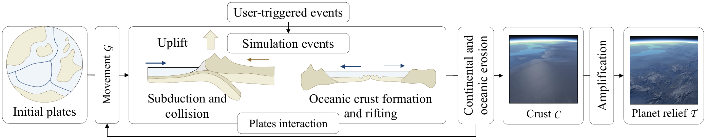

**Figure 2:** Given an initial planet with plates $\mathcal{P}(0)$, we compute the movement of the tectonic plates $\mathcal{P}(t)$ and process the tectonic events such as subduction, collision or oceanic crust formation, which shape the crust $\mathcal{C}$.
The user can freely prescribe the geodetic movement of the plates $\mathcal{G}$ at any time, trigger events such as plates rifting into fragments, allowing for real-time authoring and control during the simulation.
The final high resolution relief $\mathcal{T}$ is obtained by amplifying the crust using either real-world elevation data or procedural landforms.

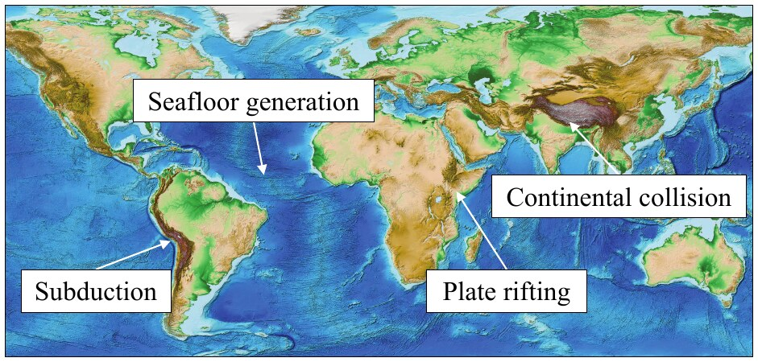

**Figure 3:** Examples of the four major tectonic phenomena reproduced in our procedural model: subduction, continental collision, seafloor generation and plate rifting.

**Tectonics fundamentals** Plates form a partition of the lithosphere, the uppermost layer of the planet.
As the lithosphere is colder and less dense than the asthenosphere, plates can be seen as rigid fragments or slabs, floating and drifting above the mantle.
The crust, which is the upper part of the lithosphere, can be either *oceanic* or *continental*, the latter being older, less dense and thicker than the former.
As plates drift across the surface of the sphere they separate, collide and deform along their boundaries and shape the crust, hence the relief of the surface of the planet.

**Model** Our procedural model relies on heuristics chosen for their performance and plausibility (Section 4).
The reason for this is imparted by research in plate tectonics which is mostly a qualitative theory.
No direct formulae exist for evaluating plate deformation and uplift movement.
While quantitative tectonophysics models have emerged recently, they rely on partial differential equations that require computationally expensive numerical solvers.
As such they do not provide a direct or closed form expression of the phenomena occurring at the surface of the planet.
Instead, we propose a novel phenomenological model designed to reproduce the behavior of plate tectonics phenomena, yet without guaranteed physical accuracy.

A planet is defined as a set of tectonic plates, denoted as $\mathcal{P}$ (Figure 4).
Without loss of generality, we assume that a planet is a sphere centered at the origin; the slightly oblate shape of some planets is not taken into account out of efficiency and can be obtained as a post processing step by warping the crust.

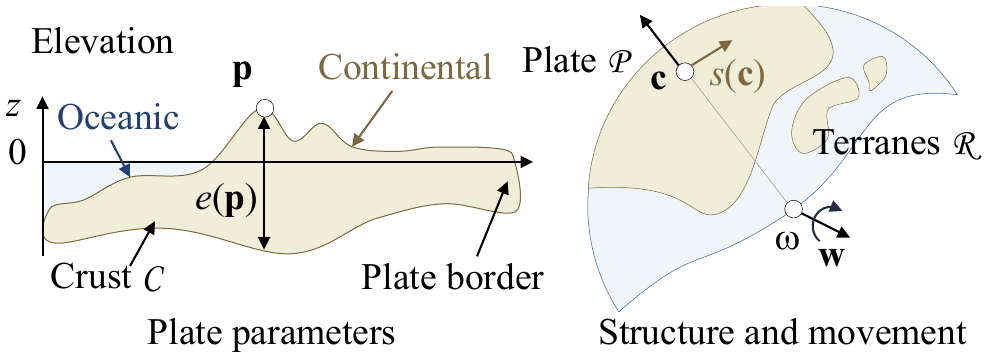

**Figure 4:** Parameters of a tectonic plate: crust $\mathcal{C}$, elevation $z$ and thickness $e$, geodetic movement $\mathcal{G}$.

Each plate $\mathcal{P}$ is a portion of crust parametrized (Table 1) over its domain with the following functions: type $x_{\mathcal{C}}(\mathbf{p})$, thickness $e(\mathbf{p})$ and surface elevation $z(\mathbf{p})$.
According to the crust type $x_{\mathcal{C}}$, which can be either oceanic or continental, we add the following parameters: crust age $a_o(\mathbf{p})$, local ridge direction $\mathbf{r}(\mathbf{p})$, for oceanic crust - and orogeny type $o(\mathbf{p})$, local fold direction $\mathbf{f}(\mathbf{p})$ and orogeny age $a_c(\mathbf{p})$ for continental crust.
The age of oceanic crust represents its age since the formation along the oceanic ridge.
The orogeny type of continents can be either *Andean* or *Himalayan*, *i.e.*, the result of subduction or continental collision respectively.
These parameters are involved in the simulation of the evolution of the planet, and are also used for the reconstruction of the detailed relief of the planet during the amplification process.
Appendix A presents a table with notations and constants used in our model.

| Symbol | Description |
| :---: | :---: |
| $x_{\mathcal{C}}$ | Crust type (oceanic or continental) |
| $e$ | Crust thickness |
| $z$ | Relief elevation |
| $a_o$ | Crust age (oceanic) |
| $\mathbf{r}$ | Local ridge direction (oceanic) |
| $a_c$ | Orogeny age (continental) |
| $o$ | Orogeny type (continental) |
| $\mathbf{f}$ | Local fold direction (continental) |

**Table 1:** Parametrization of the crust.

In our implementation, plates are modeled as spherical triangulations $\mathcal{M}$ of points $\mathbf{p}_k$.
The points sample the surface of the planet and store the crustal and tectonic data and the functions are defined using barycentric interpolation.

The plates are moving over the reference sphere according to a *rigid geodetic movement*, denoted as $\mathcal{G}$.
As described in geoscience, the rotational movement of the plates is defined by using a normalized rotation axis $\mathbf{w}$ passing through the center of the planet.
Let $\omega$ be the angular speed, the surface speed of any point $\mathbf{p}$ on a plate is defined as $s(\mathbf{p}) = \omega\, \mathbf{w} \times \mathbf{p}$.

*Terranes* are an important concept in our model.
In geology, they are portions of continental crust or island systems transported by surrounding oceanic crust to subduction zones.
They resist subduction and instead suture or accrete to the base continental plate.
In our model, we simplify and extend this definition: a *terrane* $\mathcal{R}$ in a plate $\mathcal{P}$ will be defined as a connected region of continental crust (Figure 4).
Therefore, *terranes* can range in size from small isolated islands to entire continents.

**Workflow** An interactive authoring session (Figure 2) starts with the specification of the initial state of the plates $\mathcal{P}_i$ which can be shaped by the user, or generated procedurally.
In our implementation, this automated generation is performed by distributing a user-prescribed number of plate centroids $\mathbf{c}_i$ over the sphere and defining the plates as the spherical Voronoi cells of the set $\{\mathbf{c}_i\}$.
More irregular continent shapes can be obtained by warping the geodetic distances to the centroids using a simple noise function.
We then initialize the movement of the plates $\mathcal{G}_i$, which can be also defined by the user or randomly generated.

The simulation computes the interactions between the plates such as subduction, collision, oceanic crust formation and rifting (Figure 3), and updates the characteristics of the crust $\mathcal{C}$.
All these phenomena can be also triggered or parametrized by the user at any time during the evolution, allowing direct and interactive control.
The detailed high resolution relief of the planet $\mathcal{T}$ can then be generated by amplifying the crust data using either procedural amplification or synthesis from example data.

## 4. Procedural tectonics

The overall tectonic simulation computes the evolution of the characteristics of the crust according to the interaction between the drifting tectonic plates.
The iterative process is based on a discrete time-step $\delta t$ set to $2\,\mathrm{My}$ in our implementation.

The simulation computes the interactions between the plates.
We model four different types of interactions: *subduction* (Section 4.1) and *continental collision* (Section 4.2) which both take place at convergent boundaries, *oceanic crust generation* (Section 4.3) that takes place at divergent plate boundaries, and *plate rifting* which is the fragmentation of a plate into smaller plates (Section 4.4), that tend to drift apart from each other.
We compute the interpenetration distance between colliding plates and the distance to the oceanic ridge to update the parameters of the plates such as fold directions $\mathbf{f}$, surface elevations $z$, or crust age $a_o$.
The crust elevations are then modified according to *continental erosion* and oceanic crust elevation *dampening* (Section 4.5).

### 4.1. Subduction

Classic subduction (Figure 5) occurs at the convergent boundary between an oceanic plate $\mathcal{P}_i$ and a second plate $\mathcal{P}_j$, which can be either continental or oceanic.
The density of the crust of plate $\mathcal{P}_i$ is greater than $\mathcal{P}_j$, which causes $\mathcal{P}_i$ to plunge beneath $\mathcal{P}_j$: the slab is sucked into the mantle, and at the subduction front a deep *oceanic trench* forms.
Subduction generates volcanism and deformation (orogeny) of the overriding plate.

Our model also simulates so-called *forced subductions*, taking place where high oceanic relief (plateaus, old ridges) or small terranes (islands) that are part of the subduction system are forced under another plate.
This type of subduction yields greater deformation of the overriding plate $\mathcal{P}_j$ [Clo93, DLMvH98].

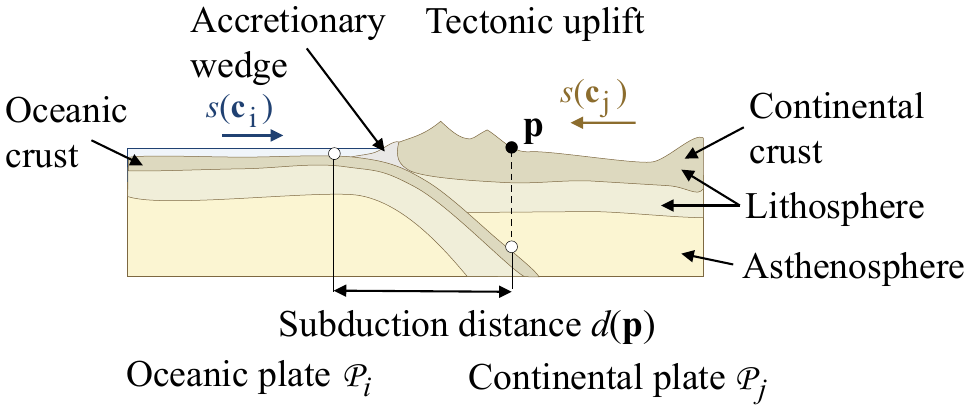

**Figure 5:** Oceanic-continental subduction: the oceanic plate $\mathcal{P}_i$ plunges down and the crust of the continental plate $\mathcal{P}_j$ folds and deforms in a global uplift.

We trigger a subduction event according to the relative size and age of the plates in contact.
Two converging oceanic plates always lead to the subduction of the older plate.
An oceanic plate always plunges beneath a continental plate.
Finally, we allow partial subduction when we find a continental-continental configuration; this initiates a *forced subduction*, which then evolves into a *continental collision* where terranes collide.

We compute the uplift in the subduction region between the two plates.
Let $\mathbf{p}$ be a point of plate $\mathcal{P}_j$ in the subduction region, and $d(\mathbf{p})$ be the distance to the subduction boundary (Figure 5).
Let $v(\mathbf{p}) = \|s_i(\mathbf{p}) - s_j(\mathbf{p})\|$ denote the relative speed of the two plates.
We define the uplift $\tilde{u}_j$ of plate $\mathcal{P}_j$ as a combination of the relative speed $v$, the distance to the subduction front $d$ and the elevation of the plate $\mathcal{P}_i$ plunging beneath $\mathcal{P}_j$ (Figure 6):

$$
\tilde{u}_j(\mathbf{p}) = u_0 \, f \circ d(\mathbf{p}) \; g \circ v(\mathbf{p}) \; h \circ \tilde{z}_i(\mathbf{p})
\tag{1}
$$

$u_0$ is the base subduction uplift (Appendix A).
The functions $f$ and $g$ define the normalized deformation with respect to the distance to the subduction front $d(\mathbf{p})$ and the relative speed $v(\mathbf{p})$.
In our implementation, $f$ is defined as a piecewise cubic curve with a maximum at a control distance to the boundary, that fades to 0 when the distance reaches the maximum subduction distance.
$g$ is defined as a simple linearly increasing function $g(v) = v/v_0$.

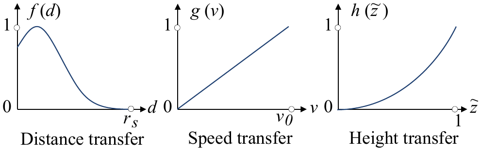

**Figure 6:** Uplift subduction profile curves: $f$ taking into account the distance to the front, $g$ taking into account the relative speed, and $h$ for elevation.

Let $\tilde{z}(\mathbf{p})$ denote the normalized elevation with respect to the maximum depth of oceanic trenches $z_t$ and the highest continental elevation $z_c$.
The influence of the elevation of the crust $\mathcal{P}_i$ is:

$$
h(\tilde{z}_i) = \tilde{z}_i^2
\tag{2}
$$

$$
\tilde{z}_i(\mathbf{p}) = (z_i(\mathbf{p}) - z_t)/(z_c - z_t)
\tag{3}
$$

The concept is that, as mentioned, elevations above sea level have an important impact over the uplift, whereas abyssal elevations do not play an important part.
In practice, the relative influence of the deformation functions can be controlled by user-defined weights.

We set the orogeny age of the emerging parts of islands or continents $a_c(t + \delta t) = 0$.
The new elevation of the crust of plate $\mathcal{P}_j$ is defined as:

$$
z_j(\mathbf{p}, t + \delta t) = z_j(\mathbf{p}, t) + \tilde{u}_j(\mathbf{p}) \, \delta t
\tag{4}
$$

We update the fold direction according to the relative speed of the plates:

$$
\mathbf{f}_j(\mathbf{p}, t + \delta t) = \mathbf{f}_j(\mathbf{p}, t) + \beta \, (s_i(\mathbf{p}) - s_j(\mathbf{p})) \, \delta t
\tag{5}
$$

$\beta$ is a constant weighting the influence of the relative speed over the folding direction.

**Slab pull** is a specific phenomenon that takes place at the subduction front for parts of the crust that start the subduction process.
*Slab pull* refers to the fact that any subducting plate is always drawn towards its subduction front.
To take this phenomenon into account, we update the geodetic movement $\mathcal{G}_i$ of the plate $\mathcal{P}_i$ by modifying its rotation axis:

$$
\mathbf{w}_i(t + \delta t) = \mathbf{w}_i(t) + \varepsilon \sum_{k=0}^{n-1} \frac{\mathbf{c}_i \times \mathbf{q}_k}{\|\mathbf{c}_i \times \mathbf{q}_k\|} \, \delta t
\tag{6}
$$

The points $\mathbf{q}_k$ are located in the subduction front.
This transformation brings the plate $\mathcal{P}_i$ closer to the local subduction front.

The modifications of the rotation axis are scaled according to the parameter $\varepsilon$; we use $\varepsilon \ll 1$ so that a single sample point will have a limited influence over the movement of the plate, whereas long subduction fronts with many point samples will have a noticeable influence.

### 4.2. Continental collision

The convergence of two plates with sufficient continental mass may result in a *continental collision*.
The density of the continental crust does not allow subduction, therefore a *slab break* event occurs, *i.e.* the rupture of the terranes from their supporting plate, and the suturing of the colliding continental parts with the collided plate.

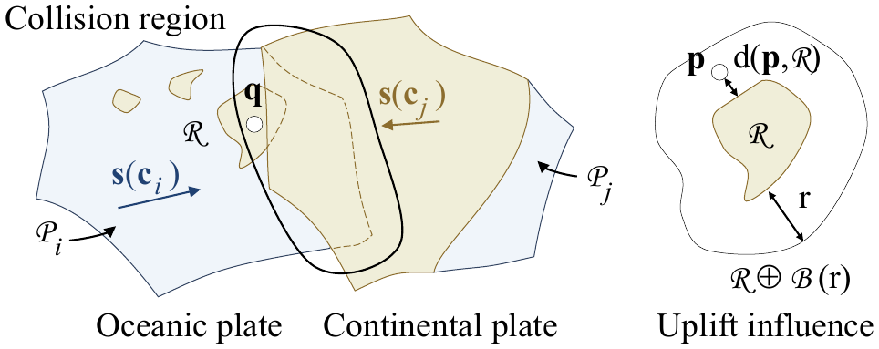

**Figure 7:** Collision between an oceanic plate $\mathcal{P}_i$ and a continental plate $\mathcal{P}_j$: a small terrane detaches from $\mathcal{P}_i$, merges with $\mathcal{P}_j$ and produces a local uplift in its neighborhood.

Without loss of generality, let $\mathcal{P}_i$ be an oceanic plate with one terrane $\mathcal{R}$ and $\mathcal{P}_j$ a continental plate (Figure 7).
Contrary to subduction, which is a continuous process extending over many time steps, collisions are discrete events: at a given time step $t$ the terrane $\mathcal{R}$ stops migrating and sutures to the collided plate $\mathcal{P}_j$.
The region of influence of the collision is defined as $\mathcal{R} \oplus \mathcal{B}(r)$, *i.e.* the area of the terrane offset by a radius $r$ representing the maximum distance of influence.
Let $\mathbf{q}$ be the centroid of $\mathcal{R}$; the radius of influence should be greater as the area of the terrane $\mathcal{A}$ is larger and as the relative speed of the plates increases.
We use the following power law:

$$
r = r_c \, \sqrt{v(\mathbf{q})/v_0} \; \mathcal{A}/\mathcal{A}_0
\tag{7}
$$

The constant $r_c$ represents the global maximum influence distance for the model; $\mathcal{A}_0$ is a constant representing the average initial area of a tectonic plate.
The discrete elevation surge $\Delta z$ in the neighborhood of $\mathcal{R}$ is defined as a compactly supported function of the distance to the terrane:

$$
\Delta z(\mathbf{p}) = \Delta_c \mathcal{A} \; f \circ d(\mathbf{p}, \mathcal{R})
\tag{8}
$$

$$
f(x) = \left(1 - \left(\frac{x}{r}\right)^2\right)^2
\tag{9}
$$

where $\Delta_c$ denotes the discrete collision coefficient (Appendix A).
Finally, the elevation of $\mathbf{p}$ is instantly augmented:

$$
z(\mathbf{p}, t + \delta t) = z(\mathbf{p}, t) + \Delta z(\mathbf{p})
\tag{10}
$$

The new local folding direction is given by:

$$
\mathbf{f}(\mathbf{p}, t + \delta t) = \left(\mathbf{n} \times \frac{\mathbf{p} - \mathbf{q}}{\|\mathbf{p} - \mathbf{q}\|}\right) \times \mathbf{n}
\tag{11}
$$

where $\mathbf{n}$ is the normal to the sphere at $\mathbf{p}$ and $\mathbf{q}$ is the centroid of the terrane.
Once the data of the points have been updated for plate $\mathcal{P}_j$, we detach the samples in $\mathcal{R}$ and attach them to plate $\mathcal{P}_j$.

### 4.3. Oceanic crust generation

The oceanic crust forms from the ridge separating diverging plates.
As oceanic crust ages, it gets colder and denser and tends to lower its elevation, forming abyssal plains.

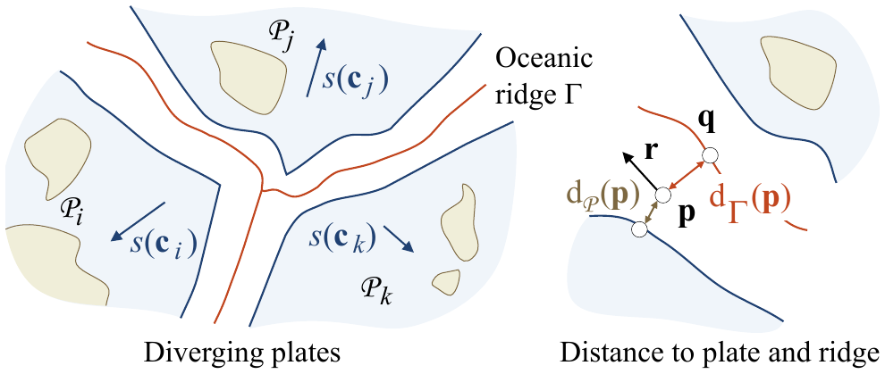

**Figure 8:** Oceanic crust generation between diverging plates.

Let $d_\Gamma(\mathbf{p})$ and $d_{\mathcal{P}}(\mathbf{p})$ be the distances from $\mathbf{p}$ to the ridge and to the closest plate respectively (Figure 8).
We define the interpolating factor as $\alpha = d_\Gamma(\mathbf{p})/(d_\Gamma(\mathbf{p}) + d_{\mathcal{P}}(\mathbf{p}))$.
The elevation of the new points $z(\mathbf{p}, t)$ is computed by blending the linearly interpolated elevation between plates $\bar{z}$ with a template ridge function profile $z_\Gamma$ (Figure 9):

$$
z(\mathbf{p}, t + \delta t) = \alpha \, \bar{z}(\mathbf{p}, t) + (1 - \alpha) \, z_\Gamma(\mathbf{p}, t)
\tag{12}
$$

We compute the direction parallel to the ridge $\mathbf{r}$ which is used for amplifying the oceanic crust and to generate the detailed oceanic terrain model.
Let $\mathbf{q}$ be the projection of $\mathbf{p}$ onto the ridge; we define:

$$
\mathbf{r}(\mathbf{p}) = (\mathbf{p} - \mathbf{q}) \times \mathbf{p}
\tag{13}
$$

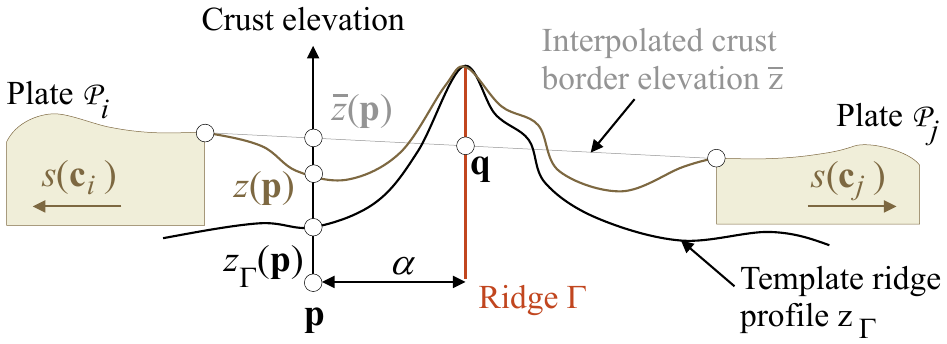

**Figure 9:** Computation of the oceanic crust elevation along oceanic ridges: $z(\mathbf{p})$ is defined by blending a generic profile curve $z_\Gamma$ with the interpolated elevation $\bar{z}$.

**Plate sampling** During the oceanic crust generation, we generate new points in the region of the ocean ridge, assign them to the nearest plate, and compute their corresponding crust parameters.
Oceanic crust formation is a continuous process that extends over several time steps.
However, because of the sampling and meshing process involved in the computation of the plates, the oceanic crust generation is processed every $10 - 60$ time steps, depending on the observed maximum plate speed.

### 4.4. Plate Rifting

Plate rifting is a discrete event which fragments a plate into smaller plates, which in turn tend to drift apart from each other (Figure 10).
It plays an important part in the overall realism of a virtual planet as it prevents the formation of unnatural super-continents caused by collisions.

Rifting fractures a given plate $\mathcal{P}$ into $n$ sub-plates $\mathcal{P}_i$, $n \in [2, 4]$.
The fracture curve $\Gamma$ and the shape of the new sub-plates are computed by distributing $n$ centroids $\mathbf{c}_i$ at random positions in $\mathcal{P}$ and constructing corresponding Voronoi cells $\mathcal{P}_i$.
We warp the boundaries of the Voronoi cells to generate irregular fracture lines between the sub-plates.
Random diverging directions are finally assigned to the new plates.

Rifting events are triggered according to a Poisson Law probability whose parameter $\lambda$ accounts for the relative continent size:

$$
P = \lambda e^{-\lambda} \quad \text{with} \quad \lambda = \lambda_0 \, f(x_{\mathcal{P}}) \, \mathcal{A}/\mathcal{A}_0
\tag{14}
$$

where $\lambda_0$ defines the average number of rifting events in the considered time window, and the transfer function $f(x_{\mathcal{P}})$ defines the influence of the continental crust type ratio of the plate $x_{\mathcal{P}}$.

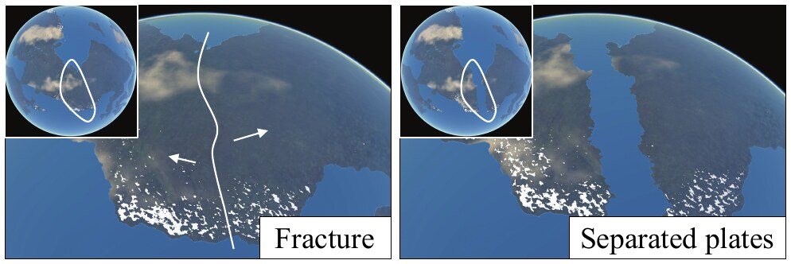

**Figure 10:** Example of a plate rifting into $2$ fragments: left image shows the plate before fragmentation, right image shows two separated continents after $15\,\mathrm{My}$.

Note that rifting events can be triggered and controlled by the user by prescribing the location, the fracture line $\Gamma$ and the time step at which the event takes place.

### 4.5. Continental erosion and oceanic dampening

At every time step of the simulation we perform continental erosion and oceanic dampening that modify the elevation of crust samples.

**Continental erosion** The relief of continents is shaped by a vast variety of erosion phenomena such as hydraulic, thermal, glacial or wind erosion.
The coarse sampling resolution of the crust ($\approx 50\,\mathrm{km}$) combined with the large time steps ($2\,\mathrm{My}$) allows us to rely on a simple erosion model.
In our approach, we perform the following simple erosion:

$$
z(\mathbf{p}, t + \delta t) = z(\mathbf{p}, t) - \frac{z(\mathbf{p}, t)}{z_c} \, \varepsilon_c \, \delta t
\tag{15}
$$

**Oceanic dampening** As the oceanic crust spreads from the mid-ocean ridge and ages, its density increases and its elevation decreases.
We apply the following dampening:

$$
z(\mathbf{p}, t + \delta t) = z(\mathbf{p}, t) - \left(1 - \frac{z(\mathbf{p}, t)}{z_t}\right) \varepsilon_o \, \delta t
\tag{16}
$$

Moreover, oceanic trenches tend to be filled with sediments, mostly imparted by the formation of an accretion wedge at the subduction front.
Therefore, we approximate the sediment filling process by modifying the elevation of the point samples in the trenches:

$$
z(\mathbf{p}, t + \delta t) = z(\mathbf{p}, t) + \varepsilon_t \, \delta t
\tag{17}
$$

The three constants $\varepsilon_c$, $\varepsilon_o$ and $\varepsilon_t$ represent the continental erosion, the oceanic elevation damping and the sediment accretion values for the simulation (Appendix A).
Finally we apply low frequency coherent noise to obtain more realistic variations over the planet.

## 5. Amplification

Once terminated by the user, the tectonics process yields crust data $\mathcal{C}$.
This coarse model can be further amplified to obtain the final terrain $\mathcal{T}$ of the planet.
We extract relevant information from the sampled crust data, and transfer it to the relief generator.
In this section, we describe two generators: one purely procedural, and another exemplar-based.

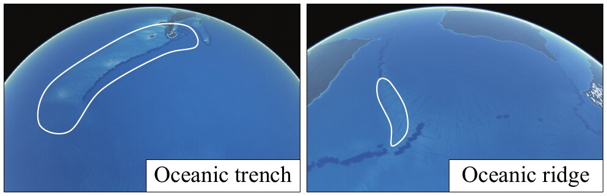

**Figure 11:** Procedural amplification of the oceanic crust obtained by adding noise with amplitudes and frequencies computed from the age and ridge direction parameters; small islands have been generated by the tectonic process.

**Procedural amplification** is performed by adding coherent noise to the base crust elevation $z$.
This technique is used to generate the oceanic relief (Figure 11).
Mid-ocean ridges are characterized by many transform faults, lying perpendicular to the ridges.
We recreate this feature by using 3D Gabor noise [LLDD09], oriented using the recorded parameters $\mathbf{r}$, *i.e.* the local direction parallel to the ridge, and oceanic crust age $a_o$ to accentuate the faults where the crust is young.
We add, as an extra layer, a high frequency gradient noise sum to provide details for underwater sceneries.

**Exemplar-based generation** relies on blending heightfield primitives [GGP\*15] to synthesize the elevation of the terrain $\mathcal{T}$.
The heightfield primitives can be real earth elevation data or user-specified elevation models.
Recall that the crust $\mathcal{C}$ is described as a set of samples, each holding data recorded from the procedural tectonics process.
We identify the local terrain type $x_{\mathcal{T}}$, and then assign a primitive matching it to every sample point (Figure 12).

Our implementation uses exemplar-based terrains for generating the continental relief.
We used some of the USGS Shuttle Radar Topography Mission digital elevation models, at 90 m precision.
Each exemplar $\mathcal{E}$ was preprocessed to extract its average folding direction $\mathbf{f}_{\mathcal{E}}$ and the elevation range.
Continental point samples in $\mathcal{C}$ falling in an orogeny zone are assigned specific $x_{\mathcal{T}}$ depending on the recorded endogenous factor $o$, *i.e.* subduction or continental collision.
The resulting terrain type is either *Andean* or *Himalayan*.
If the local age of the orogeny is superior to a user-specified threshold, then $x_{\mathcal{T}}$ is set to *old mountains*.
If the continental sample falls outside any orogeny, $x_{\mathcal{T}}$ is set to *plain*.

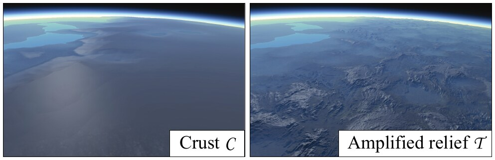

**Figure 12:** Example of crust $\mathcal{C}$ terrain generated by the simulation (left) and the detailed elevated relief $\mathcal{T}$ (right) obtained by exemplar-based amplification.

The positions of the primitives are shifted by a small random offset to avoid repetition artifacts, and rotated in the tangent plane of the sphere to align with the local fold direction $\mathbf{f}$.
The final amplified elevation is computed as a weighted sum of the elevation of the primitives.

## 6. Implementation Details

The crust is initialized as a set of attributed points $\mathbf{p}$ over the sphere.
To generate a near-optimal distribution of the sample points, we rely on Fibonacci sampling of the sphere [KISS15].
We then construct a global Spherical Delaunay Triangulation [Ren97], that we partition into a set of initial plates $\mathcal{P}$.

**Meshing** The sampling and meshing of the sphere is performed off-line as a pre-processing step, and re-used many times during the simulation, in particular for seafloor generation.
Instead of incrementally remeshing the planet at every step, which would be computationally demanding, we compute the movement of the plates and perform a global resampling every 10–60 iterations.
The parameters of the samples located between diverging plates are computed using the method described in Section 4.3.
The parameters of the other sample points are computed using barycentric interpolation of crust data from the plate they intersect.
The new set of plates is built by partitioning the triangulation according to samples assignments.

**Plate boundary tracking** We detect plate collisions efficiently by tracking the intersection between the boundary triangles of the plates.
We also rely on a bounding box hierarchy for every plate to accelerate intersection tests.
For each tracked converging triangle, we also update the distance of its vertices to the convergence front at every time step by overestimating: $d(\mathbf{p}, t + \delta t) \geq d(\mathbf{p}, t) + \|s(\mathbf{p})\|\,\delta t$.

**Continental collisions** *Terranes* are handled while tracking plate subduction.
If two continental triangles of two different plates intersect, we switch the tracking mode to continental collision.
The collision event is triggered if the interpenetration distance between the two plates is greater than a user-defined threshold, 300 km in our system.
For a given plate $\mathcal{P}_i$, the set of *terranes* and the set of collided plates are detected.
We detach each *terrane* by removing its triangles indexes and attach them to the collided plate.
Finally, we compute and spread the uplift in the collision region.

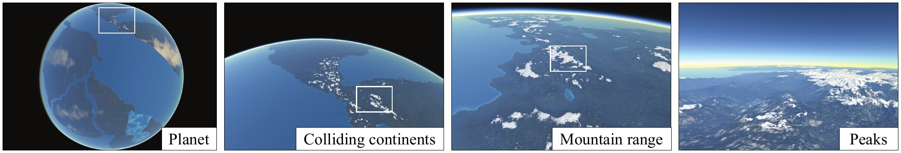

**Figure 13:** Real time rendering of a synthetic planet with four visible continents: the low resolution model of the crust is amplified with a procedurally parametrized elevation model to obtain high resolution terrains, thus allowing for real time authoring.

## 7. Results

Our method was implemented in C++ and tested on an Intel Core i7-6700K clocked at 4 GHz with 16 GB of RAM and a Nvidia GTX 1080.
The planets shown throughout the paper were generated using our tectonics-inspired algorithm.
We relied on the graphics hardware for real-time rendering.
Our implementation achieves a frame rate ranging between 37 and 145 Hz, depending on camera altitude.
An adaptive meshing scheme is used, the ocean surface exists as an animated mesh and the oceanic and atmospheric rendering are implemented as shaders.
A complete description of the rendering technique is beyond the scope of the paper, we refer the reader to [CR11] for an introduction to planet-scale rendering.

All the images shown throughout the paper show a variety of synthetic planets that have been generated by our approach.
Unless stated otherwise, we used 500 000 point samples for the tectonics model for a 6 370 km radius planet ($\approx 35$ km resolution).
The example-based amplification process used 19 sets taken from the publicly available USGS data set SRTM90: 7 for young *Himalayan* regions, 11 for *Andean* orogeny, and 6 for old mountain ranges.
<!-- CHECK: as printed, 7 + 11 + 6 = 24, not 19; left unchanged because the correct figure is unknown -->

### 7.1. Control

The originality of our approach consists in combining a procedural model for approximating and simulating the complex tectonic phenomena with the ability to interactively change the parameters of the plates during the simulation.

As a purely procedural approach, our method can generate a time-varying synthetic planet.
Given an initial continental and oceanic plate distribution and geodetic movements, our procedural model computes their evolution and can automatically synthesize a virtual planet featuring important emerging characteristics such as oceanic ridges and plains, and continental plains and mountain ranges.
Our experiments show that realistic planets are obtained after a few hundred iterations, *i.e.* $\approx 250$ My.

The user can choose to design the initial tectonic plates and control scenarios (Figure 16) for its temporal evolution by prescribing the geodetic movements of the plates, or start from an existing planet such as the earth and synthesize scenic events, for example the rifting of the African continent, and making Australia collide with Asia (Figure 17).
Our method is not physically accurate and will not predict the true evolution of the Earth, however it provides user-control and is sufficiently plausible for the production of special effects and science fiction scenarios.

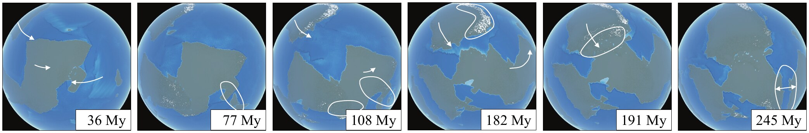

**Figure 16:** Example of a user-defined scenario defining the evolution of the continents of a planet.
At $t = 36\,\mathrm{My}$, the user modified the geodetic movement of the oceanic plate containing the island to the east, so that it should move towards the continent and collision occurs at $t = 77\,\mathrm{My}$.
At $t = 108\,\mathrm{My}$ the northern continent accelerates towards the center, subduction is initiated at $t = 182\,\mathrm{My}$ involving the oceanic border of both plates.
Subduction turns into collision of the plates due to massive continental crust at 191 My.
Finally, the user selected the newly formed super-continent and triggered a plate rifting event which resulted in a fracture and the apparition of a new sea, at $t = 245\,\mathrm{My}$.

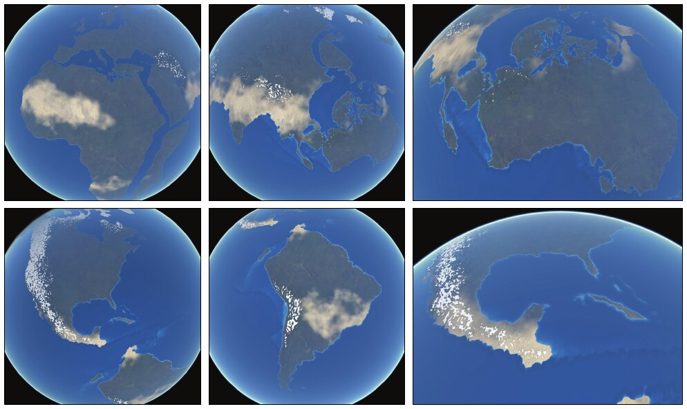

**Figure 17:** Example of a user-specified evolution of the earth: the plates were initialized with elevation data, and the user defined the movement of the plates.
At 80 My, the continents had drifted or collided, but the original landforms were still recognizable.

Alternatively, the user may also control the procedural generation of plates by prescribing global constraints, such as the initial continental to oceanic ratio or the initial number of plates.
At any moment during the simulation the user can select continents, adjust the movements or directly change the parameters of the crust.
The user may also trigger rifting events on continents and define the way a plate should split, or switch the main crust type, *e.g.* from continental to oceanic.

### 7.2. Comparison to other methods

Although a variety of methods for modeling and generating virtual terrains and landscapes have been proposed, few attempts have been made to synthesize entire planets.
Existing techniques rely on procedural noise [EMP\*98] or modified mid-point displacement [DGGK11].

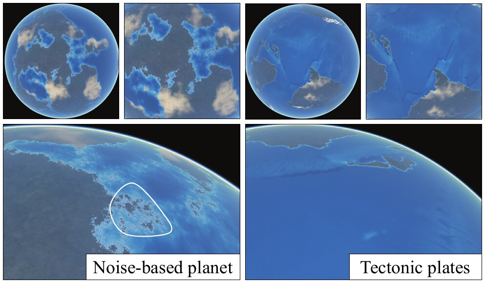

**Figure 14:** Comparison between a planet generated by using a sum of noise, and our method.
Noise-based planets have homogeneous fractal shaped continents and highly varying oceanic crust elevation, and mountain ranges are located at the center of the continents.
In contrast, our method produces distinctive and realistic oceanic and continental landforms featuring continental symmetry, coastal cordilleras, and oceanic trenches.

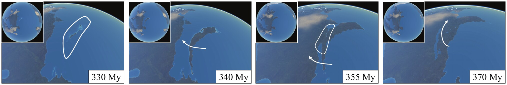

**Figure 15:** Example of a terrane accreting onto a continent.
At $t = 330\,\mathrm{My}$, the oceanic plate to the east converges towards the continental plate, and initiates subduction; uplift induces seafloor elevation, producing the emergence of an island arc.
At $t = 340\,\mathrm{My}$ the island arc has turned into a large island, oriented along the subduction front and its trench.
At $t = 355\,\mathrm{My}$ the user re-orients the movement of the oceanic plate to the north-west, and the collision at $t = 370\,\mathrm{My}$ produces the complete accretion of the island to the main continent.

Fractal approaches put the emphasis on self-similarity, and therefore fail at generating characteristic landform structures, both in terms of shape and distribution, such as groups of islands near a continent, or cordilleras close to coastlines.
Figure 14 shows a side by side comparison of a noise-based synthetic planet and our tectonics-based model.
Note that although our current implementation does not generate drainage networks over the continents, our plate model is compatible with existing river network generation [DGGK11] and stream power erosion algorithms [CBC\*16] which could be used to better sculpt the coarse crust elevations (see Section 7.5 about limitations), at the expense of more computationally demanding iterations.

### 7.3. Validation

We performed a user study to evaluate the realism of synthetic planets produced by our tectonics-based method compared to existing fractal-based approaches [EMP\*98].
We chose to compare results using a two-alternative forced choice user experiment.
Participants in the study were presented with 6 pairs of images, and asked to select the most realistic in each case.
The overall order of presentation, as well as the order within pairs, was randomized.
In this experiment, the shading of the two planets was identical (Figure 14), in order to avoid any bias induced by the rendering.
24 persons, between the age of 22 and 28, participated in the study.
Our model received a total of 97 votes, compared to 47 for the fractal model.
This yields a $\chi^2$ of 8.3 and a p-value less than 0.4%, which is highly in the favor of our method.

A more complete user study could be carried out to evaluate the visual impact of the individual components and parameters of our model, such as relative percentage of continents, or drifting parameters.
Although time consuming, such a study would be an interesting extension for future work.
We validated the result of our simulation with a geological expert in tectonics.
The expert was very positive about the overall realism of the animated virtual planets (see accompanying video) and confirmed that the effects produced by our procedural model were realistic.
He pointed out several minor defects that should be taken into account to improve the method (see Section 7.5 on limitations).

### 7.4. Performance

The geometric model computation is split into two parts.
The crust computation is performed on the CPU and the crust data, including the indexes of the exemplars, base elevations, age and fold directions, are streamed to the GPU.
The amplification process is performed directly on the GPU.

| Resolution | 102 km | 78 km | 50 km | 35 km |
| --- | ---: | ---: | ---: | ---: |
| Sample points | 60k | 100k | 250k | 500k |
| Subduction | 0.08 | 0.14 | 0.26 | 0.65 |
| Continental collision | 0.02 | 0.04 | 0.69 | 0.63 |
| Elevation | 0.09 | 0.10 | 0.29 | 0.62 |
| **Total** | 0.19 | 0.28 | 1.24 | 1.90 |
| Oceanic crust | 0.58 | 1.22 | 3.58 | 13.10 |
| Plate rifting | 0.23 | 0.21 | 1.50 | 7.70 |

**Table 2:** Average time-step execution time (in seconds) for different planet resolutions; the planet has a 6 370 km radius.

Table 2 reports crust generation statistics for a planet with an initial state featuring 40 plates and a land coverage ratio of 0.3.
Oceanic crust generation and plate rifting are the most computationally demanding tectonic processes, whereas the other ones can be computed at interactive rates for a resolution of $\approx 100$ km.
In our implementation, we perform plate rifting and crust generation every 20 to 120 My, depending on maximum plate speed.

The computation of the elevation of the crust is performed in parallel over several threads: the tectonic processes which are per-sample point atomic operations can be safely threaded.
The triangulation $\mathcal{M}$ of the continental and oceanic plates is organized into a bounding box hierarchy to speed up the intersection tests and the distance queries.

### 7.5. Limitations and future work

**Control.** In our current implementation, the user can only control the movement and fracture of the plates throughout time.
Therefore, she only has indirect control over the final shape of the continents and the characteristics of the oceanic and continental relief.
This limitation could be leveraged by combining our method with other smaller-scale terrain authoring systems to provide more control over the generated planets.

**Realism.** Although we had to simplify some phenomena in order to obtain a procedural model allowing for interactive control, our approach was validated by a geological expert in tectonics who pointed out several limitations.
Here we review some of the limitations and propose interesting research directions.

Plate *rifting* progressively tears the crust into pieces instead of directly breaking the crust; the very reason for that is that the rotation axes of the fragments are located at a point along the rift.
In our implementation we resorted to direct divergence of the fragments to avoid any collision artifacts between neighboring plate boundaries, which would have sutured the fragments and therefore canceled the rifting process.
A more precise boundary tracking algorithm would enable us to better reproduce the tearing effect efficiently.
Our plate convergence model tends to generate more *forced subduction* events than expected.
The reason comes from efficiency concerns as detecting and preventing subduction of large terranes would introduce another computationally demanding step in the simulation loop; we preferred preserving the interactive speed of our model to allow authoring.

For similar efficiency reasons, we did not model *passive margins* and more generally shallow underwater continental parts.
Finally, we did not generate *hot spots* in our model, such as the Hawaiian islands chain.
This feature could be easily implemented in our model as specific sample points drifting across plates.

## 8. Conclusion

In this paper, we have presented an original tectonic-inspired procedural approach for modeling virtual planets.
Our approach allows to control the shape of the continents and generates coherent continental and oceanic landforms such as mountainous cordilleras and plateaus, oceanic ridges and island arcs.
Our method provides global and local control to the user who may prescribe the movement of the continents, or trigger events such as rifting interactively during the simulation.
The data produced by the crust simulation provides us with landform parameters which can be used to amplify the elevation of the crust and generate high resolution terrain reliefs.

This original work is a first step towards procedural modeling of planets and opens several interesting research directions.
The procedural tectonic model could be improved to include some specific and important phenomena such as hot spots that generate volcanic islands or ocean floor aging which creates complex oceanic trenches.
Finally, our model could be combined with a procedural atmosphere and climate model at different time scales to allow the simulation of large scale ecosystems.

## Acknowledgments

This work was supported by the project PAPAYA P110720-2659260, funded by the Fonds National pour la Société Numérique and the project HDW ANR-16-CE33-0001.
Special thanks go to Nicolas Coltice (Laboratoire of Geology of Ecole Normale Supérieure de Paris) for having helped us to improve the method and to evaluate the results.

## References

- **[BA05]** Belhadj F., Audibert P.: Modeling landscapes with ridges and rivers. In *Proceedings of the Symposium on Virtual Reality Software and Technology* (Monterey, USA, 2005), ACM, pp. 151–154.
- **[BTR15]** Bercovici D., Tackley P., Ricard Y.: 7.07-the generation of plate tectonics from mantle dynamics. *Treatise on Geophysics. Elsevier, Oxford* (2015), 271–318.
- **[BY10]** Braun J., Yamato P.: Structural evolution of a three-dimensional, finite-width crustal wedge. *Tectonophysics 484* (2010), 181–192.
- **[CBC\*16]** Cordonnier G., Braun J., Cani M.-P., Benes B., Galin É., Peytavie A., Guérin É.: Large scale terrain generation from tectonic uplift and fluvial erosion. *Computer Graphics Forum 35*, 2 (2016), 165–175.
- **[CCB\*18]** Cordonnier G., Cani M.-P., Benes B., Braun J., Galin E.: Sculpting mountains: Interactive terrain modeling based on subsurface geology. *IEEE Transactions on Visualization and Computer Graphics 24*, 5 (2018), 1756–1769.
- **[CGG\*17]** Cordonnier G., Galin E., Gain J., Benes B., Guérin E., Peytavie A., Cani M.-P.: Authoring Landscapes by Combining Ecosystem and Terrain Erosion Simulation. *ACM Transactions on Graphics 36*, 4 (2017), 134:1–134:12.
- **[CGU17]** Coltice N., Gérault M., Ulvrová M.: A mantle convection perspective on global tectonics. *Earth-Science Reviews 165* (2017), 120–150.
- **[Clo93]** Cloos M.: Lithospheric buoyancy and collisional orogenesis: Subduction of oceanic plateaus, continental margins, island arcs, spreading ridges, and seamounts. *Geological Society of America Bulletin 105*, 6 (1993), 715–737.
- **[CR11]** Cozzi P., Ring K.: *3D engine design for virtual globes*. AK Peters/CRC Press, 2011.
- **[CS17]** Coltice N., Shephard G. E.: Tectonic predictions with mantle convection models. *Geophysical Journal International 213*, 1 (2017), 16–29.
- **[DGGK11]** Derzapf E., Ganster B., Guthe M., Klein R.: River networks for instant procedural planets. *Computer Graphics Forum 30*, 7 (2011), 2031–2040.
- **[DLMvH98]** Dominguez S., Lallemand S., Malavieille J., von Huene R.: Upper plate deformation associated with seamount subduction. *Tectonophysics 293*, 3-4 (1998), 207–224.
- **[EMP\*98]** Ebert D. S., Musgrave F. K., Peachey D., Perlin K., Worley S.: *Texturing and Modeling: A Procedural Approach*, 3rd ed. Morgan Kaufmann Publishers Inc., 1998.
- **[GDG\*17]** Guérin E., Digne J., Galin E., Peytavie A., Wolf C., Benes B., Martinez B.: Interactive example-based terrain authoring with conditional generative adversarial networks. *ACM Transactions on Graphics (Proceedings of Siggraph Asia) 36*, 6 (2017), 228:1–228:13.
- **[GDGP16]** Guérin E., Digne J., Galin E., Peytavie A.: Sparse representation of terrains for procedural modeling. *Computer Graphics Forum (Proceedings of Eurographics) 35*, 2 (2016), 177–187.
- **[GGG\*13]** Génevaux J.-D., Galin É., Guérin É., Peytavie A., Benes B.: Terrain generation using procedural models based on hydrology. *ACM Transactions on Graphics 32*, 4 (2013), 143:1–143:13.
- **[GGP\*15]** Génevaux J.-D., Galin É., Peytavie A., Guérin É., Briquet C., Grosbellet F., Benes B.: Terrain modeling from feature primitives. *Computer Graphics Forum* (2015), 198–210.
- **[GMM15]** Gain J., Merry B., Marais P.: Parallel, realistic and controllable terrain synthesis. *Computer Graphics Forum 34*, 2 (2015), 105–116.
- **[HGA\*10]** Hnaidi H., Guérin É., Akkouche S., Peytavie A., Galin É.: Feature based terrain generation using diffusion equation. *Computer Graphics Forum 29*, 7 (2010), 2179–2186.
- **[KISS15]** Keinert B., Innmann M., Sänger M., Stamminger M.: Spherical Fibonacci mapping. *ACM Transactions on Graphics 34* (2015), 193:1–193:7.
- **[KMN88]** Kelley A. D., Malin M. C., Nielson G. M.: Terrain simulation using a model of stream erosion. *SIGGRAPH Computer Graphics 22*, 4 (1988), 263–268.
- **[LLDD09]** Lagae A., Lefebvre S., Drettakis G., Dutré P.: Procedural noise using sparse Gabor convolution. *ACM Transactions on Graphics 28*, 3 (2009), 54:1–54:10.
- **[LP68]** Le Pichon X.: Sea-floor spreading and continental drift. *Journal of Geophysical Research 73*, 12 (1968), 3661–3697.
- **[MKM89]** Musgrave F. K., Kolb C. E., Mace R. S.: The synthesis and rendering of eroded fractal terrains. *ACM Siggraph Computer Graphics 23*, 3 (1989), 41–50.
- **[Mor68]** Morgan W. J.: Rises, trenches, great faults, and crustal blocks. *Journal of Geophysical Research 73*, 6 (1968), 1959–1982.
- **[PH93]** Prusinkiewicz P., Hammel M.: A fractal model of mountains and rivers. In *Graphics Interface* (1993), vol. 93, Canadian Information Processing Society, pp. 174–180.
- **[Ren97]** Renka R. J.: Algorithm 772: STRIPACK: Delaunay triangulation and Voronoi diagram on the surface of a sphere. *ACM Transactions on Mathematical Software (TOMS) 23*, 3 (1997), 416–434.
- **[RPP93]** Roudier P., Peroche B., Perrin M.: Landscapes synthesis achieved through erosion and deposition process simulation. *Computer Graphics Forum 12*, 3 (1993), 375–383.
- **[TGM12]** Tasse F. P., Gain J. E., Marais P.: Enhanced texture-based terrain synthesis on graphics hardware. *Computer Graphics Forum 31*, 6 (2012), 1959–1972.
- **[ZSTR07]** Zhou H., Sun J., Turk G., Rehg J. M.: Terrain synthesis from digital elevation models. *IEEE Transactions on Visualization and Computer Graphics 13*, 4 (2007), 834–848.

## Appendix A: Constants

The model is completed by a set of global parameters, with the following values.
The sea level was set to 0 as the reference elevation.

| Symbol | Description | Value |
| :---: | :---: | ---: |
| $\delta t$ | Time-step | $2\,My$ |
| $R$ | Planet radius | $6\,370\,km$ |
| $z_r$ | Highest oceanic ridge elevation | $-1\,km$ |
| $z_a$ | Abyssal plains elevation | $-6\,km$ |
| $z_t$ | Oceanic trench elevation | $-10\,km$ |
| $z_c$ | Highest continental altitude | $10\,km$ |
| $r_s$ | Subduction distance | $1\,800\,km$ |
| $r_c$ | Collision distance | $4\,200\,km$ |
| $\Delta_c$ | Collision coefficient | $1.3 \times 10^{-5}\,km^{-1}$ |
| $v_0$ | Maximum plate speed | $100\,mm\,y^{-1}$ |
| $\varepsilon_o$ | Oceanic elevation damping | $4 \times 10^{-2}\,mm\,y^{-1}$ |
| $\varepsilon_c$ | Continental erosion | $3 \times 10^{-2}\,mm\,y^{-1}$ |
| $\varepsilon_t$ | Sediment accretion | $3 \times 10^{-1}\,mm\,y^{-1}$ |
| $u_0$ | Subduction uplift | $6 \times 10^{-1}\,mm\,y^{-1}$ |

**Table 3:** Overview of the main parameters for our synthetic planet generation algorithm; the values reported in the table were used for generating the examples shown throughout the article.

