# Physically-based analytical erosion for fast terrain generation

Petros Tzathas1, Boris Gailleton2, Philippe Steer2,3, and Guillaume Cordonnier1

- 1Inria, Université Côte d’Azur, France
- 2Univ Rennes, CNRS, Géosciences Rennes, UMR 6118, France
- 3Institut universitaire de France

Computer Graphics Forum, Volume 43 (2024), Number 2 (EUROGRAPHICS 2024). DOI: [10.1111/cgf.15033](https://doi.org/10.1111/cgf.15033). Author version, HAL: [hal-04525371](https://hal.science/hal-04525371v1).

This transcription corrects typographical errors and notation inconsistencies in the author version.

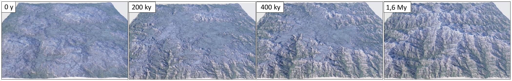

**Figure 1:** Our method receives as input an initial terrain ($t = 0y$, left), a map of the tectonic uplift, and a time $t$.
Thanks to the analytical solutions of the stream power law, our method outputs the eroded terrain at time $t$, without the need of a costly simulation.
Therefore, a user can easily explore the time continuum, from the early erosion of the input terrain ($t = 200ky$, center left) to the steady state equilibrium between uplift and erosion ($t = 1.6My$, right).

## Abstract

Terrain generation methods have long been divided between procedural and physically-based.
Procedural methods build upon the fast evaluation of a mathematical function but suffer from a lack of geological consistency, while physically-based simulation enforces this consistency at the cost of thousands of iterations unraveling the history of the landscape.
In particular, the simulation of the competition between tectonic uplift and fluvial erosion expressed by the stream power law raised recent interest in computer graphics as this allows the generation and control of consistent large-scale mountain ranges, albeit at the cost of a lengthy simulation.
In this paper, we explore the analytical solutions of the stream power law and propose a method that is both physically-based and procedural, allowing fast and consistent large-scale terrain generation.
In our approach, time is no longer the stopping criterion of an iterative process but acts as the parameter of a mathematical function, a slider that controls the aging of the input terrain from a subtle erosion to the complete replacement by a fully formed mountain range.
While analytical solutions have been proposed by the geomorphology community for the 1D case, extending them to a 2D heightmap proves challenging.
We propose an efficient implementation of the analytical solutions with a multigrid accelerated iterative process and solutions to incorporate landslides and hillslope processes – two erosion factors that complement the stream power law.

## CCS Concepts

- Computing methodologies → Shape modeling;

## 1. Introduction

Terrains are ubiquitous in a large variety of graphics applications, whether they form the background of virtual worlds or the stage of many storytelling artworks.
Mountains, in particular, stand out from their monumental presence and the diversity of their features.

It is therefore unsurprising that research in computer graphics has investigated the problem of generating and authoring mountainous landscapes [GGP\*19].
Nevertheless, while several approaches work well for small to medium-scale terrains (the scale of the river to the valley) [EMP\*02, BTHB06, GMM15], for larger scales up to the scale of the mountain range they lack geological consistency which is prevailing in large mountain structures.
Consistency is achieved by approaches based on physical simulations [CCB\*17] which are preeminent in this case.
However, physical simulations require the integration of the geological history of landscapes, leading in turn to long simulation time or numerous iterations before reaching a suitable result.

Our work comes from the observation that there exist analytical solutions to the mathematical equation that expresses the formation of large-scale landscapes resulting from the competition between tectonic uplift and fluvial incision.
Thanks to an efficient implementation of these analytical solutions, we obtain a terrain modeling tool that shares the benefits of a physical simulation, but without the cost of thousands of time-stepping iterations.
Instead, the temporal component of the simulation becomes another parameter provided to the user, that controls the real-world duration of the erosion process.

The *stream power law* is commonly used in geomorphology [WT99, BW13] and now in computer graphics [CBC\*16, SPF\*23] to model large-scale river erosion.
Combined with *uplift* - the tectonically-driven rate of elevation change of the mountain - this results in a Partial Differential Equation (PDE) that describes the formation of the mountain ranges over geological time.
Early studies in Earth sciences suggest that this equation admits analytical solutions [RTP13, Ste21] that readily provide a landscape at a time $t$ (Figure 1), without requiring the lengthy iterations of a time-stepping scheme.
However, these solutions use several simplifying assumptions, for instance, that the terrain is initially flat.
We propose a new derivation and fast numerical implementation of these solutions for the more general case, which enables us to reach a larger range of applications, from the instantaneous generation of large-scale mountain ranges to the controllable aging of a user-provided terrain.
Inspired by the implicit time-stepping scheme for the stream power law [BW13, CBC\*16], our algorithm uses an ordering of the terrain grid cells, starting at the domain boundaries, and following the river network upstream.
This strategy comes with a caveat illustrative of the challenges of porting the 1D solution to the 2D setting: elevations are computed based on an order that depends on the hydrology network, but the hydrology network itself depends on the elevations.
Previous work [Ste21] developed a fixed-point algorithm that iterates over the successive computation of the river network and then the elevations.
Yet, this algorithm converges slowly, requiring too many iterations to be applied in an interactive editing context and assumes flat initial topography.
We therefore propose two solutions: one inspired by multigrid approaches to accelerate the convergence, and another that allows small deviations from the analytical solutions and uses optimization to enforce the smoothness of the terrain surface.
This added freedom - without sacrificing the geological consistency - provides more flexibility and allows user control.
Finally, we observe that the solutions to the stream power law yield a singularity that results in infinitely large slopes close to the ridges - where geologists suggest that other erosion processes dominate [LD03].
Therefore, we explore solutions to include approximations of other processes such as hillslope and thermal erosion.
We demonstrate the applicability of our method through a variety of results, that show the versatility of the analytical solutions that are able to quickly generate large-scale mountains (Figure 1, right), as well as providing a fast physically-based erosion tool (Figure 1, center left).

To summarize, we claim the following technical contributions: 1) We extend the derivations of analytical solutions for the stream power law and propose an efficient implementation that covers a range of applications from the post-process erosion of a user-provided terrain to the generation of terrains *ex nihilo*.
2) We accelerate the convergence between elevations and the river network, with an accurate approach inspired by multigrid and a more permissive one via optimization which allows for more control over the hydrology network.
3) We incorporate other processes such as hillslope erosion and landslides (thermal erosion).

## 2. Previous Work

Terrain generation methods are generally classified among three main categories: example-based (or data-based), procedural, and physically-based [GGP\*19].
Our new *analytical model* - inspired by previous work in Earth sciences - is, in essence, a physically-based procedural method.

**Data-driven** - or example-based - methods assemble terrains from patches or statistics extracted from the topography of real examples, typically captured by satellites.
Initially inspired by texture synthesis [ZSTR07, GMM15] and extended to machine-learning [GDG\*17], these methods are fast, controllable, and provide an unmatched realism at a small scale.

However, data-driven methods are unable to ensure geological consistency.
While this is not noticeable on a small scale, inconsistencies at a larger scale can have a critical impact for instance on the river network, where some streams can end abruptly.
Scott *et al.* [SD21] demonstrated the negative visual impact of these inconsistencies and proposed a correction by carving a realistic river network as a post-process.
While this approach fixes the river network, several inconsistencies in the distribution of valleys and elevation remain and reduce the realism at a large scale.

**Procedural** generation [EMP\*02] builds terrains from a combination of mathematical functions, especially multi-frequency noise that mimics the self-similarity of nature across scales [MVN68].
This mathematical foundation leads to methods that are extremely fast, parallel, and unbounded in size.
These approaches are usually hard to control, although this issue has been recently alleviated, either by local editing tools such as noise brushes [dCB09], global interpolation around diffusion curves [HGA\*10], or in the gradient domain [GPM\*22].
It is, however, still difficult to ensure the realism and consistency of the results.
One solution is to build the terrain around a procedural river network [GGG\*13] which ensures hydrological consistency.
Thanks to our analytical solution of the physical equations, our model ensures consistency of the hydrology network and the topography, and introduces a temporal parameter.

**Physically-based** methods were inspired by the geological knowledge that landscapes are shaped by the combination of various processes [WT99, WHBY22]: climate which modulates the rates of erosion, and tectonics which controls the uplift rate (the rate of vertical growth of the mountain).
In computer graphics, researchers initially modeled the most visible factor: erosion, which was first used as a post-process over a procedural or user-modeled terrain [MKM89].
This method was refined with data structures and algorithms for strength-varying layers of rocks [RPP93, BF01], and by improving the water model with Shallow Water equations [Ben07], Smoothed Particles Hydrodynamics [KBKv09] and GPU implementations [VBHS11].

Methods that simulate hydraulic erosion handle the water dynamics explicitly, which, in theory, increases the physical accuracy of the erosion but introduces numerical constraints that limit them to a smaller spatiotemporal extent.
To compensate, the results are scaled up, which therefore reduces the overall plausibility.
In contrast, fluvial erosion methods implement models developed in geomorphology, for instance, the stream power law [WT99].
These laws abstract water physics under simpler proxies, *e.g.,* the drainage area that represents water flux (or discharge), which yields simulations that can efficiently cover much larger time spans.
Therefore, fluvial erosion allows a tight coupling with the growth of the mountain under tectonic uplift [CBC\*16] to model the formation of large-scale mountain ranges.
Uplift was also proposed as a guide for the user to shape the landscape [CCB\*17, SPF\*23].
We build our analytical model upon the laws introduced by fluvial erosion methods, but our mathematical treatment removes the need for costly iterations inherent to simulations.

**Earth sciences** commonly use simulations to understand the formation of mountains.
The variety of models adapted to many use cases is immense [CDM14] and out of the scope of the paper.
Therefore, we will focus on the family of methods shared with computer graphics that build upon the stream power law [HK83, WT99].
Several implementations were proposed: fast implementations of implicit solutions [BW13], enhancement of a numerical model with analytical solution near the ridges [GWHB14], or the inclusion of sediment deposition.

Early analytical solutions were introduced, first on models that simplify the treatment of the water discharge [Luk72, Luk74] and introduce the method of characteristics for erosion equations.
This idea was later extended to the stream power law [RTP13] that simplifies the problem thanks to a translation to dimensionless variables.
Eventually, Steer [Ste21] proposed a solution to the 2D problem and tested it with several scenarios, to study in particular the response of the landscape to temporal variations in the uplift, which is an important question in geomorphology.
However, some questions were left open and we aim to answer them in this work, such as the case where the initial terrain is not flat, which allows us to erode existing terrains.
Furthermore, their method used an iterative algorithm to enforce the convergence of the analytical solution, which we accelerate with an approach inspired by multigrid.

## 3. Background and overview

Geomorphology explains mountain formation as the competition between mountain growth and fluvial erosion.
In this section, we will explain the underlying equations, show the challenges behind analytical solutions, and provide a high-level overview of our algorithms and data structures.

### 3.1. Landscape dynamics in geology

Mountain formation is generally associated with tectonic plate convergence, mantle dynamics, and/or volcanic activity.
In the context of tectonic convergence, the eventual collision of the plates leads to a thickening of the crust accommodated by visco-elasto-plastic deformation, brittle rupture (faults), and folding of the rock layers [Avo03, GCG\*09].
The thickening leads to a vertical upward motion of rocks towards the surface, referred to as *rock uplift*, which competes with erosion and can lead to a progressive increase in the surface altitude, called *surface uplift* [EM90].
Rates of rock uplift and erosion vary in space and time and achieve values up to a few millimeters per year in some mountain ranges.

The uplift is counteracted by erosion, which impacts the slopes of the mountain and therefore its maximal elevation.
Erosion comes from many factors: water, glaciers, landslides, wind, and even anthropic or biological impact.
Many models in geomorphology consider only erosion by water, also called *fluvial* erosion.
Indeed, the fluvial network is considered the backbone of landscapes, and fluvial incision dictates the rate of landscape erosion [Whi04].
While simple to model, fluvial erosion explains the main topographical characteristics of most mountain ranges and has been the dominant erosion factor over many geological periods - with the notable exception of the last million years, where the Quaternary saw an important increase in glacial erosion that leaves specific marks in high altitude [PMD01, ENPL09, SHV\*12].

A first common modeling approximation is to consider surface evolution as a detachment-limited process (as opposed to transport-limited) where the evolution of surface elevation $z$ is directly related to the competition between rock uplift and erosion rate, and not to the capacity of the rivers to transport or deposit sediments [How94].
In this setting, erosion is generally described using the stream power incision model [HK83, How94, WT99, Lag14], where erosion rate is a power law of the surface slope $\|\nabla z\|$, and drainage area $A$ that acts as a proxy for the river discharge.
The drainage area $A(\mathbf{x})$ is defined at a position $\mathbf{x}$ as the area of the drainage basin - or catchment - upstream of $\mathbf{x}$.
Coupled with the uplift $u$, the *Stream Power Law* expresses the rate of change of surface elevation:

$$
\frac{\partial z}{\partial t} = u - k A^m \|\nabla z\|^n,
\tag{1}
$$

where $k$, $m$ and $n$ are erosion coefficients.
Throughout the paper, we will use some of the common values: $m = 0.4$ and $n = 1$.
The choice of $n = 1$, also commonly used in geomorphology, makes the equation linear and therefore simplifies the derivation of the analytical solutions.
While this choice barely impacts the result as the valley profiles are mostly directed by the ratio $m/n$, we acknowledge that the actual values of $m$ and $n$ remain an open question in geomorphology [Lag14].

Eqn. 1 is a linear hyperbolic Partial Differential Equation (PDE), which can be interpreted as an *advection* of the initial terrain $z_0 = z(t = 0)$ along the rivers, at a velocity $k A^m$.
This equation admits analytical solutions in 1D that can be computed thanks to the method of characteristics [Luk74, RTP13], and used to model 2D heightmaps [Ste21].

### 3.2. Challenges and algorithm

Throughout our implementation, we use a regular grid as our data structure – a standard for terrains that eases the multigrid-inspired technique that we introduce below.
This grid initially stores the user-specified uplift $u$, initial elevation $z_0$, and boundary mask $b$: each cell where $b$ is *True* will force its altitude to remain constant: $z = z_0$.
At least one cell should be specified as a boundary to ensure that the erosion problem is well-posed.
The grid is progressively augmented with all the intermediate values needed by our implementation, including the drainage area $A$.
Our output is a regular grid containing the final elevation $z$.

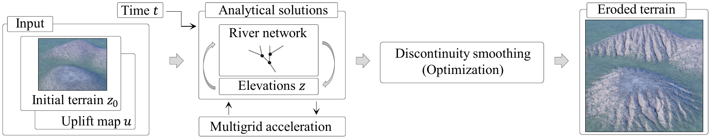

**Figure 2:** From a user-provided initial terrain $z_0$, uplift map $u$, and target time $t$ (left) our method outputs the eroded terrain at time $t$.
Contrary to simulation-based approaches, our algorithm does not rely on a time-stepping scheme but uses the analytical solutions of the stream power law.
To compute these solutions, we rely on a multi-grid accelerated process that iterates over both the computation of the river networks and the computation of the elevations predicted by 1D analytical solutions embedded in these rivers (center left).
Optionally, the user can choose to interrupt this iteration before convergence, for example, to preserve the initial river network, and in this case, we propose an optimization-based approach to smooth the remaining discontinuities (center right).

Analytical solutions were exposed in the geoscience literature [Luk74, RTP13, Ste21] but with some restrictions: either these solutions are in 1D [Luk74, RTP13] and the proposed algorithms are not straightforward to extend to 2D, or the solutions are in 2D [Ste21] but are restricted to a simplified case where the initial elevation $z_0$ as well as the bounds $z(b)$ are assumed to be zero, and the uplift is constant in space.
In Section 4, we detail our first contribution which is the derivation and implementation of the analytical solutions in the general case, compatible with a 2D setting.

We follow [Ste21] and order the computation along the river network.
This network consists of a set of trees that covers the terrain and represents the progressive merging of high-altitude small streams down to the larger rivers.
We obtain the 2D analytical solution by solving the 1D problem on each upstream path embedded in the tree structures.
Similarly to the previous implicit time stepping schemes for the Stream Power Law [BW13, CBC\*16], we separate the computation into two parts: first we accumulate the drainage area by following the river directions from the high elevations (ridges) of the terrain to the bounds, then we evaluate the analytical solution upstream from the bounds to the ridges.

This strategy leads to a second issue that hinders the optimal complexity of our algorithm on a stream tree: the elevations obtained from the implicit solution depend on the ordering of the nodes in the river network, which itself depends on the elevations.
In practice, this leads to the formation of discontinuities at the boundaries of drainage basins.
A solution is to use a fixed point algorithm: start with the initial elevation $z_0$, compute the corresponding drainage $A_0$, and then iterate over a progressively improving sequence of elevations $z_i$ and $A_i$, that eventually converge to the desired solution $z$.
A straightforward implementation of this algorithm converges [Ste21] but requires at worst a number of iterations proportional to the length of the longest river in the terrain.
In Section 5, we propose two solutions to reduce the number of iterations (Figure 2):

- We observe that the convergence speed is limited by the fact that basin boundaries can only move by one cell per iteration, and therefore introduce a method inspired by multigrid to move the bounds across different scales.
- We propose an alternative strategy that does not require any change in the drainage, but instead uses an optimization to find a terrain as close as possible to the analytical solution but without discontinuities.

We show how we can combine these two approaches to allow the user to specify the desired accuracy of the final terrain in a continuum between the geologically accurate solutions provided by multigrid and a result that preserves the hydrological features of the input terrain, enforced by our optimization.

Our last challenge lies in the fact that the solutions to the Stream Power Law lead to singularities close to the ridges: the amount of water decreases when we approach the higher parts of the mountain, which are therefore less impacted by erosion and eventually degenerate into infinitely steep slopes.
In practice, fluvial erosion is negligible or even not applicable in these locations, in which other erosion processes dominate.
In Section 6, we propose some geomorphological-inspired modeling strategies to mitigate this issue, by adding terms that mimic other erosion factors, such as landslides (or thermal erosion) [MKM89], or hillslope erosion [BS97].

## 4. Analytical solutions of the stream power law

Analytical solutions of the stream power law describe elevations of an eroded terrain at a given time $t$, without requiring the many iterations of a time-stepping scheme.
Existing 1D analytical solutions in Earth sciences [RTP13] simplify the derivation thanks to dimensionless variables, which complicates their algorithmic treatment.
We instead describe how to derive the solutions with the natural variables and how to infer an efficient algorithm to evaluate them.

### 4.1. The method of characteristics for the stream power law

Eqn. 1, with $n = 1$, can be rewritten as:

$$
\frac{\partial z}{\partial t} = u - k A^m \frac{\nabla z}{\|\nabla z\|} \cdot \nabla z,
\tag{2}
$$

which falls in the category of hyperbolic partial differential equations and can be solved by the method of characteristics [RTP13, Ste21].
This method consists of finding a family of space-time curves, called characteristic curves, along which the equation becomes an Ordinary Differential Equation [ZT86].

Our first observation is that the spatial component of the characteristic curve follows the direction of the topographic gradient $\frac{\nabla z}{\|\nabla z\|}$.
Intuitively, this means that the elevation at any point $x$ in the terrain will only depend on elevations downstream of $x$, by following the path of steepest gradients.
We call this path a *river path* as this is the trajectory naturally followed by the water, and parameterize it by $s$, the distance between the bound ($s = 0$) and any point on the path (Figure 3, left).

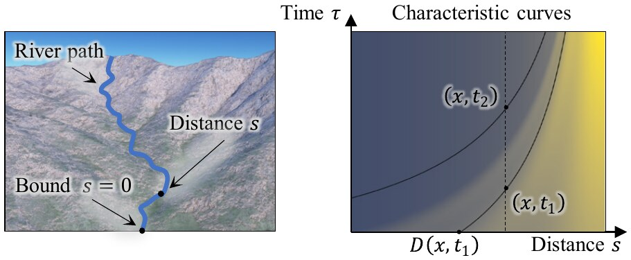

**Figure 3:** We compute the analytical solutions along a river path (left), parameterized by the distance $s$ to the bounds.
We add the time component $\tau$ to define the set of characteristic curves (right), each of them associated with a given position $x$ and time $t$ where we want to evaluate the elevation.
Here, the curve passing through $(x,t_1)$ intersects the horizontal axis at $D(x,t_1)$, in which case the elevation $z_0$ is advected from $D(x,t_1)$ (Eqn. 8).
The curve associated with $(x,t_2)$ intersects the vertical axis, suggesting that the system already achieved steady-state (Eqn. 9).

Along this path, Eqn. 2 simplifies as:

$$
\frac{\partial z}{\partial t} = u(s) - a(s) \frac{\partial z}{\partial s},
\tag{3}
$$

where $a(s) = k A(s)^m$.
Note that we assume that $A$ does not depend on time – we observed that, after some time, the drainage $A$ stabilizes in the main river channels.
A solution of Eqn. 3 was proposed in Earth sciences [Ste21] with the assumption that $u$ is constant in space and varies in time, which is important for geomorphologists who study the erosional response to tectonic perturbations.
We prefer an orthogonal approach where the uplift varies in space but not in time, as we expect the uplift to be easier to control for the user as a function of space alone [SPF\*23].

We use the following assumptions at the bound:

$$
\begin{cases}
u(s = 0) = 0 \\
z(s = 0, t) = z_0(0) \\
z(s, t = 0) = z_0(s).
\end{cases}
\tag{4}
$$

The constraint that the uplift vanishes at the boundary ensures the well-posedness of the problem, as otherwise the mountains would keep growing indefinitely.

The method of characteristics relates space $s$ and time $\tau$ on a set of characteristic curves with the equation:

$$
\frac{d\tau}{ds} = \frac{1}{a(s)}.
\tag{5}
$$

As we seek the elevation at time $t$ and position $x$, we only consider the curve that includes the point $x,t$.
For this curve, the space-time relationship is expressed by $\tau_{x,t}(s)$ defined such that $\tau_{x,t}(x) = t$, which gives after integration:

$$
\tau_{x,t}(s) = t - \int_s^x \frac{1}{a(s')}\,ds'.
\tag{6}
$$

Note that $\tau_{x,t}(s)$ parameterizes time, and therefore should remain positive.
The function $\tau_{x,t}$ being strictly increasing, we define a point $D_{x,t}$ by $\tau_{x,t}(D_{x,t}) = 0$, such that the characteristic curve is only defined when $s \geq D_{x,t}$.
This is illustrated in the right of Figure 3 by the curve associated with $(x,t_1)$.
The other curve – going through $(x,t_2)$ – shows a case where $\tau_{x,t}(D_{x,t}) = 0$ does not have a solution, and for which we set $D_{x,t} = 0$.

Then, along the characteristic curve, Eqn. 3 is rewritten as:

$$
\frac{dz}{ds} = \frac{u(s)}{a(s)},
\tag{7}
$$

which we integrate on the domain of definition of the curve $s \geq D_{x,t}$, to obtain the formula for the elevation:

$$
z(x,t) = z_0(D_{x,t}) + \int_{D_{x,t}}^x \frac{u(s)}{a(s)}\,ds.
\tag{8}
$$

Note that for large $t$ or small $x$, $D_{x,t}$ can be negative, in which case the boundary assumptions (Eqn. 4) give the solution:

$$
z(x,t) = z_0(0) + \int_0^x \frac{u(s)}{a(s)}\,ds.
\tag{9}
$$

If this happens for all cells in the terrain, this solution corresponds to the steady state of the stream power law.

Compared to previous simulation-based methods that required iterating over time, this solution directly expresses the elevation of the terrain from the uplift and drainage area.
This is why we follow geology literature [Ste21] to call this an analytical solution (with respect to time), even if we need to resort to a numerical evaluation of the integral over space.

### 4.2. Recursive algorithm for the 1D analytical solutions

Solutions based on dimensionless variables in 1D [RTP13] evaluate the solution at dimensionless positions, with a non-trivial mapping to real positions.
Instead, we first propose a numerical evaluation of the analytical solutions (Eqn. 8) on the 1D case, at the real positions along the river path.
We will explain in Section 4.3 how we use this solution to model 2D heightmaps.
For now, we assume that all the values ($z_0$, $u$, $a$) are known and stored in a 1D array.
We denote by $\delta x$ the spacing between cells of the array.

Our goal is to compute all the elevations in the array, essentially fixing $t$ and varying $x$.
A naive implementation of Eqn. 8 is inefficient: for each position $x$, we would need to parse the array from $D_{x,t}$ to $x$ to compute the integral, resulting in a quadratic complexity.
Instead, we observe that significant portions of the computation are similar among neighboring cells of the array, which means that the computation of the elevation at a position $x$ can use data already computed at the previous position $x - \delta x$.
This observation suggests an iterative algorithm, which parses the array and progressively computes the elevations in a single iteration.

We introduce the function $T(x,y)$:

$$
T(x,y) = \int_x^y \frac{1}{a(s')}\,ds',
\tag{10}
$$

which gives the time required for the elevation to be advected from position $x$ to $y$.
The first step of our algorithm is to compute $D_{x,t}$, defined implicitly by $\tau_{x,t}(D_{x,t}) = 0$, or

$$
T(D_{x,t}, x) = t.
\tag{11}
$$

Eqn. 11 is not well defined for small $x$ or large $t$, which are cases where the information would need to be advected from beyond the boundaries of the domain.
To detect this situation, we set $T(0,0) = 0$ and parse the array from the bound, progressively evaluating $T(0,x) = T(0,x - \delta x) + \delta x/a(x)$ until we find the first $x_0$ for which $T(0,x_0) > t$.
We set $D_{x,t} = 0$ for $x < x_0$, and, assuming that $1/a$ is locally constant near $x = 0$:

$$
D_{x_0,t} \approx a(0) T(0, D_{x_0,t}) = a(0)(T(0,x_0) - t).
\tag{12}
$$

Then, we propose a recursive formulation to compute $D_{x,t}$ elsewhere.
For a given cell position $x > x_0$, we assume that we know $D_{x-\delta x,t}$.
Writing Eqn. 11 for both $x - \delta x$ and $x$ results in:

$$
\int_{x-\delta x}^x \frac{1}{a(s')}\,ds' = \int_{D_{x-\delta x,t}}^{D_{x,t}} \frac{1}{a(s')}\,ds'.
\tag{13}
$$

We approximate the left-hand side of Eqn. 13 as $\delta x/a(x)$.
Starting from $D_{x-\delta x,t}$, we progressively parse the array until we find the highest $x_i$ such that $T(D_{x-\delta x,t}, x_i) < \delta x/a(x)$, which allows us to split the integral and rewrite Eqn. 13 as:

$$
\delta x/a(x) = T(D_{x-\delta x,t}, x_i) + T(x_i, D_{x,t}),
\tag{14}
$$

and, again using a locally constant approximation of $1/a$, we obtain:

$$
D_{x,t} = x_i + a(x_i) \left( \frac{\delta x}{a(x)} - T(D_{x-\delta x,t}, x_i) \right).
\tag{15}
$$

Note that for each $x$, we parse a portion of the array to find $x_i$ and compute $D_{x,t}$.
However, the sum of the size of all portions seen during the whole execution of the algorithm does not exceed $2N$, with $N$ being the size of the array, which leads to linear time complexity.

With $D_{x,t}$ computed, the first term of Eqn. 8, $z_0(D_{x,t})$ comes naturally from the linear interpolation of the value of $z_0$ at the two cell points enclosing the position $D_{x,t}$.

Next, we compute the second term of Eqn. 8.
We rewrite Eqn. 8 as:

$$
z(x,t) = z_0(D_{x,t}) + S(D_{x,t}, x),
\tag{16}
$$

where $S(x,y)$ represents the difference of elevation between positions $x$ and $y$ and results from the balance uplift and erosion:

$$
S(x,y) = \int_x^y \frac{u(s')}{a(s')}\,ds'.
\tag{17}
$$

We use the notation $S(x)$ as a shorthand for $S(D_{x,t}, x)$, and propose another recursive formulation to compute $S(x)$ from $S(x - \delta x)$.
The boundary condition gives the initialization: $S(0) = 0$, and, by decomposition of the integral,

$$
S(x) = S(x - \delta x) + S(x - \delta x, x) - S(D_{x-\delta x,t}, D_{x,t}).
\tag{18}
$$

We have $S(x - \delta x, x) \approx \delta x u(x)/a(x)$, and compute $S(D_{x-\delta x,t}, D_{x,t})$ parsing the array between $D_{x-\delta x,t}$ and $D_{x,t}$, progressively accumulating $\delta x u/a$.
Note that $D_{x-\delta x,t}$ and $D_{x,t}$ do not necessarily coincide with cell boundaries, and therefore the evaluation of the integral close to these end-points needs to be scaled by the distance between them and the closest cell boundary.

Here again, the sum of the sizes of the sub-arrays that we parse at each subsequent step of the recursion is smaller than $2N$, resulting overall in a linear time algorithm.

**In summary,** our algorithm consists of the following steps:

1. Iterate through the array and accumulate $T(0,x)$ to find $x_0$, deduce $D_{x_0,t}$ from Eqn. 12.
2. Iterate through the array to progressively compute $D_{x,t}$ with Eqn. 15.
3. Iterate through the array to progressively compute $S(x)$ with Eqn. 18.
4. Compute the final elevation with $z(x,t) = z_0(D_{x,t}) + S(x)$, where $z_0(D_{x,t})$ is obtained by linear interpolation.

### 4.3. Extension to the 2D terrain domain

We now show that our algorithm for the 1D solution of the analytical equation readily extends to the 2D solution by changing our computation domain from a line to a tree covering the terrain surface.
We explained in Section 4.1 that the analytical solutions are computed along a 1D *river path*, that follows the steepest path on the terrain.
In practice, rivers merge into an algorithmic tree structure, that we call a *river tree*, and we call the set of all river trees the *river network* or *hydrology network*.
On a river tree, each node has a single downstream neighbor, on which we can apply directly the recursive formulations from Section 4.2.
In practice, this requires ordering the computation so that it follows the nodes of the tree, which is suggested by the literature on implicit solutions to the stream power law [BW13, CBC\*16] or previous attempts toward analytical solutions in the geology literature [Ste21].

The ordering is (weakly) defined by assigning to each cell $c$ of the terrain a receiver $c_r$, which is one of the four direct neighbors to the cell, and whose elevation is strictly lower than the cell.
In our case, we choose the receiver randomly, with a probability proportional to the difference in elevation between the cell and its lower neighbors.
We prefer a random sampling over the deterministic choice of the lowest neighbor [BW13, CBC\*16] that was designed for irregular grids and yields the formation of uniform axis-aligned valleys on regular grids (Figure 8).
Furthermore, the noise induced by the randomization results in more naturally diverse patterns.
To ensure the deterministic behavior of our algorithm, we precompute and store the random variable used by each cell to sample the receiver.

This ordering results in a set of river trees whose roots correspond to the bounds of the terrain and whose leaves correspond to the ridges.
The inset figure below shows the river network for a $32 \times 32$ terrain, different colors corresponding to different trees.

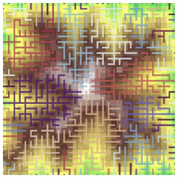

We parse this tree in two directions: first, we accumulate the area of the cells $\delta x^2$ from the leaves to the root to compute the drainage area $A$.
Here, a topological sort on the tree guarantees the correctness of the computation of $A$ from the invariant that any cell is evaluated after all upstream cells [BW13, CBC\*16, Ste21].

Then, we parse the tree in the other direction, from the root (bound) to the leaves, to evaluate the analytical solution.
The 1D recursive algorithm (Section 4.2) translates directly to that case: each cell at position $x$ has a single receiver that plays the role of the cell at $x - \delta x$ in the recursive formula (Eqns. 15, 18).
The main issue, which distinguishes us from previous work, is that our algorithm relies on operations located at the advection location $D_{x,t}$, downstream of the evaluated cell.
We tackle this issue by using another ordering for this step: with a depth-first search, we can record the sequence of cells between the bound and the current cell, and use this sequence to evaluate the integrals involving $D_{x,t}$ in Eqns. 15 and 18.

Strategies based on ordering share a common pitfall when local minima are present on the terrain – and analytical solutions in particular are not well defined for that case.
Following previous work [BW13, CBC\*16], we rely on a depression carving algorithm [SD21] to reroute some of the cells as if breaches were carved in the terrain to allow for the water to flow out of all local minima.

The choice of a single receiver results in an incorrect evaluation of the slope of the terrain (as $\|\nabla z\|$ requires the spatial derivative from both the $x$ and $y$ directions).
We compensate for this approximation by introducing a correction term: for a cell at position $x$ with a receiver at position $x_r$, we change $a(x)$ to $a(x) = k A^m \frac{\delta x \|\nabla z\|}{z(x) - z(x_r)}$.
Note that we still evaluate the spatial derivatives of $\|\nabla z\|$ downstream, as the difference between the cell elevation and the lowest elevation in the $x$ and $y$ directions, respectively.
The inset figure shows the difference between not using (top) and using (bottom) the slope correction, with highlights on the isolines of a terrain constructed by enforcing a constant slope upward from a boundary circle.
The correction removes the directional artifacts and yields the expected concentric isolines.

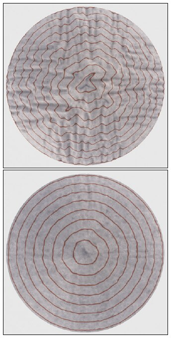

Note that we need an existing terrain to compute both the ordering and the aforementioned correction term, which yields an interdependency between the ordering and the analytical solution: the analytical solution requires an ordering to provide the elevation at time $t$, but the ordering requires the same elevations.
We will discuss strategies to combine ordering and analytical solutions in the next section.

## 5. Combining river network and elevations

The 2D analytical solutions presented in the previous section depend on an ordering of the river network, which itself depends on the elevation predicted by the analytical solutions.
This problem leads to significant artifacts in the result if we follow a simple strategy such as using the ordering of the terrain $z_0$: large discontinuities can occur in the analytical solutions, mainly at the boundaries between drainage basins which correspond to leaves of the river trees, leaving unrealistic large cliffs in the landscape (Figure 4, left).

### 5.1. Fixed-point algorithm

To solve this interdependency, [Ste21] suggested using a fixed point algorithm, that starts with $z_0$, computes the ordering (and correction), evaluates the analytical solutions, and iterates until the elevation converges.
However, this corrects the ordering slowly because only the leaves of the trees can change their connectivity at each iteration, leading to an upper bound for the number of iterations corresponding to the number of nodes of the longest river.

We observed that this algorithm converges for the steady state case (large $t$), but could sometimes oscillate, especially for small $t$, small uplift, and large discontinuities in the initial topography.
We address this issue with an exponential moving average (at each iteration, we average the topography predicted by the steady state with the elevations resulting from the previous iteration).

The large number of iterations required limits the applicability of analytical solutions to interactive applications and hinders their benefits compared to a full simulation.
Therefore, we propose two strategies: one inspired by the theory of multigrid - which still performs this iterative process but with fewer iterations at different scales, and the second using an optimization to reduce the discontinuities provoked by a mismatch between the ordering and the elevations.

### 5.2. Accelerating the convergence via multigrid

Multigrid is commonly used to solve elliptic PDEs with a coarse-to-fine approach, first on a coarse approximation of the problem, which is then progressively upsampled toward the final resolution.
This strategy accelerates the propagation of low-frequency information, which is similar to our needs and motivates the design of a multi-scale algorithm to accelerate the convergence.

We use a mipmapping type of downsampling operator where the elevation is averaged between $2 \times 2$ neighboring nodes, which we apply to the initial terrain $z_0$, the uplift $u$, and the boundary condition $b$, down to a user-specified minimal resolution.
We then compute a few iterations where we subsequently order the nodes and compute analytical solutions, similarly to Section 5.1.
We upsample the resulting elevation with bilinear interpolation to reiterate this process on the next scale.
A simple upsampling tends to produce a regular spacing of the rivers that follows the blocks of the lower resolutions (inset, top), with sharp turns.
We prevent these artifacts by adding some jittering (inset, bottom) during the upsampling process, where a uniform random offset in $[-0.25, 0.25]^2$ is added to the locations of the nodes before interpolation.

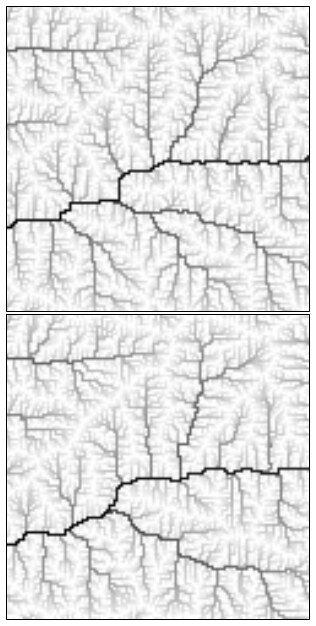

After experimenting with several *cycles* from the multigrid literature, we observed that an up/down-sample strategy inspired by the simplest *V-cycle* gives the best trade-off between speed and accuracy.
In practice, we mostly use around $4-5$ levels and $5-6$ iterations, which are enough to remove the most noticeable artifacts.
If artifacts remain, they are generally solved by adding more iterations, but we prefer using the optimization algorithm presented next as a post-process as it reduces the need for tuning hyperparameters.

### 5.3. Optimization-based altitude correction

Our multigrid algorithm efficiently updates the river network to remove the discontinuities but is not applicable in all situations.
For instance, a user might want to preserve the original drainage or use a procedurally generated river network [GGG\*13, GBG\*19].
For these cases, we assume that the river network is given and fixed, and we find the minimal correction to the analytical solution that removes the discontinuities.
Figure 4 shows the discontinuities seen after applying the analytical solutions directly to the initial river network (left), and how the discontinuities were removed by our optimization method (right).

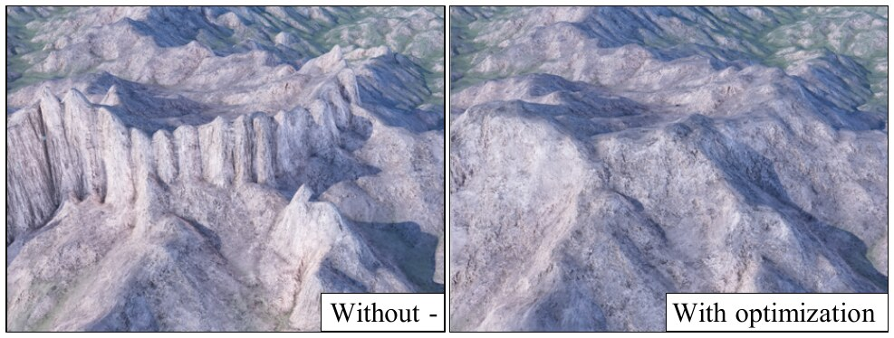

**Figure 4:** Discontinuities observed after the computation of the analytical solution on the initial river network (left), corrected with optimization (right).

Let us define a *non-connected neighbor* $c_n$ of a cell $c$ as one of its 4 direct neighbors such that $c$ is not a receiver of $c_n$ and $c_n$ is not a receiver of $c$.
We denote by $\mathrm{NCN}(c)$ the set of non-connected neighbors of a cell $c$.
We detect a discontinuity when the elevation difference between a cell $c$ and a non-connected neighbor at position $c_n \in \mathrm{NCN}(c)$ is larger than the elevation difference between the cell and its receiver ($c_r$):

$$
z(c) - z(c_n) > z(c) - z(c_r)
\tag{19}
$$

Reducing the discontinuity requires raising $c_n$, lowering $c$, or some combination of both, and then propagating these changes downstream and upstream.
Along a single river, multiple such situations may occur and they might also lead to conflicting changes.
Therefore, we developed an optimization algorithm that is more prone to balance these different constraints, rather than a deterministic algorithm based on a parsing of the river network.

A key insight of our algorithm is that we work on the space of elevation differences $d_c = z(c) - z(c_r)$, which has two advantages.
First, it simplifies the treatment of the non-negativity of the slope: to preserve the river network, we force $d_c \geq 0$.
Second, the elevation is reconstructed by accumulating the elevation differences, this propagates the influence of each constraint along the entirety of the tree at each step of gradient descent, while an approach based on the elevations would only propagate the information by one cell at each step.

In this setting, the set of elevation differences $d_c$ (or $\mathbf{d}$ in vector form) is the optimization variable.
During the optimization, we recompute the elevation $z_c$ from $\mathbf{d}$ by accumulating $d_i$ for $i$ downstream of $c$, down to the elevation $z_b$ of a boundary node $b$.
We use the analytical solutions to compute a target elevation difference $\tilde{d}_c$.

We build our objective function around two terms.
The *river term* retains the elevation differences given by the analytical solution:

$$
L_r(\mathbf{d}) = \sum_c \frac{(d_c - \tilde{d}_c)^2}{2}
\tag{20}
$$

The *discontinuity term* reduces the elevation difference between a cell $c$ and a lower non-connected neighbor $c_n$ so that $z_c$ stays above the receiver of $c$:

$$
L_d(\mathbf{d}) = \sum_c \sum_{c_n \in \mathrm{NCN}(c)} \frac{\max(z_c - z_{c_n} - \tilde{d}_c, 0)^2}{2}
\tag{21}
$$

We obtain $\mathbf{d}$ by solving the following optimization problem

$$
\begin{aligned}
&\min \lambda_r L_r(\mathbf{d}) + \lambda_d L_d(\mathbf{d}) \\
&\text{subject to } d_c \geq 0,
\end{aligned}
\tag{22}
$$

where $\lambda_r = 1/3$ and $\lambda_d = 2/3$ weigh the two components of the objective.

We remap $z$ to $[0, 1]$ and use gradient descent to solve Eqn. 22.
The sequential nature of the computation of $z_c$ from $\mathbf{d}$ is not readily compatible with existing automatic differentiation solvers, therefore we show in Appendix A how we accumulate the gradients with respect to $\mathbf{d}$ throughout the river network.
To prevent exploding gradients, we weigh each gradient of the *discontinuity term* $\partial L_d / \partial d_c$ by the number of nodes $N_c$ upstream of $c$ - which can be computed from the drainage area as $N_c = A_c / \delta x^2$.
We use the step size for the gradient descent $l_r = 0.01$, which we modulate locally to enforce the inequality $d_c \geq 0$.

## 6. Other erosion factors

The stream power law presents a singularity when the drainage area reaches zero: when time increases, the solution converges to infinitely steep ridges.
This is documented by geologists [LD03], who suggest that the stream power law is not applicable in these locations, or at least dominated by other processes.
We explore two possible predominant processes: hillslope erosion and landslides, and propose approximations to easily integrate them into our algorithm.

### 6.1. Hillslope erosion

Hillslope processes encompass the weathering of the mountain slopes and the diffusion that results from the creep flow of the eroded material.
It is often simplified as a linear diffusion of the terrain elevation [BS97, SPF\*23, CJP\*23]:

$$
\frac{\partial z}{\partial t} = k_h \Delta z,
\tag{23}
$$

Where $k_h$ is the hillslope erosion coefficient.

An analytical solution including the hillslope erosion would require joining the stream power law (Eqn. 1) with Eqn. 23 which results in an advection-diffusion equation.
Solving this equation needs a global 2D treatment, preventing our decomposition to a set of 1D solutions on the stream tree, and the complexity of the derivations and implementation of the solutions even in the 1D case challenges their usability in a terrain modeling framework.

Instead, we propose another modeling choice for the hillslope erosion, which is simpler to incorporate into our analytical solutions.
We observe that, while a solution in the transient case seems out of reach, it is possible to propose a model that has the same behavior as the diffusion equation at steady-state.

Let us consider the 1D steady-state equilibrium between the hillslope and the uplift:

$$
u + k_h \frac{\partial^2 z}{\partial s^2} = 0,
\tag{24}
$$

We integrate from $s$ to the ridge $r$, where the slope vanishes; and use Hack’s law [Hac57] to associate the distance to the ridge with the drainage $A$: $r - s = C A(s)^h$, where $C$ is a constant in the range $[1.4 - 2]$, and the exponent is usually set to $h = 0.6$:

$$
\frac{\partial z}{\partial s} = \frac{C u}{k_h A(s)^{-h}}.
\tag{25}
$$

Finally, we observe that Eqn. 3 converges to Eqn. 25 at steady state and close to the ridge with a simple modification to the term $a$:

$$
a(s) = k A(s)^m + \frac{k_h}{C} A(s)^{-h}.
\tag{26}
$$

### 6.2. Thermal erosion

Thermal erosion is commonly used in computer graphics to model the granular nature of mountains, which are particularly unstable above a critical *talus* slope:

$$
\frac{\partial z}{\partial t} = -k_t \max\left(0, \frac{\partial z}{\partial s} - s_c\right),
\tag{27}
$$

where $s_c = \operatorname{atan}(30^\circ)$ is the critical slope.
We modify Eqn. 3 to add the contribution of the thermal erosion:

$$
\frac{\partial z}{\partial t} = u(s) - a(s) \frac{\partial z}{\partial s} +
\begin{cases}
k_t\, s_c & \text{if } \frac{\partial z}{\partial s} > s_c, \\
0 & \text{else}
\end{cases}
\tag{28}
$$

with a new expression for $a(s)$ (also including hillslope):

$$
a(s) = k A(s)^m + \frac{k_h}{C} A(s)^{-h} +
\begin{cases}
k_t & \text{if } \frac{\partial z}{\partial s} > s_c, \\
0 & \text{else}
\end{cases}
\tag{29}
$$

We implement the condition $\frac{\partial z}{\partial s} > s_c$ within our algorithm.
When we compute Eqn. 18 to obtain the elevation at a position $x$, we first assume that there is no thermal erosion.
If the resulting slope is above the critical angle, we change $u$ and $a$ to incorporate the thermal erosion with Eqns. 28 and 29, and use the new values to re-estimate the elevation $z(x)$.
Note that changing $a$ also changes $D_{x,t}$, which slightly changes the algorithm summarized at the end of Section 4.2: instead of computing first $D_{x,t}$ for all $x$, then $S(x)$ for all $x$, and finally $z(x)$, we interleave them to compute together $D_{x,t}$, $S(x)$, and $z(x)$ from their values at $x - \delta x$.

## 7. Results

We prototyped our algorithm in Python with *numpy* (the code will be released with the paper).
Our algorithms require several tree operations that are not trivially parallelizable, therefore we improved the performance of Python loops with just-in-time compilation provided by the package *numba*.
We used an Intel Xeon E5-2650 v4 CPU with 64 GB RAM to compute all the results and timings reported in this section.
We interfaced our code with *Houdini* [Sid23] to showcase the use of our approach in an interactive editing session (see the companion video) and we use *Terragen* [Sof23] to produce the final renderings.
The parameter values used throughout our experiments are the ones shown in Table 1 and the uplift is constant, unless otherwise mentioned.
The code, Houdini file, and heightfields are available at https://gitlab.inria.fr/landscapes/analytical-terrains.

| Parameter | Symbol | Value |
|---|---|---|
| Uplift | $u$ | $10^{-3}\,m\,y^{-1}$ |
| Fluvial erosion | $k$ | $2 \cdot 10^{-5}\,m^{1-2m}\,y^{-1}$ |
| Precipitation | $p$ | $1\,m\,y^{-1}$ |
| Drainage exponent | $m$ | $0.4$ |
| Hack's law constant | $C$ | $1.5\,m^{1-2h}$ |
| Hack's law exponent | $h$ | $0.6$ |
| Hillslope erosion | $k_h$ | $0.1\,m^2\,y^{-1}$ |
| Thermal erosion | $k_t$ | $10^{-3}\,m\,y^{-1}$ |
| Critical slope | $s_c$ | $0.57$ |

**Table 1:** Parameters used throughout our experiments.

### 7.1. Validation and comparison

**Analytical solutions and simulation.** The purpose of our algorithm based on analytical solutions is to quickly generate terrains that are similar to the results of a simulation of the stream power law.
In Figure 5, we compare between our method (with multigrid, top left), a simulation [CBC\*16] (top right), and previous work in geology [Ste21] (Fixed point iteration, bottom left).
The comparison is performed at steady-state ($t = 4.6\,My$) as the last method does not handle initial topography and, also, in order to limit the integration error of the simulation.
In this example, we use a constant uplift modulated by a subtle noise on a $512 \times 512$ terrain with $\delta x = 50\,m$.
In the simulation, we use 460 iterations with $dt = 10000$, which we found to be the maximal time-step that did not produce visible artifacts.
The fixed-point algorithm required 43 iterations to converge.

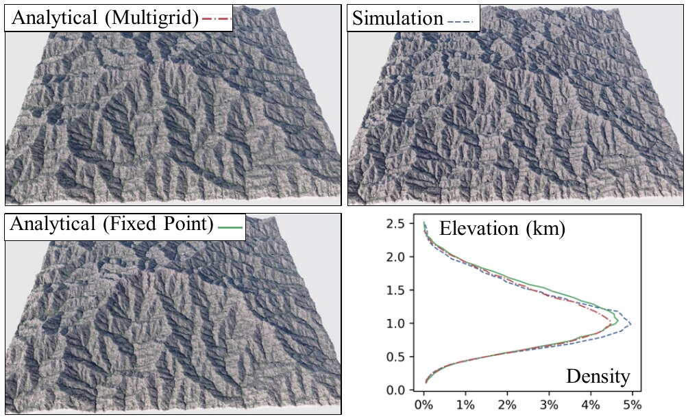

**Figure 5:** We compare our method at steady state (with multigrid, top left) with a simulation [CBC\*16] (top right) and a fixed point algorithm [Ste21] (bottom left).
These three methods should produce similar results, which we highlight by comparing their hypsometry (or the density plot of the elevations, bottom right).

The strength of analytical solutions is that they do not need to explicitly model the intermediate time states of the terrain, but this means that the river network at convergence is one of the many possible networks that agree with the stream power law.
Therefore, it is impossible to measure a one-to-one difference between all three approaches - note that this is a common issue on models involving the stream power law, which strongly depend on initial conditions and implementation choices.
Instead, we rely on the *hypsometry* [Str52] (distribution of elevations) to highlight the similarity between the three results.

Table 2 shows the time required to reach these results for different resolutions.
We keep the total extent of the terrain constant, therefore decreasing $\delta x$ from 50 to 25 and $12\,m$.
We observe that we need to decrease the time-step proportionally to the cell size to prevent artifacts in the simulation, therefore the number of iterations increases in both the fixed point (43, 82, 156 iterations) and the simulation (230, 460, 980 iterations).
In contrast, the multigrid methods only require the addition of one level of down/up-sampling, which leads to a complexity almost linear to the number of cells.
We additionally show the performance of the optimization algorithm, in the worst case, which is when we adjust the elevations to the initial drainage (disabling the iterative approach).
In practice, we observed that the optimization cleans all visible discontinuities after 50 iterations for all resolutions.
Overall, we did not observe significant changes in performance with other erosion parameters.

| Resolution | Multigrid | Fixed-Point | Simulation | Optim. |
|---|---|---|---|---|
| 512 | 1.79 s | 7.85 s | 55.52 s | 0.94 s |
| 1024 | 8.18 s | 70.89 s | 556.42 s | 4.10 s |
| 2048 | 33.65 s | 538.71 s | 4799.44 s | 16.61 s |

**Table 2:** Time required to compute a terrain at various resolutions, for our method with multigrid, the fixed point iteration, and the simulation.
We also show the total time required to correct the discontinuities with our optimization algorithm in the worst case (the elevations are adjusted to the initial river network).

**GPU simulations** of the stream power law [SPF\*23] might in some cases be faster than our method even though they require many iterations.
There are, however, caveats inherent to the GPU architecture that prevent them from being used in all cases.
First, GPU simulations use an explicit time-stepping scheme, which bounds the admissible time step and can yield a prohibitive number of iterations for small $\delta x$.
Second, depressions in the topography lead to local minima that interrupt the river network.
Similarly to other CPU algorithms, we use depression breaching [CBC\*16, SD21] to enforce the continuity of the river across the depressions.
The absence of such an algorithm on GPU implementations is particularly visible in cases where we erode without uplift – all the water is trapped within the depressions and the erosion only occurs in the vicinity of the topographic gradients.
We illustrate this problem in the inset figure, where we use a simulation without depression filling to erode an escarpment for $500\,ky$.
While the result should be similar to Figure 12 (right), the erosion remained local to the initial cliff and did not expand toward wide canyons.

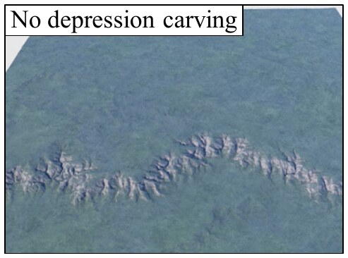

**Hydrology-based and physically-based.** Many procedural methods targeted the instant generation of terrains, often through the use of noise functions [EMP\*02].
Closer to us, Génevaux *et al.* [GGG\*13] proposed a procedural approach based on hydrology.
They generate a river network whose formation and elevation is guided by a slope map.
The elevation of areas between rivers is computed using a second slope map.
Since our method, similarly, computes the elevations progressively in the order defined by the river network, we alter the $a(s)$ term of Eqn. 3 so as to enforce a small slope for main rivers ($\|\nabla z\| = 0.06$ if the drainage is above $2500\,m^3 y^{-1}$), and a stronger slope for the sides of the mountain ($\|\nabla z\| = 0.6$), corresponding to the two slope maps of [GGG\*13].
In Figure 6, we compare our method (right) with this hydrology-based approach.
While the latter convincingly arranges rivers and surrounding mountains, our physically-based solutions yield more diverse patterns at all scales, self-emerging from the combination of uplift, stream power law, and hillslope [CMA\*16].

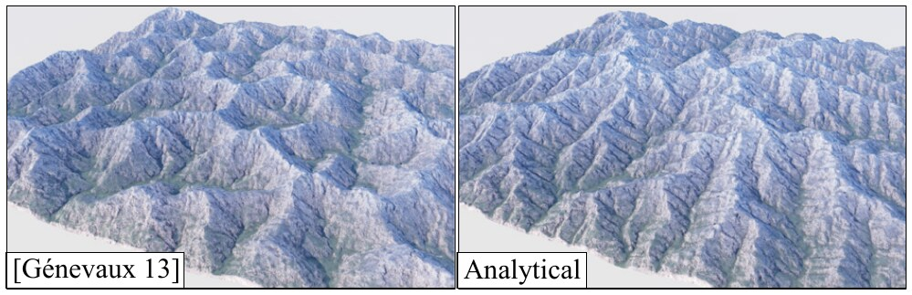

**Figure 6:** Comparison between a hydrology-based approach based on [GGG\*13] (left) and our analytical solution (right).
While the hydrology-based approach preserves the river consistency, our physically-based analytical solutions produce more diverse multi-scale features.

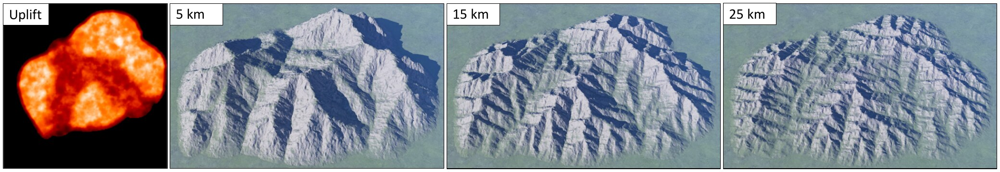

**Figure 7:** Terrains at equilibrium between uplift and erosion, controlled by a user-painted uplift map (left).
We show the impact of the local variations of the uplift map at three different scales, for mountain width ranging from $5\,km$, to $15\,km$, and $25\,km$.

### 7.2. Ablation study

Here, we explore our implementation choices and show the impact of the erosion models we introduced in Section 6.

**Choice of the receiver.** In Section 4.3, we suggested choosing the receiver randomly among the neighbors below each node.
In Figure 8, we compare this strategy with the choice of the lowest neighbor (minimum receiver).
Choosing the lowest neighbor leads to the formation of uniform axis-aligned slopes.
In practice, this choice constrains the rivers to follow a straight line, reducing the possible convergence of small streams.
This is the reason for both the axis-aligned appearance of the slopes and their steepness, as non-merging streams reduce the drainage area locally and therefore the erosion.

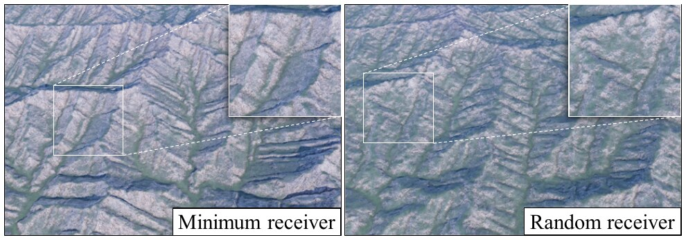

**Figure 8:** By choosing a random receiver among the lower neighbors of a node (right) compared to the lowest one (left), we avoid the formation of uniform axis-aligned slopes.

**Hillslope erosion** stabilizes the slopes of the mountains and acts as the main erosion process at low drainage where the stream power law becomes negligible [LD03].
We show the impact of hillslope in Figure 9, where we show the analytical solutions of the stream power law only at $\delta x = 50\,m$ (left), compared with our modified formulation that includes the hillslope erosion (Section 6.1, right of Figure 9).
Without hillslope, we observe the emergence of unrealistically sharp ridges and peaks.

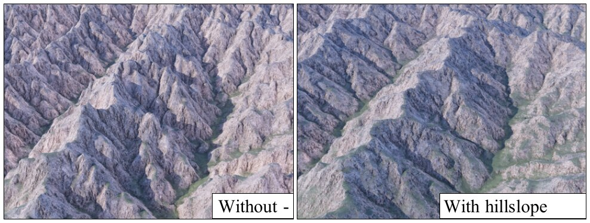

**Figure 9:** Close-up view on a ridge-line with hillslope disabled (left) and enabled (right).
Hillslope controls the slopes and prevents the formation of sharp ridges and peaks.

**Thermal erosion** is commonly used in computer graphics [MKM89] to dampen the main cliffs that arise in procedurally generated terrains.
Strong cliffs also occur naturally, for instance, if the outlet of a river is below an average *plateau* altitude.
We synthesize this behavior on a mostly flat initial terrain - with some Perlin noise to initiate the river profiles - where we significantly reduce the altitude of one of the boundary nodes.
We see cliffs appearing in Figure 10 (left), but the stream power law does not let us control the steepness of the cliff, only the speed at which it propagates away from the low boundary node following the drainage patterns.
In contrast, adding thermal erosion as explained in Section 6.2 allows us to adjust the critical angle, and hence the shape of the slopes (Figure 10, right).

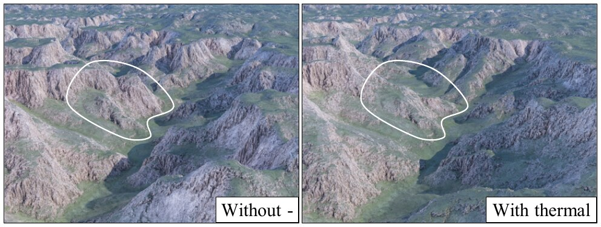

**Figure 10:** Cliffs produced by the lowering of the river outlet are not easily controllable with stream power law alone (left), while thermal erosion introduces a critical slope that allows us to reshape the steepest slopes.

### 7.3. Applicability of our method

We now illustrate the versatility of our method through several applications.
Figure 1 shows a landscape initialized with Perlin noise and eroded at different user-provided times to illustrate the range of possible effects, from a short post-process that carves only the main slopes (at $t = 200\,ky$) to the complete formation of a new mountain range ($t = 1.6\,My$).

**User-made terrains** can be authored through a combination of procedural techniques, noise and modeling tools (*i.e.,* extrusion, smoothing).
In Figure 11, we asked a user to produce a coarse terrain ($\delta x = 30\,m$, top left) and use our method (without uplift) to add erosion details.
We observe the different patterns produced by varying the erosion time ($100\,ky$, $200\,ky$, and $300\,ky$), and notice in particular that both the incision depth and the shape of the eroded cavities are affected – shorter time carves numerous small gullies, which deepen and merge into fewer large valleys at a longer erosion time.

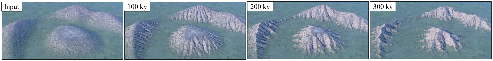

**Figure 11:** From a user-sculpted terrain (top left), we apply our method as an erosion post-process at $t = 100\,ky$, $200\,ky$ and $300\,ky$.
We notice that the erosion time affects both the depth and the shape of the erosional features.

**Uplift** emerges from tectonic activity and is responsible for the formation of mountain ranges.
It is therefore used as another tool to control the generation of large-scale landscapes.
In Figure 7, we show that the different uplift-based controls developed in previous work [CCB\*17, SPF\*23] readily extend to our method.
These methods use various strategies to fill an uplift map, and provide this map as input to a simulation of the stream power law.
We use a user-painted uplift map (Figure 7, left), which could alternatively be generated by one of the aforementioned methods, and show how the map controls the formation of the $4.6\,My$ old mountain at different scales (from left to right a $5\,km$, $15\,km$, and $25\,km$ large mountain).
We notice in particular that variations in the uplift map mainly dictate the trajectory of the main rivers at smaller scales, and also influence the local ridge-line elevations for larger ranges.

**Escarpments** are steep slopes that separate flat areas of different elevations.
The sudden change in elevation yields a strong erosive response, that illustrates the need for the advective component of the analytical solutions.
Indeed, a simpler solution that would only model a progressive reduction of the slopes would only cause a local smoothing of the cliffs, while the stream power law predicts a retreat of the cliff along the drainage pattern at a speed that depends on the river discharge [SS20].
We illustrate this behavior in Figure 12, where we start from a procedurally generated cliff that separates two areas with uniform elevation (left).
Then we apply our method without uplift and observe the cliff retreating after 200 and $500\,ky$.
Note that without uplift, without deposition, and with flat boundary conditions, the retreating cliff leaves open a flat area around the main rivers.

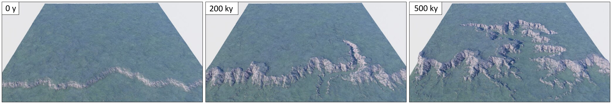

**Figure 12:** Evolution of a procedurally generated escarpment (left).
After $200\,ky$ the cliff retreats slightly and a canyon starts forming around the main river.
After $500\,ky$, the canyon widens, inheriting the flat bottom from the lower part of the escarpment, and starts branching.

**Canyons,** especially the well-known examples such as the *Grand Canyon*, do not exhibit the large flat-bottomed areas between the cliffs observed in Figure 12.
The difference comes from the boundary conditions: our results in Figure 12 assumed a flat boundary condition, while a canyon is typically tributary to another river downstream.
To implement this, we assume a constant $a = a(0)$ to extend $D_{x,t}$ negatively beyond the bound and we assume a constant slope to deduce $z_0(D_{x,t})$.
We illustrate the impact of this new boundary condition in Figure 13 where we set a single boundary node to which we assign this *small slope boundary condition*.
We additionally set a source point on the other side of the terrain where we impose a strong drainage area $A$ to enforce the formation of a main river connecting these two points.
Erosion at time $t = 700\,ky$ shows a fully formed canyon with multiple tributary rivers branching out.
Note that the new boundary condition resulted in the desired V-shaped walls surrounding the main river.

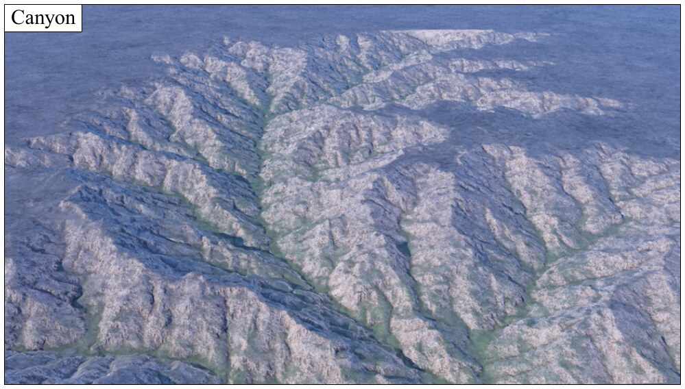

**Figure 13:** Canyon generated by our method, at time $t = 700\,ky$.
Compared to Figure 12, a simple change in the boundary conditions yields the characteristic V-shape incision by the canyon river.

### 7.4. Limitations

The main limitation of our work is that our algorithm does not enforce the time-continuity of the results: in some cases and especially for very long geological times, changing the time can modify the placement of the valleys.
This is due to the fact that we predict a possible river network together with the elevations, without considering the past evolution of this network.
While this issue is already documented in the fixed point case [Ste21], our multigrid implementation can sometimes degrade it, because a change in the river network at a coarser scale can affect a large region of the terrain at the finest scale.

Another limitation is inherent to analytical formulation, which restricts the possible combination with other erosion laws.
We proposed new models for hillslope and thermal erosion which have a critical impact when fluvial erosion is low but including other processes, sediment deposition, or simply a non-linear dependency to the slope in the stream power law (the exponent $n \neq 1$) might prove challenging.

## 8. Conclusion

We proposed a new method to quickly erode large-scale terrains.
Thanks to the analytical solution of the stream power law, we do not have to rely anymore on numerous iterations inherent in simulations.
Instead, the time becomes another parameter that the user can explore without any incidence on the computation time.
We proposed a derivation and implementation of these analytical solutions adapted to computer graphics applications, allowing the user to specify both an initial terrain to be eroded and an uplift map to control the emergence of a mountain range and explore any intermediate possibility.
To the challenge of generating a terrain physically consistent with its river network, we propose two solutions that yield interactive performances: an accurate multigrid acceleration, and an optimization-based approach that preserves the initial river network.
Eventually, we introduced new models for hillslope and thermal erosion that are easily integrable in our implementation.
Our main limitation is the lack of time consistency at large time $t$, which motivates future work on a more conservative hydrology-based multigrid scheme, or alternative solutions where analytical solutions would control the procedural generation of river networks [GBG\*19].

## Acknowledgements

This project was sponsored by the Agence Nationale de la Recherche project Invterra ANR-22-CE33-0012-01, by the H2020 European Research Council (grant agreement no. 803721) and research and software donations from Adobe Inc.

## Appendix A: Gradient Derivation

We solve the minimization problem Eqn. 22 with a gradient descent approach, which requires the computation of the derivatives of $L_r$ and $L_d$ with respect to $d$.

The derivatives of the river term are immediate:

$$
\frac{\partial L_r}{\partial d_i} = d_i - \tilde{d}_i.
\tag{30}
$$

For the discontinuity term, we observe that each $d_i$ contributes to $z_j$ for all cells $j$ that are upstream of $i$ ($i$=$j$ included) and for these $\frac{\partial z_j}{\partial d_i} = 1$.
The elevation $z_j$ appears in $L_d$ as either $z_c$ or $z_{c_n}$, which yields the following expression:

$$
\begin{aligned}
\frac{\partial L_d}{\partial d_i} = \sum_{j \in \text{Upstream of } i} \; \sum_{j_n \in \mathrm{NCN}(j)} & \bigl( \max(z_j - z_{j_n} - \tilde{d}_j, 0) \\
& - \max(z_{j_n} - z_j - \tilde{d}_{j_n}, 0) \bigr)
\end{aligned}
\tag{31}
$$

This can be computed recursively, similarly to drainage, by accumulating the contributions of the donors of a cell:

$$
\begin{aligned}
\frac{\partial L_d}{\partial d_i} = \sum_{j \in \text{Donors of } i} \frac{\partial L_d}{\partial d_j} + \sum_{i_n \in \mathrm{NCN}(i)} & \bigl( \max(z_i - z_{i_n} - \tilde{d}_i, 0) \\
& - \max(z_{i_n} - z_i - \tilde{d}_{i_n}, 0) \bigr)
\end{aligned}
\tag{32}
$$

## References

- **[Avo03]** Avouac J.-P.: *Mountain Building, Erosion, and the Seismic Cycle in the Nepal Himalaya*. Elsevier, 2003, p. 1-80.
- **[Ben07]** Benes B.: Real-time erosion using shallow water simulation. In *VRIPHYS* (2007), pp. 43–50.
- **[BF01]** Benes B., Forsbach R.: Layered data representation for visual simulation of terrain erosion. In *Proceedings of SCCG* (2001), vol. 25(4), IEEE Computer Society, pp. 80–86.
- **[BS97]** Braun J., Sambridge M.: Modelling landscape evolution on geological time scales: a new method based on irregular spatial discretization. *Basin Research 9*, 1 (1997), 27–52.
- **[BTHB06]** Benes B., Těšínský V., Hornyš J., Bhatia S. K.: Hydraulic erosion. *Computer Animation and Virtual Worlds 17*, 2 (2006), 99–108.
- **[BW13]** Braun J., Willett S. D.: A very efficient o(n), implicit and parallel method to solve the stream power equation governing fluvial incision and landscape evolution. *Geomorphology 180-181* (2013), 170–179.
- **[CBC\*16]** Cordonnier G., Braun J., Cani M.-P., Benes B., Galin E., Peytavie A., Guérin E.: Large Scale Terrain Generation from Tectonic Uplift and Fluvial Erosion. *Computer Graphics Forum 35*, 2 (May 2016), 165–175.
- **[CCB\*17]** Cordonnier G., Cani M.-P., Benes B., Braun J., Galin E.: Sculpting mountains: Interactive terrain modeling based on subsurface geology. *IEEE Transactions on Visualization and Computer Graphics 24*, 5 (2017), 1756 – 1769.
- **[CDM14]** Chen A., Darbon J., Morel J.-M.: Landscape evolution models: A review of their fundamental equations. *Geomorphology 219* (2014), 68–86.
- **[CJP\*23]** Cordonnier G., Jouvet G., Peytavie A., Braun J., Cani M.-P., Benes B., Galin E., Guérin E., Gain J.: Forming terrains by glacial erosion. *ACM Transactions on Graphics 42*, 4 (2023).
- **[CMA\*16]** Clubb F. J., Mudd S. M., Attal M., Milodowski D. T., Grieve S. W.: The relationship between drainage density, erosion rate, and hilltop curvature: Implications for sediment transport processes. *Journal of Geophysical Research: Earth Surface 121*, 10 (2016), 1724–1745. \_eprint: https://agupubs.onlinelibrary.wiley.com/doi/pdf/10.1002/2015JF003747.
- **[dCB09]** de Carpentier G. J., Bidarra R.: Interactive gpu-based procedural heightfield brushes. In *Proceedings of the 4th International Conference on Foundations of Digital Games* (New York, NY, USA, 2009), Association for Computing Machinery, pp. 55–62.
- **[EM90]** England P., Molnar P.: Surface uplift, uplift of rocks, and exhumation of rocks. *Geology 18*, 12 (12 1990), 1173–1177.
- **[EMP\*02]** Ebert D. S., Musgrave F. K., Peachey D., Perlin K., Worley S.: *Texturing and Modeling: A Procedural Approach*. Morgan Kaufmann Publishers Inc., 2002.
- **[ENPL09]** Egholm D. L., Nielsen S. B., Pedersen V. K., Lesemann J.-E.: Glacial effects limiting mountain height. *Nature 460*, 7257 (2009), 884–887.
- **[GBG\*19]** Gaillard M., Benes B., Guérin E., Galin E., Rohmer D., Cani M.-P.: Dendry: A procedural model for dendritic patterns. In *Proceedings of the ACM SIGGRAPH Symposium on Interactive 3D Graphics and Games* (2019), pp. 1–9.
- **[GCG\*09]** Gapais D., Cagnard F., Gueydan F., Barbey P., Ballèvre M.: Mountain building and exhumation processes through time: inferences from nature and models. *Terra Nova 21*, 3 (2009), 188–194.
- **[GDG\*17]** Guérin E., Digne J., Galin E., Peytavie A., Wolf C., Benes B., Martinez B.: Interactive example-based terrain authoring with conditional generative adversarial networks. *ACM Transactions on Graphics 36*, 6 (Nov. 2017), 228:1–228:13.
- **[GGG\*13]** Génevaux J.-D., Galin E., Guérin E., Peytavie A., Benes B.: Terrain generation using procedural models based on hydrology. *ACM Trans. Graph. 32*, 4 (jul 2013).
- **[GGP\*19]** Galin E., Guérin E., Peytavie A., Cordonnier G., Cani M.-P., Benes B., Gain J.: A Review of Digital Terrain Modeling. *Computer Graphics Forum 38*, 2 (2019), 553–577.
- **[GMM15]** Gain J., Merry B., Marais P.: Parallel, realistic and controllable terrain synthesis. *Computer Graphics Forum 34*, 2 (2015), 105–116.
- **[GPM\*22]** Guérin E., Peytavie A., Masnou S., Digne J., Sauvage B., Gain J., Galin E.: Gradient terrain authoring. *Computer Graphics Forum 41*, 2 (2022), 85–95.
- **[GWHB14]** Goren L., Willett S. D., Herman F., Braun J.: Coupled numerical–analytical approach to landscape evolution modeling. *Earth Surface Processes and Landforms 39*, 4 (2014), 522–545.
- **[Hac57]** Hack J. T.: *Studies of longitudinal stream profiles in Virginia and Maryland*, vol. 294. US Government Printing Office, 1957.
- **[HGA\*10]** Hnaidi H., Guérin É., Akkouche S., Peytavie A., Galin É.: Feature based terrain generation using diffusion equation. *Computer Graphics Forum 29*, 7 (2010), 2179–2186.
- **[HK83]** Howard A. D., Kerby G.: Channel changes in badlands. *GSA Bulletin 94*, 6 (06 1983), 739–752.
- **[How94]** Howard A. D.: A detachment-limited model of drainage basin evolution. *Water resources research 30*, 7 (1994), 2261–2285.
- **[KBKv09]** Krištof P., Benes B., Křivánek J., Šťava O.: Hydraulic erosion using smoothed particle hydrodynamics. *Computer Graphics Forum (Proceedings of Eurographics 2009) 28*, 2 (mar 2009), 219–228.
- **[Lag14]** Lague D.: The stream power river incision model: evidence, theory and beyond. *Earth Surface Processes and Landforms 39*, 1 (2014), 38–61.
- **[LD03]** Lague D., Davy P.: Constraints on the long-term colluvial erosion law by analyzing slope-area relationships at various tectonic uplift rates in the siwaliks hills (nepal). *Journal of Geophysical Research: Solid Earth 108*, B2 (2003).
- **[Luk72]** Luke J. C.: Mathematical models for landform evolution. *Journal of Geophysical Research (1896-1977) 77*, 14 (1972), 2460–2464.
- **[Luk74]** Luke J. C.: Special solutions for nonlinear erosion problems. *Journal of Geophysical Research (1896-1977) 79*, 26 (1974), 4035–4040.
- **[MKM89]** Musgrave F. K., Kolb C. E., Mace R. S.: The synthesis and rendering of eroded fractal terrains. *SIGGRAPH Comput. Graph. 23*, 3 (jul 1989), 41–50.
- **[MVN68]** Mandelbrot B. B., Van Ness J. W.: Fractional brownian motions, fractional noises and applications. *SIAM review 10*, 4 (1968), 422–437.
- **[PMD01]** Peizhen Z., Molnar P., Downs W. R.: Increased sedimentation rates and grain sizes 2–4 myr ago due to the influence of climate change on erosion rates. *Nature 410*, 6831 (2001), 891–897.
- **[RPP93]** Roudier P., Peroche B., Perrin M.: Landscapes synthesis achieved through erosion and deposition process simulation. *Computer Graphics Forum 12*, 3 (1993), 375–383.
- **[RTP13]** Royden L., Taylor Perron J.: Solutions of the stream power equation and application to the evolution of river longitudinal profiles. *Journal of Geophysical Research: Earth Surface 118*, 2 (2013), 497–518.
- **[SD21]** Scott J. J., Dodgson N. A.: Example-based terrain synthesis with pit removal. *Computers & Graphics 99* (2021), 43–53.
- **[SHV\*12]** Steer P., Huismans R. S., Valla P. G., Gac S., Herman F.: Bimodal plio–quaternary glacial erosion of fjords and low-relief surfaces in scandinavia. *Nature Geoscience 5*, 9 (2012), 635–639.
- **[Sid23]** SideFX: Houdini, 2023.
- **[Sof23]** Software P.: Terragen, 2023.
- **[SPF\*23]** Schott H., Paris A., Fournier L., Guérin E., Galin E.: Large-scale terrain authoring through interactive erosion simulation. *ACM Transactions on Graphics 42* (2023).
- **[SS20]** Schwanghart W., Scherler D.: Divide mobility controls knickpoint migration on the Roan Plateau (Colorado, USA). *Geology 48*, 7 (04 2020), 698–702.
- **[Ste21]** Steer P.: Short communication: Analytical models for 2d landscape evolution. *Earth Surface Dynamics 9* (09 2021), 1239–1250.
- **[Str52]** Strahler A. N.: Hypsometric (area-altitude) analysis of erosional topography. *Geological society of America bulletin 63*, 11 (1952), 1117–1142.
- **[VBHS11]** Vanek J., Benes B., Herout A., Stava O.: Large-scale physics-based terrain editing using adaptive tiles on the GPU. *IEEE Computer Graphics and Applications 31*, 6 (2011), 35–44.
- **[WHBY22]** Wolf S. G., Huismans R. S., Braun J., Yuan X.: Topography of mountain belts controlled by rheology and surface processes. *Nature 606*, 7914 (2022), 516–521.
- **[Whi04]** Whipple K. X.: Bedrock rivers and the geomorphology of active orogens. *Annual Review of Earth and Planetary Sciences 32*, 1 (2004), 151–185.
- **[WT99]** Whipple K. X., Tucker G. E.: Dynamics of the stream-power river incision model: Implications for height limits of mountain ranges, landscape response timescales, and research needs. *Journal of Geophysical Research: Solid Earth 104*, B8 (1999), 17661–17674.
- **[ZSTR07]** Zhou H., Sun J., Turk G., Rehg J. M.: Terrain synthesis from digital elevation models. *IEEE Transactions on Visualization and Computer Graphics 13*, 4 (2007), 834–848.
- **[ZT86]** Zachmanoglou E., Thoe D.: *Introduction to Partial Differential Equations with Applications*. Dover Books on Mathematics. Dover Publications, 1986.

